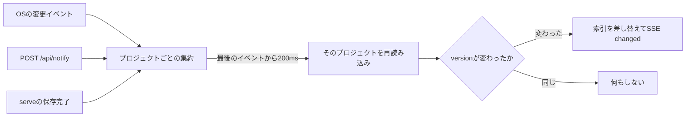

# 変更の通知

ファイルの変更を検知し、ブラウザや待機中のエージェントへ通知する仕組みを説明します。変更の識別にはversion、配信にはServer-Sent Events（SSE）を使います。

## versionと更新通知

プロジェクトの`version`は、正本ファイル（`project.json`・`epic.json`・`PLAN.md`・`task.json`・`TASK.md`）の相対パスと内容、`assets/`・`evidence/`のファイル名から計算したSHA-256ハッシュです。同じ内容を保存しても変わらず、以前の内容に戻すと以前のversionが再び現れることもあります。利用側はversionの大小や順序ではなく、一致するかどうかだけを比較します。

1. `serve`は起動時にデータ領域を一度だけ解決し、終了まで使い続けます。待ち受けを始めた後に`serve.json`を書き、終了時に消します。
2. すべてのプロジェクトを索引に読み込む前に、`shared/`の再帰的な監視を登録します。`.`で始まる名前・`.internal/`・`README.md`のイベントは無視します。
3. イベントはプロジェクトごとに200msまとめます。監視が再走査を求めたら、すべてのプロジェクトを読み直します。
4. 何かが変わった保存の後、CLIは`serve.json`を読み、通常のTCP接続で`POST http://127.0.0.1:<port>/api/notify`を300msのタイムアウトを設定して送り、失敗は無視します。ファイルを直接編集するエージェントは通知しなくてかまいません。
5. versionが変わると、接続中のすべてのブラウザがSSEの`changed`を受け取り、プロジェクトの一覧と現在のボードを取り直します。`wait`は自分のプロジェクトのversionだけを比べます。
6. 定期的なポーリングは、どこにもありません。

起動時には、作成から1時間以上たった一時ファイル（`.<name>.tmp-*`、`.new-*`）も消します。正本と、確定していないジャーナルには触れません。

## ライブ更新

ブラウザは`GET /api/events`を購読します。`ready`・`changed`・再接続のたびに、`GET /api/projects`と現在のボードを取り直します。`ready`はサーバーのビルドIDも伝えます。別のビルドの画面を開いているページは、開いている操作が終わってから一度だけ再読み込みします（[サーバーと画面](./server-and-ui.md#web画面の作り)を参照）。SSEが切れると、PCの画面は切断を表示し、ブラウザの自動再接続に任せます。定期的なポーリングや照合はなく、通知を取りこぼした場合は、次の再接続や再読み込みで最新の状態を取得します。`changed`がどう作られるかは[保存と復旧](#versionと更新通知)にあります。
