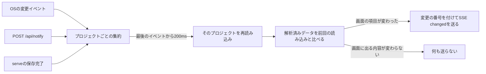

# 変更の通知

ファイルの変更が、ブラウザや待機中のエージェントに届くまでの仕組みを説明します。version、ファイルの監視、変更の記録、Summary と Detail の読み取り、Server-Sent Events（SSE）を扱います。

## version

Summary はそれぞれ`version`を持ちます。これは、ファイルの生のバイト列ではなく、解析したデータから計算したSHA-256ハッシュ（先頭16バイトを16進数で表記したもの）です。そのため、内容が同じならサーバーを再起動しても同じ値になります。Summary の`version`は`ETag`としても使われます。

タスクは、要約項目のハッシュと、`document`・`history`の2つのDetailセクションごとのversionを持ちます。エピックは、要約項目のハッシュと、`document`のversionを持ちます。利用側は、versionが一致するかどうかだけを比べます。以前の内容に戻ると以前のversionが再び現れることもありますが、利用側は「前に持っているversionと違うか」だけを知りたいので問題ありません。

## ファイルの変更から通知まで



1. `serve`は起動時にデータ領域を一度だけ解決し、終了まで使い続けます。待ち受けを始めた後に`serve.json`を書き、終了時に消します。自動のサーバーは、使われずに止まるときは止まる前に消します。終わりかけのサーバーにコマンドがつながらないようにするためです（[サーバーと画面](./server-and-ui.md#自動での停止)を参照）。自動のサーバーに`serve -d`をすると、書き換えるのは`mode`だけです。
2. すべてのプロジェクトを索引に読み込む前に、`shared/`の再帰的な監視を登録します。`.`で始まる名前・`.internal/`・`README.md`のイベントは無視します。プロジェクトの`docs/`のイベントはボードのデータではないので、ドキュメントの通知に回し（[ドキュメント](#ドキュメント)を参照）、プロジェクトを読み込み直すことはありません。プロジェクトの`notify/`のイベントもボードのデータではないので、同じ200 msの待ち時間のあと、読み込み直さずに後述の`messages`の変更を送ります。

   監視にはプラットフォームのファイルイベント（macOSではFSEvents）を使います。`AGBOARD_WATCH=poll`を設定すると、代わりに`shared/`を100msごとに走査します。負荷の高いMacではFSEventsへの登録に何秒もかかることがあるため、テストはこのポーリングを使います。テスト内で起動するサーバーは、データ領域と一緒にこのモードを`server::run_until_in`に渡すので、`AGBOARD_HOME`を設定しません。
3. イベントはプロジェクトごとに200ms集約します。監視が再走査を求めたら、すべてのプロジェクトを読み直します。

   プロジェクトのフォルダーと索引が食い違うときは、リクエストはこの読み直しを待ちません。プロジェクト一覧はファイルを読むので、CLIが作ったプロジェクトをすぐに載せます。フォルダーはあるのに索引にまだないプロジェクトへのリクエストは、先にそのプロジェクトを索引に読み込みます。フォルダーがなくなったプロジェクトへのリクエストは、すぐに`project_not_found`を返します。この読み込みで見つかった変更は、監視の次の読み直しと一緒に送ります。
4. 何かが変わった保存の後、CLIは`serve.json`を読み、通常のTCP接続で`POST http://127.0.0.1:<port>/api/notify`を300msのタイムアウトを設定して送ります。失敗は無視します。ファイルを直接編集するエージェントは通知しなくてかまいません。
5. 読み直した後、サーバーは前回の読み込みと解析済みデータを比べます。SummaryやDetailに表示される内容が変わらない保存では、イベントを送りません。変わった場合は、このサーバーの実行で次の`seq`を付け、開いているすべてのストリームへSSEの`changed`を送ります。

   読み直しでは、ファイルの内容のバージョンが前回の読み込みと同じでも、プロジェクトのファイルを必ず読み込みます。バージョンだけでは、変更前と変更後の状態が混ざった読み込みと、正しい読み込みを区別できないためです。読み込みの最中にフォルダーを消して書き直すと、読み込みが終わる前にファイルがもとのバージョンに戻ることがあります。読み込んでも新しい変更がなければ、イベントは送りません。
6. 定期的なポーリングは、どこにもありません。

## 項目（facet）と変更イベント

`changed`には、変わったリソースと、その中で変わった項目が入ります。

```json
{"instanceId": "inst-5f3a", "seq": 42, "projectId": "…", "changes": [
  {"resource": "task", "id": 302, "facets": ["summary", "history"]},
  {"resource": "epic", "id": "EPIC-1", "facets": ["document"]},
  {"resource": "messages", "id": "…", "facets": ["summary"]},
  {"resource": "project", "id": "…", "facets": ["deleted"]}
]}
```

| 項目 | 意味 |
| --- | --- |
| `summary` | タイトル、状態、位置、エピック、回答待ちの質問、完了条件の件数。 |
| `request` | タスクが待っている質問が変わったこと。質問の追加・回答・取り下げ・参照の変更で、導いた`pendingRequestId`が変わったときに送ります。必ず`summary`と一緒に送り、タスクだけが持ちます。 |
| `document` | 本文と完了条件の文章。 |
| `history` | 履歴。 |
| `deleted` | リソースがなくなったこと。プロジェクトは`summary`か`deleted`だけを持ちます。 |

プロジェクトの`qa/*/QA.md`が変わると、`id`がプロジェクトIDで、facetが`summary`だけの`messages`の変更を送ります。クライアントはSummaryを読み直します。プロジェクトの`notify/`フォルダ（[定期サマリー](../reference/files.md#定期サマリー)）の変更も、プロジェクトを読み直さずに同じ`messages`の変更を送ります。クライアントはサマリーの一覧を読み直します。プラットフォームがイベントを取りこぼして全プロジェクトを読み直すときは、各プロジェクトの`notify/`フォルダ（ファイル名・サイズ・更新時刻）を前回通知した状態と比べ、違うフォルダについてだけこの変更を送ります。イベントで通知済みのサマリーの変更が2回通知されることはありません。タスクをアーカイブへ移す、またはアーカイブから戻すことは`summary`の変更です。解析できないファイルは、そのリソースの`summary`・`document`・`history`が変わったものとして扱われます。`request`は、読み取れる依頼IDが変わったときだけ加えます。

`seq`は、1つの`instanceId`の中で`changed`ごとに1ずつ増えます。`instanceId`はサーバーを起動するたびに新しくなるので、`seq`が最初から数え直されたことが分かります。

## クライアントによるSummaryとDetailの利用

クライアントはプロジェクトごとに1つのSummaryを持ちます。Summaryは、ファイルを読み直さず、索引の投影から作られます。`If-None-Match`が`version`と一致するリクエストには、本文のない`304`を返します。

Detail（タスクの本文と履歴、またはエピックの本文）は、カードやエピックを開いたときに、画面が表示するセクションだけ読みます。Detail はNDJSONで届きます。クライアントは`complete`行を受け取った後にだけ、そのバージョンを確定します。`complete`のないストリームは捨てます。

`changed`を受け取ったクライアントは、次の処理をします。

- プロジェクトのSummaryを読み直します。
- 項目名が示したセクションを古いものとして印を付け、開いているものだけを読み直します。
- イベントに含まれないセクションは、そのまま残します。

Summaryを読んでいる途中に届いた`changed`は、その応答にまだ含まれていない変更を示している場合があります。応答がその変更を反映していない場合、クライアントはもう一度読みます。反映していないと判断するのは、`version`が以前と同じときと、最初の読み込みのように比べる前のSummaryがないときです。読み直しは最大で合計3回です。

`seq`の欠番、新しい`instanceId`、知らないイベントを見つけたクライアントは、プロジェクトのSummaryと関連するDetailのキャッシュを捨て、Summaryを読み直します。ストリームが遅れすぎた場合は、取りこぼしたイベントの代わりに`resync`（`{"instanceId", "seq"}`）が届きます。クライアントは同じように全体を読み直します。

## エージェントの待機とイベント

変更待ち・質問の回答待ち（`message ask`と`message wait`）・次タスク待ちは、`src/agent/wait_engine.rs`を共有します。それぞれの呼び出し元が目的別の成立条件と、任意の単調時計に基づく期限を渡します。エンジンは固定したProjectIdを接続前に読み、SSEの`ready`後と各`changed`イベントの後にも確認します。snapshotが呼び出し元の条件を満たさない変更は読み飛ばして待ち続けます。

次タスクモードでは、初回snapshotに対象タスクがなかったときだけ、絶対期限を一度設定します。他プロジェクトの変更や接続維持コメントでは延長しません。期限到達時に最後のsnapshotを読み、条件をもう一度評価するため、境界時刻までに届いたタスクを取得できます。最終読取に失敗した場合はエラーになり、対象なしにはなりません。変更待ちの任意timeoutはエラー（`wait_timeout`）のままです。タスク待ちの待機期限は、終了コード0の`idle_timeout`になります。対象条件と出力形式は[エージェント連携](./agents#変更を待つ)を参照してください。

起動時には、作成から1時間以上たった一時ファイル（`.<name>.tmp-*`、`.new-*`）も消します。正本と、確定していないジャーナルには触れません。

## ライブ更新

画面は`GET /api/events`を購読します。このストリームはすべてのプロジェクトの変更を流します。スマホの画面も同じボードのアプリなので、PCでもngrokの入口でも同じストリームを購読します。このストリームは、次のイベントを送ります。

- 購読後に`ready`。サーバーのビルドIDを含みます。別のビルドの画面を開いているページは、開いている操作が終わってから一度だけ再読み込みします（[サーバーと画面](./server-and-ui.md#web画面の作り)を参照）。
- 上で説明した`changed`。
- ストリームが遅れたときの`resync`。
- 15秒ごとの接続維持。接続維持では何も取得しません。
- 保存された言語やテーマを変えたときの`preferences`。
- ボードのストリームだけで、プロジェクトの`docs/`が変わったときの`docs`（[ドキュメント](#ドキュメント)を参照）。

45秒間何も届かない接続は切断して開き直します。開き直しの間隔は、1秒、2秒、5秒、10秒と増やし、最大で30秒です。タブが非表示のときはブラウザが接続を手放し、表示に戻ると開き直します。接続を開くと同時にSummaryも読むので、前回の読み取りから接続までの間に起きた変更を取りこぼしません。

PCの画面は、ストリームが切れている間、切断の状態を表示します。定期的なポーリングや照合はありません。通知を取りこぼした場合は、接続が開き直されたときか、ページを再読み込みしたときに気付きます。

## Web Pushの配信

変更フィードは、購読したスマホへのWeb Pushも駆動します（購読の方法は[Web Pushの購読](./remote-access.md#web-pushの購読)を参照）。`src/server/push_delivery/`の1つのタスクがフィードを追います。

1. **比較。** プロジェクトごとに、各タスクが前回に示していた内容（未回答の質問、成果の版、履歴のエントリー）を保持します。変更のあと、同じ作業の続きの保存を600ミリ秒待ち、インデックスからプロジェクトを読んで比較します。見つけるのは、なかった成果の版、新たに未回答になった質問、追加された履歴のエントリーです。新しく現れたタスクは追跡を始めるだけで、カードの作成は通知しません。アーカイブ済みのタスク、下書き、案内用のサンプルカードは通知しません。起動時の最初の読み取りを基準にするので、すでにボードにあったものは通知しません。
2. **選択。** 各出来事には、その出来事を指すキーがあります。保存済みの[通知設定](../reference/files.md#通知設定)で種類がオンのものだけを残します。1回の読み取りで見つけた1つのタスクの出来事は、最も重要な1件の通知にまとめます。優先順は、質問、成果、履歴のエントリーです。まとめた他の出来事のキーも、一緒に記録します。
3. **送信。** その出来事をまだ受け取っていない端末ごとに、`{title, body, url, tag}`のメッセージを作ります（保存済みの言語で英語か日本語）。タイトルはカードのタイトル、本文は要約・質問・履歴からMarkdownの記号を除いた最初の1文を40文字までに切り詰めたもので、出来事に文がなければカードに起きたことを書きます。端末向けに暗号化し、VAPID鍵で署名して、その端末のプッシュサービスへPOSTします。リンクは公開アドレス上のもので、成果なら成果のリンク、質問なら質問のリンク、履歴なら履歴のリンク（カードを履歴タブで開きます）、それ以外はタスクのリンクです。質問は`Urgency: high`で送ります。`tag`と`Topic`ヘッダーは出来事のキーから作るため、同じ出来事の後のコピーは、端末でもプッシュサービスでも先のものを置き換えます。
4. **記録。** [台帳](../reference/files.md#プッシュ配信の台帳)に、端末とキーごとのエントリーを書きます。エントリーのある出来事は、その端末へ二度と送りません。404か410なら購読を削除します。429・5xx・応答なしは、1分・5分・30分・120分後に再試行し、合計5回です。それ以外は諦めます。

**定期サマリー。** 2つ目のタスク（`summary.rs`）が30秒ごとに、集計期間が終わったかを調べます。通知設定の間隔ごと（期間はローカル時計の切りのよい時刻、つまり日付が変わる0時から間隔の倍数の時刻で終わります。1時間ごとなら毎時0分で、サーバーを起動した時刻には左右されません。最初の期間は、起動後の最初の区切りで終わり、起動前の1間隔分を含みます）に、各プロジェクトのその期間の成果（索引は保存から監視の待ち時間だけ遅れるため、索引ではなくファイルから読むので、期間の終わり直前に保存した成果も必ず含まれます）の[サマリー](../reference/files.md#定期サマリー)を、種類の設定にかかわらずプロジェクトの`notify/`に書きます。`summary`の種類がオンで、その期間に成果があったときは、端末ごとに通知を1件送ります。タイトルは期間の時刻、本文は成果の件数と最初の3件のタイトル、リンクはプロジェクトのリンクに`&messages=summary`を付けたもの（`/?project=<id>&messages=summary`）で、メッセージ欄のサマリーのタブを開きます。台帳のキーは`summary:<project>:<id>`なので、サマリーは1台に1回だけ送られます。期間は、終わった時点で全プロジェクトに対して閉じます。読み取れない（ファイルが読み込めない、またはタスクの`task.json`が解析できず、そのタスクの成果が見えない）、または書き込めないプロジェクトは、同じ期間のまま30秒ごとにやり直し、その期間を記録するまでは後の期間に含めません。そのプロジェクトのせいで、ほかのプロジェクトのサマリーが止まることはなく、そのプロジェクトの次の期間は保存済みの最新のサマリーの終わりから始まるので、成果が抜けることもありません（書くものがないまま復旧したプロジェクトも、その期間の終わりを次の期間の始まりとして保ちます）。間隔がオフのときは、何も書かず何も送りません。

リモート接続が止まっている間は、リンクに公開アドレスが必要なため何も送りません。その間の出来事は`skipped`として記録し、あとから送ることはしません。接続の状態は、タスクが変更に気づいた時点と送る時点の両方で見るため、接続が止まっている間に起きた変更は、復旧後にも送りません。また、各送信は別のタスクで動くので、応答の遅いプッシュサービスが次の変更の検知を遅らせることはありません。このタスクはボードのロックを持たず、台帳が読めない、プッシュサービスが応答しないといった失敗は、通知にだけ影響します。コードは手順ごとに分かれています。`events.rs`（比較と選択）、`message.rs`、`webpush.rs`（RFC 8291の暗号化とRFC 8292の署名。RFC 8291の例で検証）、`transport.rs`（ネットワークに触れる唯一の場所。テストで偽物を使えるようtraitにしています。実物はリダイレクトに従わず、公開HTTPSのホスト名でない送信先を拒否し、公開アドレスにだけ接続するので、PC自身のネットワークに解決されるホスト名は拒否されます）、`ledger.rs`、`deliver.rs`、`runtime.rs`（タスク本体）です。

## ドキュメント

プロジェクトの`docs/`のファイルは利用者のもので、ボードのデータではありません。その変化は`changed`とは別に伝えます。

1. 監視は、`projects/<id>/docs/`の下のパスを、そのプロジェクトのドキュメントとして分類します。イベントは同じ200 msの待ち時間を経ます。
2. 待ち時間が終わると、サーバーは`GET /api/events`で`{"projectId": "…"}`を付けた`docs`を送ります。ファイルは読まず、`version`も変えず、`seq`も使いません。プラットフォームがイベントを取りこぼしたときや、ストリームが遅れたときは、`projectId`は`null`です。どのプロジェクトのドキュメントが変わったかもしれない、という意味です。
3. エージェントの待機はこれを無視します。

ドキュメントのダイアログは、自分のプロジェクトの`docs`を受けるたびと、ストリームを開き直すたびに、ファイルの一覧を読み直します。開いているファイルは、`revision`を比べるためだけに読み直します。変わっていれば表示し直して通知を出し、一覧から消えていれば最後の内容を残して通知を出します（[サーバーとUI](./server-and-ui.md#ドキュメントのダイアログ)を参照）。
