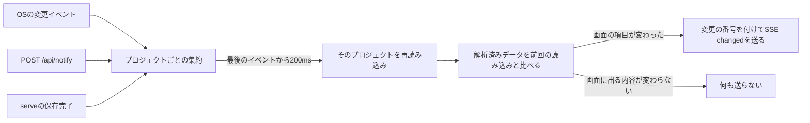

# 変更の通知

ファイルの変更が、ブラウザや待機中のエージェントに届くまでの仕組みを説明します。version、ファイルの監視、変更の記録、Summary と Detail の読み取り、Server-Sent Events（SSE）を扱います。

## version

Summary はそれぞれ`version`を持ちます。これは、ファイルの生のバイト列ではなく、解析したデータから計算したSHA-256ハッシュ（先頭16バイトを16進数で表記したもの）です。そのため、内容が同じならサーバーを再起動しても同じ値になります。Summary の`version`は`ETag`としても使われます。

タスクは、要約項目のハッシュと、`document`・`history`の2つのDetailセクションごとのversionを持ちます。エピックは、要約項目のハッシュと、`document`のversionを持ちます。利用側は、versionが一致するかどうかだけを比べます。以前の内容に戻ると以前のversionが再び現れることもありますが、利用側は「前に持っているversionと違うか」だけを知りたいので問題ありません。

## ファイルの変更から通知まで



1. `serve`は起動時にデータ領域を一度だけ解決し、終了まで使い続けます。待ち受けを始めた後に`serve.json`を書き、終了時に消します。
2. すべてのプロジェクトを索引に読み込む前に、`shared/`の再帰的な監視を登録します。`.`で始まる名前・`.internal/`・`README.md`のイベントは無視します。プロジェクトの`docs/`のイベントはボードのデータではないので、ドキュメントの通知に回し（[ドキュメント](#ドキュメント)を参照）、プロジェクトを読み込み直すことはありません。
3. イベントはプロジェクトごとに200ms集約します。監視が再走査を求めたら、すべてのプロジェクトを読み直します。
4. 何かが変わった保存の後、CLIは`serve.json`を読み、通常のTCP接続で`POST http://127.0.0.1:<port>/api/notify`を300msのタイムアウトを設定して送ります。失敗は無視します。ファイルを直接編集するエージェントは通知しなくてかまいません。
5. 読み直した後、サーバーは前回の読み込みと解析済みデータを比べます。SummaryやDetailに表示される内容が変わらない保存では、イベントを送りません。変わった場合は、このサーバーの実行で次の`seq`を付け、開いているすべてのストリームへSSEの`changed`を送ります。
6. 定期的なポーリングは、どこにもありません。

## 項目（facet）と変更イベント

`changed`には、変わったリソースと、その中で変わった項目が入ります。

```json
{"instanceId": "inst-5f3a", "seq": 42, "projectId": "…", "changes": [
  {"resource": "task", "id": 302, "facets": ["summary", "history"]},
  {"resource": "epic", "id": "EPIC-1", "facets": ["document"]},
  {"resource": "project", "id": "…", "facets": ["deleted"]}
]}
```

| 項目 | 意味 |
| --- | --- |
| `summary` | タイトル、状態、位置、エピック、回答待ちの質問、受入条件の件数。 |
| `document` | 本文と受入条件の文章。 |
| `history` | 履歴。 |
| `deleted` | リソースがなくなったこと。プロジェクトは`summary`か`deleted`だけを持ちます。 |

タスクをアーカイブへ移す、またはアーカイブから戻すことは`summary`の変更です。解析できないファイルは、そのリソースのすべての項目が変わったものとして扱われます。

`seq`は、1つの`instanceId`の中で`changed`ごとに1ずつ増えます。`instanceId`はサーバーを起動するたびに新しくなるので、`seq`が最初から数え直されたことが分かります。モニターのストリームは、自分が送るイベントに自分で番号を付けます。そのため、他のプロジェクトの変更があってもモニターの`seq`には欠番が生じません。

## クライアントによるSummaryとDetailの利用

クライアントはプロジェクトごとに1つのSummaryを持ちます。Summaryは、ファイルを読み直さず、索引の投影から作られます。`If-None-Match`が`version`と一致するリクエストには、本文のない`304`を返します。

Detail（タスクの本文と履歴、またはエピックの本文）は、カードやエピックを開いたときに、画面が表示するセクションだけ読みます。Detail はNDJSONで届きます。クライアントは`complete`行を受け取った後にだけ、そのバージョンを確定します。`complete`のないストリームは捨てます。

`changed`を受け取ったクライアントは、次の処理をします。

- プロジェクトのSummaryを読み直します。
- 項目名が示したセクションを古いものとして印を付け、開いているものだけを読み直します。
- イベントに含まれないセクションは、そのまま残します。

`seq`の欠番、新しい`instanceId`、知らないイベントを見つけたクライアントは、プロジェクトのSummaryと関連するDetailのキャッシュを捨て、Summaryを読み直します。ストリームが遅れすぎた場合は、取りこぼしたイベントの代わりに`resync`（`{"instanceId", "seq"}`）が届きます。クライアントは同じように全体を読み直します。

## エージェントの待機とイベント

変更待ち・Pendingの回答待ち・次タスク待ちは、`src/agent/wait_engine.rs`を共有します。それぞれの呼び出し元が目的別の成立条件と、任意の単調時計に基づく期限を渡します。エンジンは固定したProjectIdを接続前に読み、SSEの`ready`後と各`changed`イベントの後にも確認します。snapshotが呼び出し元の条件を満たさない変更は読み飛ばして待ち続けます。

次タスクモードでは、初回snapshotに対象タスクがなかったときだけ、絶対期限を一度設定します。他プロジェクトの変更や接続維持コメントでは延長しません。期限到達時に最後のsnapshotを読み、条件をもう一度評価するため、境界時刻までに届いたタスクを取得できます。最終読取に失敗した場合はエラーになり、対象なしにはなりません。変更待ちの任意timeoutはエラー（`wait_timeout`）のままです。タスク待ちの待機期限は、終了コード0の`idle_timeout`になります。対象条件と出力形式は[エージェント連携](./agents#変更を待つ)を参照してください。

起動時には、作成から1時間以上たった一時ファイル（`.<name>.tmp-*`、`.new-*`）も消します。正本と、確定していないジャーナルには触れません。

## ライブ更新

画面は`GET /api/events`を購読します。このストリームはすべてのプロジェクトの変更を流します。モバイルモニターは`GET /monitor/api/events?project=<projectId>`を購読します。こちらはアドレスに含まれるプロジェクトの変更だけを流し、プロジェクト一覧の項目は含みません。どちらのストリームも、次のイベントを送ります。

- 購読後に`ready`。サーバーのビルドIDを含みます。別のビルドの画面を開いているページは、開いている操作が終わってから一度だけ再読み込みします（[サーバーと画面](./server-and-ui.md#web画面の作り)を参照）。
- 上で説明した`changed`。
- ストリームが遅れたときの`resync`。
- 15秒ごとの接続維持。モニターでは`heartbeat`イベントです。接続維持では何も取得しません。
- 保存された言語やテーマを変えたときの`preferences`。
- ボードのストリームだけで、プロジェクトの`docs/`が変わったときの`docs`（[ドキュメント](#ドキュメント)を参照）。

45秒間何も届かない接続は切断して開き直します。開き直しの間隔は、1秒、2秒、5秒、10秒と増やし、最大で30秒です。タブが非表示のときはブラウザが接続を手放し、表示に戻ると開き直します。接続を開くと同時にSummaryも読むので、前回の読み取りから接続までの間に起きた変更を取りこぼしません。

PCの画面は、ストリームが切れている間、切断の状態を表示します。定期的なポーリングや照合はありません。通知を取りこぼした場合は、接続が開き直されたときか、ページを再読み込みしたときに気付きます。

## ドキュメント

プロジェクトの`docs/`のファイルは利用者のもので、ボードのデータではありません。その変化は`changed`とは別に伝えます。

1. 監視は、`projects/<id>/docs/`の下のパスを、そのプロジェクトのドキュメントとして分類します。イベントは同じ200 msの待ち時間を経ます。
2. 待ち時間が終わると、サーバーは`GET /api/events`で`{"projectId": "…"}`を付けた`docs`を送ります。ファイルは読まず、`version`も変えず、`seq`も使いません。プラットフォームがイベントを取りこぼしたときや、ストリームが遅れたときは、`projectId`は`null`です。どのプロジェクトのドキュメントが変わったかもしれない、という意味です。
3. モニターのストリームは`docs`を送りません。エージェントの待機もこれを無視します。

ドキュメントのダイアログは、自分のプロジェクトの`docs`を受けるたびと、ストリームを開き直すたびに、ファイルの一覧を読み直します。開いているファイルは、`revision`を比べるためだけに読み直します。変わっていれば表示し直して通知を出し、一覧から消えていれば最後の内容を残して通知を出します（[サーバーとUI](./server-and-ui.md#ドキュメントのダイアログ)を参照）。
