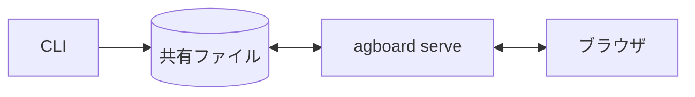
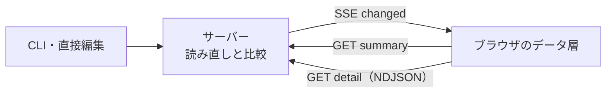
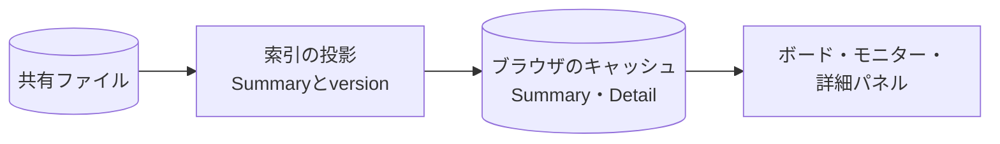
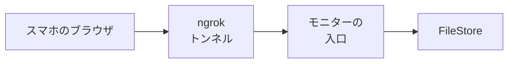
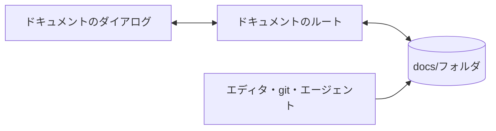

# Agent Boardの仕組み

Agent Boardの構成、データの保存先、エージェントの操作がブラウザへ反映されるまでの流れを説明します。開発を始める際は、まずこのページで全体像を確認してください。各機能の詳細は、関連する解説ページで扱います。

## 全体像

Agent Boardは、一つのRust製実行ファイル`agboard`です。同じバイナリが、エージェントや人が実行するCLIと、ブラウザにボードを表示するWebサーバー（`agboard serve`）の両方を担います。

データベースは使わず、すべてのプロジェクトを共有領域内のファイルに保存します。保存先は、ホームディレクトリの`.agent-board/shared/`、または`AGBOARD_HOME`配下です。人とエージェントが書くもの（タスクの本文、受入条件、履歴、エピックの詳細）はMarkdownに、操作上の状態（レーン、稼働状態、未回答の質問）はJSONに保存します。ファイルが正本なので、エージェントは`TASK.md`と`EPIC.md`を直接編集してもよく、サーバーが変更を検知して表示へ反映します。

### データの読み書き

CLIとブラウザは、同じローカルファイルを読み書きします。タスクの状態は`task.json`、本文・受入条件・履歴は`TASK.md`、エピックの詳細は`EPIC.md`に保存されます。

エージェントは`agboard add`・`mv`・`state`などでタスクを操作し、ユーザーはブラウザから操作します。`rm`や`init`による削除・初期化はユーザーがCLIで行います。`TASK.md`と`EPIC.md`は直接編集することもでき、サーバーが変更を検知します。CLIの保存には、ロックと一時ファイルのrenameを使います。

### 変更の通知

CLIは`POST /api/notify`で保存を通知し、ファイルの直接編集はOSの変更イベントで検知されます。サーバーは変更されたプロジェクトを読み直し、画面に表示する内容が変わっていれば`SSE: changed`で変更されたリソースを知らせます。ブラウザは、Summaryを読み直し、開いている詳細のうち変わったものだけを読み直します。

### 変更から画面まで

通知にデータそのものは含まれません。通知が伝えるのは、変わったものの名前だけです。ブラウザは必要なものを読み、結果をキャッシュに保持します。

- **Summary。** カードと一覧の行はすべてプロジェクトのSummaryから描きます。Summaryは本文を含まないので、ボードは速く表示され、1つのタスクが変わっても、ほかのタスクの本文は読み直しません。
- **Detail。** 本文・受入条件の文章・履歴は、カードやエピックを開いたときだけ読みます。ブラウザは、セクションごとにversionを付けて保持します。
- **SSE。** 1つの`changed`イベントは、変わったタスク・エピック・項目を、`instanceId`と`seq`とともに知らせます。`seq`の欠番や新しい`instanceId`は、ブラウザがキャッシュを捨ててSummaryを読み直す合図です。
- **キャッシュ。** ブラウザは、直近4プロジェクトのSummaryと、上限のある数のDetailを、最も長く使われていないものから捨てながら保持します。通知だけでキャッシュを書き換えることはなく、ブラウザは必ずデータを読み直します。

### モバイルモニター

スマホのブラウザは、`serve`の中で動くngrokのトンネルを通して、読み取り中心のモニターに接続します。接続は**設定**か`agboard serve --monitor ngrok`で始め、公開Hostの完全一致と、起動ごとに作る4桁の合言葉で守ります。トンネルの転送先は専用のループバックの入口です。その入口は、ローカルと同じFileStore・ファイル監視・更新通知を使います。詳しくは[モバイルモニター](./remote-access.md)を参照してください。

### プロジェクトのドキュメント

各プロジェクトには、利用者のMarkdown文書を置く`docs/`もあります。プロジェクトのフォルダの中にありますが、ボードとは切り離して扱います。監視は`docs/`を無視し、`version`にも含めず、文書を保存しても`changed`は送りません。ブラウザは専用の4つのルートでファイルを読み、保存します。読んだ後にファイルが変わっていた場合、保存は拒否されます。[保存と復旧](./saving-and-recovery.md#プロジェクトのドキュメント)と[セキュリティモデル](./security.md#プロジェクトのドキュメント)を参照してください。

### 基本方針

設計の基本方針は次の三つです。

- **すべての操作は対象のプロジェクトを指定する。** プロジェクトは不変なProjectIdで識別し、コマンドが作業フォルダや選択から対象を推測することはありません。フォルダの紐付けは、Hookが正しいプロジェクトを見つけるためだけにあります。
- **タスクは一組で保存する。** `task.json`（状態）と`TASK.md`（本文・条件・履歴）はロックの中で一緒に確定するので、片方だけが見えることはありません。[保存と復旧](./saving-and-recovery.md)を参照してください。
- **ファイルを正本とし、サーバーはキャッシュを持つ。** `serve`は高速な読み取りのためにメモリ上の索引を保持しますが、データの正本はファイルです。サーバーが止まっていてもCLIは動き、起動し直せばファイルを読み込みます。

## 一つの変更を追う

### エージェントがタスクを移動する

エージェントが`agboard --project demo mv 12 doing --actor ai`を実行すると、次のように進みます。

1. CLIがプロジェクト名をProjectIdに解決します。
2. プロジェクトの書き込みロック（`.internal/write.lock`）を最大5秒待って取ります。
3. ロックの中で最新の`task.json`と`TASK.md`を読み直し、規則（例えば、未達成の条件があるのにAIがDoneへ移せないこと）を確かめ、更新後の状態と履歴を組み立てます。
4. ジャーナルを使って両ファイルを一組で保存し、ロックを解放します。
5. 実際に何かが変わっていれば、`serve.json`を読んで、稼働中のサーバーに`POST /api/notify`を送ります。サーバーが動いていなくても問題ありません。
6. サーバーはプロジェクトを読み直し、データが変わったことを確かめて、変わったタスクと項目を添えてSSEの`changed`をすべてのブラウザに送ります。各ブラウザは、プロジェクトのSummaryを読み直し、開いている詳細のうち変わったものだけを読み直します。

### 人がブラウザで質問に答える

1. ブラウザが`POST /api/projects/{projectId}/tasks/{id}/answer`に、依頼IDと選んだ選択肢、ページに埋め込まれた書き込み用トークンを付けて送ります。
2. サーバーはタスクを探すより前に、Host・Origin・`Sec-Fetch-Site`・トークンを確かめます。
3. 書き込みロックの中で、タスクにまだ同じ依頼が残っていることを確かめ、回答を`requestAnswers`に保存し、依頼を解除し、履歴を追加して、組を確定します。
4. versionが変わり、ブラウザはSSEで更新されます。既定待機する`state ... pending --request-json`のコマンドは同じSSEで起きて回答を読みます。コマンドは質問を保存し、サーバーへ通知してから待機します。待機設定はプロセス内だけにあり、`--no-wait`は保存と通知の後に戻ります。

### エージェントがTASK.mdを直接編集する

1. エディターがファイルを書きます。直接編集にはロックが適用されず、後から保存した内容で上書きされます。
2. サーバーのファイル監視がOSのイベントを受け取り、関連するイベントを200msの間に集約します。
3. プロジェクトを読み直し、条件を満たしたタスクの自動Doneを評価し、データが変わっていればブラウザと待機中のエージェントに知らせます。

## 次に読む

- [最初の変更を追う](../getting-started/first-change.md): 一つの規則を、コマンドからファイルとテストまで追います。
- [タスクと状態](./tasks-and-states.md): タスクとは何か、どの状態が有効か。
- [履歴と判断依頼](./history-and-decisions.md): 履歴、Pending、自動Done。
- [保存と復旧](./saving-and-recovery.md): ロック、原子的な保存、失敗。
- [変更の通知](./notifications.md): 変更がブラウザと待機中のエージェントにどう届くか。
- [サーバーと画面](./server-and-ui.md)、[エージェント連携](./agents.md)、[モバイルモニター](./remote-access.md)、[セキュリティモデル](./security.md)。
- ファイルを探すときは[コード構成](../reference/code-map.md)。
