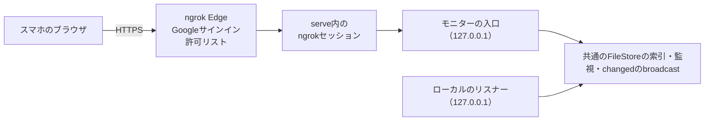

# モバイルモニター

既定では、ボードに接続できるのは同じマシンからだけです。モバイルモニターは、スマホがngrokのトンネルを通して開く、読み取り中心の別のアプリです。トンネルは`serve`プロセスの中にあり、ボードの**設定**か`agboard serve --monitor ngrok`で操作します。利用者向けの設定手順は[モバイルモニターのガイド](../../guide/operations/mobile-monitor.md)、経路は[モニターのルート](../reference/remote-routes.md)にあります。保護の概要は[セキュリティモデル](./security.md#ngrokの入口)にまとめています。

## 全体の構成

- ngrokのRust SDKを`agboard`にリンクしています。外部の`ngrok`プログラムやサイドカーはありません。`src/server/monitor_connection/`の監督役が、Traffic Policy付きのHTTPエンドポイントを一つ開き、モニターの入口へ転送します。
- モニターの入口は、接続が起動と停止を行う専用のループバックのリスナーです。ローカルのリスナーと同じ`serve`プロセスで動き、ライフサイクルのガード、FileStoreの索引とreader、監視、`changed`のbroadcastを共有します。`serve.json`にはローカルのポートだけを残すので、CLI・Hook・`wait`は影響を受けません。
- ローカルのリスナーとモニターの入口は別の面です。ローカルのリスナーは自身のHost・Origin・トークンの確認を保ち、モニターの入口がPCのボードを配信することはありません。接続設定のAPIはローカルのリスナーにだけあります。

用途ごとに二種類の状態を持ち、アクセス範囲を分離しています。

| 状態 | 含むもの | 含まないもの |
| --- | --- | --- |
| `MonitorState` | 読み取り専用のreader・`changed`の購読・許可するHost・独自の資産。 | ボードのトークンや書き込みのサービス。 |
| モニターの回答router | 回答の経路一つと、その書き込みのガード。 | PCのボードのトークン。 |

## 接続

接続は、サーバーの状態が持つ`MonitorConnections`という一つの監督役が管理します。保存した設定、トークン、ライフサイクルの状態、動作中のトンネルを持ちます。

| 状態 | 意味 |
| --- | --- |
| `disabled` | 有効ではない。既定。 |
| `needs_config` | 保存した設定は有効だがトークンがなく、何も開始していない。 |
| `starting` | トンネルを開き、ポリシーを適用している。 |
| `ready` | 公開アドレスが確定し、入口が要求を受け付ける。 |
| `reconnecting` | APIとPCのダイアログが理解する状態の一つ。監督役はこの状態にしない。ngrok SDKの転送には切断の信号がないため、失ったトンネルの復旧を保証するのは、停止して開始し直すことだけ。 |
| `failed` | 直近の開始に失敗した。`failure`にコードが入る。 |
| `stopping` | トンネルとsessionを閉じている。 |

- **開始。** 明示した開始（PCのダイアログの**保存して接続**か`--monitor ngrok`）だけがトンネルを開きます。ダイアログを開く、下書きを保存するだけでは開始しません。開始は、先に設定を有効として保存します。保存に失敗したら何も開始しません。開始要求で入力したトークンが優先され、なければ`NGROK_AUTHTOKEN`、どちらもないときだけキーチェーンのトークンを使います。
- **復元。** `serve`の起動時に保存した設定が有効なら、環境変数かキーチェーンからトークンを使える場合だけトンネルを開始します。使えなければ`needs_config`にしてPCの操作を待ちます。設定ファイルを読めなければ`config_unreadable`で`failed`にし、PCの入口は維持します。コマンドラインの開始は保存した設定より優先され、失敗すると`serve`は終了コード1で終わります。
- **許可リストやドメインの変更。** トンネルが動いている間に新しい設定を保存すると、古いトンネルを閉じ、新しいproofを作り、古いsessionとイベントストリームを終えてから、新しいトンネルを`ready`にします。
- **停止。** 停止はトンネルを閉じ、ポリシーを失効させて開いているイベントストリームを終え、新しい回答を拒否し、設定を無効として保存します。設定ファイルはatomicに書きます。proof・session・トークンをディスクへ書くことはありません。

## 保存先

| 内容 | 保存先 |
| --- | --- |
| 許可するメール、ドメイン、Googleアプリの選択、`enabled`、`revision` | `<データ領域>/.internal/monitor-connection.json`。所有者だけが読み書きできる、アプリの内部ファイル。[共有ファイル](../reference/files.md#モニター接続の設定)を参照。 |
| ngrokのトークン | 利用者が保存しない限り、メモリーだけ。保存したトークンはOSのキーチェーン（service `agent-board`、account `ngrok-authtoken`）。 |
| トンネルのproof、アプリsession、CSRFトークン | 一回の起動の間、メモリーだけ。 |

`NGROK_AUTHTOKEN`とキーチェーンは必要になったときに読むため、トークンが要らない起動ではキーチェーンに触れません。キーチェーンがない、または拒否する場合は、`keychainAvailable`がfalseになり、保存は`keychain_unavailable`で拒否され、利用者は毎回トークンを入力します。

## 認証と書き込みの保護

要求は、次の四つの層を順に通った場合だけモニターに届きます。

1. **Edge。** Traffic Policyが、すべてのパスでGoogle OAuthを行い、メールが許可リストにないアカウントを拒否し、届いた`X-Agboard-Tunnel-Proof`ヘッダーをすべて取り除いたうえで、この起動のproofを一つだけ付けます。許可リストはJSONの配列として直列化し、式へ文字列連結で埋め込みません。
2. **proofとHost。** 入口は、トンネルが準備済みで、`Host`がngrokの返した公開HTTPSアドレスと一致し、`X-Agboard-Tunnel-Proof`がちょうど一つで定時間比較に一致する要求だけを受け付けます。ループバックのポートへの直接接続を含め、それ以外は理由を示さない同じ403を返します。転送ヘッダーやメソッド上書きのヘッダーは信頼しません。
3. **session。** ページと資産には最初の二層だけが必要です。`GET /monitor/api/session`がアプリsessionを作ります。Cookie`agboard_ngrok_session`（`Secure; HttpOnly; SameSite=Lax; Path=/monitor/`、最長12時間）はこの起動と公開アドレスに結び付き、CSRFトークンを返します。そのほかの`/monitor/api/`の経路は有効なsessionが必要で、なければ401 `session_required`です。イベントストリームは、sessionの終了、起動の終了、5分の経過で終わります（ページは再接続します）。
4. **書き込みのガード。** 回答と`POST /monitor/api/disconnect`には、公開Originとの完全一致、`Sec-Fetch-Site: same-origin`、`X-Agboard-Csrf`のCSRFトークンも必要です。

**モニターの回答**は、そのあと回答routerの書き込みのガードを通ります。入口は自身の確認をすべて通った後でだけガードの内部トークンを付けるので、ページがそれを持つことはありません。FileStoreは、ロックの中でPending・依頼ID・選択肢を再確認します。受け付けるのは、未着手か進行中のタスクの現在の依頼だけです。Done・回答済み・アーカイブ済みなどの依頼は拒否します。

トークン・proof・sessionの値が、静的なJSやCSS・manifest・APIの応答・`serve.json`・ログに現れることはありません。すべてのHTMLと機密性のあるAPIは、`Cache-Control: no-store`・`Referrer-Policy: no-referrer`・`X-Content-Type-Options: nosniff`と、スクリプトと接続を自分自身に限り`frame-ancestors 'none'`を持つCSPを返します。内容で名前が決まりトークンを含まないスクリプトとスタイルシートは、代わりにimmutableでキャッシュします。

## モニターのアプリ

- モニター（`web/monitor.html`・`web/src/app/entry/monitor.tsx`・`web/vite.monitor.config.ts`）は`web/src/pages/monitor/App.tsx`だけを起点にします。PCの`App.tsx`・`DetailPanel`・エディター・汎用の書き込みクライアントはimportしません。独自のmanifestとともに`web/dist/monitor/`にビルドし、`src/server/monitor/assets.rs`はそのmanifestだけを配信します。Mermaidには、ボードのビルドの`chunk-mermaid.core`チャンクと、そこからimportされるすべてのチャンクを使います。これらは`web/dist/monitor/`にそのままコピーし、一つでも`web/src/`のモジュールを含めばビルドを止めます。実行ファイルには同じバイト列を一度だけ埋め込みます。
- 共通の表示部品（ヘッダー、タスクの内容、状態のラベル、プロジェクトの切り替え、テーマ、i18n、閲覧専用のMarkdown・受入条件・履歴）は再利用します。タスクの見出しから、本文・受入条件・履歴・エピックのタブを持つ閲覧専用のドロワーを開き、回答フォームはタスク上に置きます。ドロワーとそのMarkdown表示は別のチャンクに分け、一覧を表示した直後に取得します。そのため、初回の読み込みは一覧と回答フォームだけで済みます。
- モニターのクライアントは、カタログ・ボード・イベント、所有する画像・エピックの読み取り、回答のPOST一つだけを持ちます。ページはトークンを持ちません。読み込み時に`GET /monitor/api/session`でsessionとCSRFトークンを取得し、一つの回答POSTでCSRFトークンを`X-Agboard-Csrf`で送ります。sessionがない・期限切れの場合や、EdgeがJSONの代わりにサインインへのリダイレクトを返した場合は、ページが**Googleで再接続**を表示し、モニターのアドレスへトップレベルで遷移します。サインインを繰り返すループにはしません。PATCH・PUT・DELETEの関数はありません。
- PCとモニターの回答は、FileStoreの一つの保存処理を共有します。ロックの中での依頼の照合、`requestAnswers`と履歴の項目、索引の更新、通知です。回答に成功したタスクは、そのレーンのIdleになります。
- ドロワーはprojectId・taskId・epicIdと世代番号で対象を固定します。タスクの本文と履歴はスナップショットから、エピックの本文は`getEpic`から読み、タブごとのスクロール位置を保ち、遅れた応答や範囲外の応答は無視します。エピックの読み込みに失敗しても再試行でき、一覧や回答を妨げません。

## 取得と復帰

モニターは、定期的なポーリングを使わずに最新のデータを表示します。最新と確認できない場合は、データが古い可能性を明示します。

- **All Projects**は、カタログを取得し、各ボードを最大4並列で取得し、カタログを確かめ直します。その間に`catalogVersion`が変わったら、新しい世代として取り直します。プロジェクトをまたいだ同一時点の一貫性はありません。
- **データの不備。** スナップショットの`problems`は、ProjectIdとともに表示へ渡します。HTTP 200でも問題が一つでもあれば`partial`にします。サマリーは「—」にし、読めたタスクだけを並べ、データに不備があると案内します。外したタスクを0件として数えることはありません。取得に失敗したプロジェクトとデータに不備のあるプロジェクトは分けて表示し、修復の操作はありません。データの不備だけでは、再試行・ポーリング・再接続をしません。
- **鮮度**は`loading`・`syncing`・`fresh`・`stale`・`partial`・`error`のいずれかです。表示が`fresh`になるのは、SSEの`ready`が届き、すべてのプロジェクトを問題なく取得し、heartbeatが期限内のときだけで、`onopen`だけでは足りません。SSEが止まった状態で手動のGETが成功したら、取得済みだが自動更新は止まっていると表示します。最後の全体取得の時刻は、問題のない完全な取得でだけ進めます。
- **一つの取得処理**を、手動の更新・SSEの通知・ページへの復帰が共有します。`AbortController`と世代番号で遅れた応答を捨て、取得中の`changed`はdirtyフラグで一回の後続の取得にまとめます。
- **SSE。** モニターはブラウザの`EventSource`を使います。SSEは`changed`を中継し、モニターのビルドIDを含む`ready`（`{"build":"…"}`）を送り、15秒ごとに`heartbeat`（data `{}`）を送ります。表示中に45秒何も届かなければ接続を古い状態にして再接続します。heartbeatでスナップショットを取り直すことはありません。
- **ページの表示状態。** 非表示の間はSSEとheartbeatの判定を止めます。表示に戻るとすぐに取り直して再接続し、`ready`による重複をまとめます。GETは10秒でタイムアウトします。再試行は1・2・5・10・30秒と間隔を延ばし、非表示の間は止めます。カタログの確かめ直しが失敗し続けたら、取り直し続けるのではなく、syncingかstaleに戻して復旧のタイマーに任せます。
- **並び順。** `agentStatusChangedAt`は稼働状態の変更時刻、`taskStatusChangedAt`はDoneの並び順に使います。相対時刻は1分ごとに更新してよいですが、そのタイマーで取り直すことはありません。
- セットアップの完了前は読み込み中を表示し、プロジェクトやタスクが0件であることとネットワークの失敗を区別します。取得した本文や件数は、`localStorage`やService Workerに保存しません。
