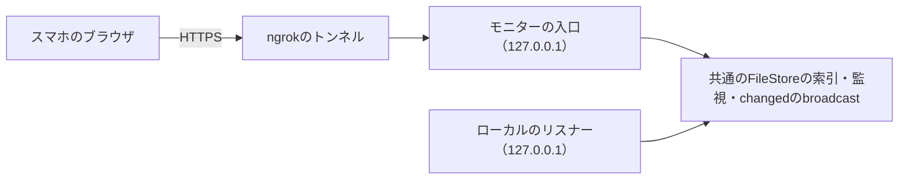

# モバイルモニター

既定では、ボードに接続できるのは同じマシンからだけです。モバイルモニターは、スマホがngrokのモニター接続を通して開く、読み取り中心の別のアプリです。利用者向けの設定手順は[モバイルモニターのガイド](../../guide/operations/mobile-monitor.md)、経路は[モニターのルート](../reference/remote-routes.md)にあります。

## 全体の構成

- モニターの入口は、接続が起動と停止を行う専用のループバックのリスナーです。ローカルのリスナーと同じ`serve`プロセスで動き、ライフサイクルのガード、FileStoreの索引とreader、監視、`changed`のbroadcastを共有します。`serve.json`にはローカルのポートだけを残すので、CLI・Hook・`wait`は影響を受けません。
- ローカルのリスナーとモニターの入口は別の面です。ローカルのリスナーは自身のHost・Origin・トークンの確認を保ち、モニターの入口がPCのボードを配信することはありません。

用途ごとに二種類の状態を持ち、アクセス範囲を分離しています。

| 状態 | 含むもの | 含まないもの |
| --- | --- | --- |
| `MonitorState` | 読み取り専用のreader・`changed`の購読・許可するHost・独自の資産。 | ボードのトークンや書き込みサービス。 |
| モニターの回答router | 回答の経路一つと、その書き込みのガード。 | PCのボードのトークン。 |

## 認証と書き込みの保護

**モニターの回答**は、回答routerの書き込みのガードを通ります。前段の入口が自身の確認をすべて通ったときにだけガードのトークンを加えるので、ページがそれを持つことはありません。回答には、対象の確認より前に、接続の公開HTTPSのoriginに完全に一致するHostとOrigin、`Sec-Fetch-Site: same-origin`、転送やメソッド上書きのヘッダーがないこと、定数時間の比較でのトークンの一致が必要です。そのうえでFileStoreが、ロックの中でPending・依頼ID・選択肢を確かめ直します。受け付けるのはTodoかDoingのタスクの現在の依頼だけで、Done・回答済み・アーカイブ済み・別の依頼は拒否します。

トークンが、静的なJSやCSS・manifest・APIの応答・`serve.json`・ログに現れることはありません。すべてのHTMLと機密のAPIは`Cache-Control: no-store`・`Referrer-Policy: no-referrer`・`X-Content-Type-Options: nosniff`と、スクリプトと接続を自分自身に限り`frame-ancestors 'none'`とするCSPを送ります。スクリプトとスタイルシートは内容から名前を付けており、トークンも含まないため、immutableでキャッシュさせます。

## モニターのアプリ

- モニター（`web/monitor.html`・`web/src/app/entry/monitor.tsx`・`web/vite.monitor.config.ts`）は`web/src/pages/monitor/App.tsx`だけを起点にします。PCの`App.tsx`・`DetailPanel`・エディター・汎用の書き込みクライアントはimportしません。独自のmanifestとともに`web/dist/monitor/`にビルドし、`src/server/monitor/assets.rs`はそのmanifestだけを配信します。Mermaidには、ボードのビルドの`chunk-mermaid.core`チャンクと、そこからimportされるすべてのチャンクを使います。これらは`web/dist/monitor/`にそのままコピーし、一つでも`web/src/`のモジュールを含めばビルドを止めます。実行ファイルには同じバイト列を一度だけ埋め込みます。
- 共通の表示部品（ヘッダー、タスクの内容、状態のラベル、プロジェクトの切り替え、テーマ、i18n、閲覧専用のMarkdown・受入条件・履歴）は再利用します。タスクの見出しから、本文・受入条件・履歴・エピックのタブを持つ閲覧専用のドロワーを開き、回答フォームはタスク上に置きます。ドロワーとそのMarkdown表示は別のチャンクに分け、一覧を表示した直後に取得します。そのため、初回の読み込みは一覧と回答フォームだけで済みます。
- モニターのクライアントは、カタログ・ボード・イベント、所有する画像・エピックの読み取り、回答のPOST一つだけを持ちます。トークンは実行時に配信されたHTMLから読みます。PATCH・PUT・DELETEの関数はありません。
- PCとモニターの回答は、FileStoreの一つの保存処理を共有します。ロックの中での依頼の照合、`requestAnswers`と履歴の項目、索引の更新、通知です。回答に成功したタスクは、そのレーンのIdleになります。
- ドロワーはprojectId・taskId・epicIdと世代番号で対象を固定します。タスクの本文と履歴はスナップショットから、エピックの本文は`getEpic`から読み、タブごとのスクロール位置を保ち、遅れた応答や範囲外の応答は無視します。エピックの読み込みに失敗しても再試行でき、一覧や回答を妨げません。

## 取得と復帰

モニターは、定期的なポーリングを使わずに最新のデータを表示します。最新と確認できない場合は、データが古い可能性を明示します。

- **All Projects**は、カタログを取得し、各ボードを最大4並列で取得し、カタログを確かめ直します。その間に`catalogVersion`が変わったら、新しい世代として取り直します。プロジェクトをまたいだ同一時点の一貫性はありません。
- **データの不備。** スナップショットの`problems`は、ProjectIdとともに表示へ渡します。HTTP 200でも問題が一つでもあれば`partial`にします。サマリーは「—」にし、読めたタスクだけを並べ、データに不備があると案内します。外したタスクを0件として数えることはありません。取得に失敗したプロジェクトとデータに不備のあるプロジェクトは分けて表示し、修復の操作はありません。データの不備だけでは、再試行・ポーリング・再接続をしません。
- **鮮度**は`loading`・`syncing`・`fresh`・`stale`・`partial`・`error`のいずれかです。表示が`fresh`になるのは、SSEの`ready`が届き、すべてのプロジェクトを問題なく取得し、heartbeatが期限内のときだけで、`onopen`だけでは足りません。SSEが止まった状態で手動のGETが成功したら、取得済みだが自動更新は止まっていると表示します。最後の全体取得の時刻は、問題のない完全な取得でだけ進めます。
- **一つの取得処理**を、手動の更新・SSEの通知・ページへの復帰が共有します。`AbortController`と世代番号で遅れた応答を捨て、取得中の`changed`はdirtyフラグで一回の後続の取得にまとめます。
- **SSE。** モニターはブラウザの`EventSource`を使います。SSEは`changed`を中継し、モニターのビルドIDを含む`ready`（`{"build":"…"}`）を送り、15秒ごとに`heartbeat`（data `{}`）を送ります。表示中に45秒何も届かなければ接続を古い状態にして再接続します。heartbeatでスナップショットを取り直すことはありません。
- **ページの表示状態。** 非表示の間はSSEとheartbeatの判定を止めます。表示に戻るとすぐに取り直して再接続し、`ready`による重複をまとめます。GETは10秒でタイムアウトします。再試行は1・2・5・10・30秒と間隔を延ばし、非表示の間は止めます。カタログの確かめ直しが失敗し続けたら、取り直し続けるのではなく、syncingかstaleに戻して復旧のタイマーに任せます。
- **並び順。** `agentStatusChangedAt`は稼働状態の変更時刻、`taskStatusChangedAt`はDoneの並び順に使います。相対時刻は1分ごとに更新してよいですが、そのタイマーで取り直すことはありません。
- セットアップの完了前は読み込み中を表示し、プロジェクトやタスクが0件であることとネットワークの失敗を区別します。取得した本文や件数は、`localStorage`やService Workerに保存しません。
