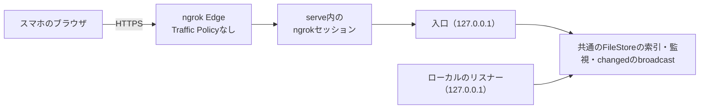

# リモートアクセス

既定では、ボードに接続できるのは同じマシンからだけです。スマホやほかのコンピューターのブラウザは、ngrokのトンネルを通してボードのアプリそのものを、合言葉のsessionの背後で開きます。トンネルは`serve`プロセスの中にあり、ボードの**設定**か`agboard serve --monitor ngrok`で操作します。利用者向けの設定手順は[リモートアクセスのガイド](../../guide/watch/remote-access.md)、経路は[入口のルート](../reference/remote-routes.md)にあります。保護の概要は[セキュリティモデル](./security.md#ngrokの入口)にまとめています。

## 全体の構成

- ngrokのRust SDKを`agboard`にリンクしています。外部の`ngrok`プログラムやサイドカーはありません。`src/server/monitor_connection/`の監督役が、Traffic Policyを指定しないHTTPエンドポイントを一つ開き、入口へ転送します。ドメインを指定しない場合、公開アドレスはngrokが選び、開始のたびに変わります（SDKはアカウントの固定の開発用ドメインを自動では割り当てません。持っていないドメインを無料アカウントが要求すると拒否されます）。ngrokアカウントが持つドメイン（無料の固定の開発用ドメインなど）を設定すると、そのドメインでエンドポイントを要求するため、開始のたびに、またサーバーを再起動したあとも同じアドレスになります。ドメインはPCの接続ダイアログの設定（省略できる推奨の欄）で、設定ファイルの`domain`に保存し、`PUT /api/monitor-connections/settings/ngrok`で送ります。代わりに環境変数`AGBOARD_NGROK_DOMAIN`も使えます。環境変数は保存したドメインより優先します（トークンは、入力したものが環境変数より優先されるので、順序が異なります）。どちらもホスト名だけ（スキーム、パス、ポート、ワイルドカードは不可）で、APIは違反を`invalid_domain`で拒否し、環境変数の値が違反なら無視します。ngrokがドメインを拒否すると、開始は`endpoint_failed`で失敗し、理由がサーバーのログに出ます。無料のngrokプランはTraffic Policyの操作を拒否するため、Traffic Policyは送りません。
- 入口は、接続が起動と停止を行う専用のループバックのリスナーです。ローカルのリスナーと同じ`serve`プロセスで動き、ライフサイクルのガード、FileStoreの索引とreader、監視、`changed`のbroadcastを共有します。`serve.json`にはローカルのポートだけを残すので、CLI・Hook・`wait`は影響を受けません。
- [プロジェクトのドキュメント](../reference/web-api.md#プロジェクトのドキュメント)のルートは、ボードのそのほかのAPIと同じく、sessionの背後で入口から配信します。配信しないのは、PC上でプログラムを起動する`docs/open`だけです。
- ローカルのリスナーと入口は別の面です。ローカルのリスナーは自身のHost・Origin・トークンの確認を保ちます。入口は、自身の検査（Host・session・Origin・CSRF）を先に行うので、ローカル用のガードを外したボードのルーターを配信し、そのページはトークンを持ちません。接続設定のAPI、`POST /api/notify`、`docs/open`はローカルのリスナーにだけあります。

## 接続

接続は、サーバーの状態が持つ`MonitorConnections`という一つの監督役が管理します。保存した設定、トークン、ライフサイクルの状態、動作中のトンネルを持ちます。

| 状態 | 意味 |
| --- | --- |
| `disabled` | 有効ではない。既定。 |
| `needs_config` | 保存した設定は有効だがトークンがなく、何も開始していない。 |
| `starting` | トンネルを開き、ポリシーを適用している。起動時の復元が安全な保管場所の読み取りを待っている間も、この状態になる。 |
| `ready` | 公開アドレスが確定し、入口が要求を受け付ける。 |
| `reconnecting` | APIとPCのダイアログが理解する状態の一つ。監督役はこの状態にしない。ngrok SDKの転送には切断の信号がないため、失ったトンネルの復旧を保証するのは、停止して開始し直すことだけ。 |
| `failed` | 直近の開始に失敗した。`failure`にコードが入る。 |
| `stopping` | トンネルとsessionを閉じている。 |

- **開始。** 明示した開始（PCのダイアログの**保存して接続**か`--monitor ngrok`）だけがトンネルを開きます。ダイアログを開く、下書きを保存するだけでは開始しません。開始は、先に設定を有効として保存します。保存に失敗したら何も開始しません。開始要求で入力したトークンが優先され、なければ`NGROK_AUTHTOKEN`、どちらもないときだけ、このPCの安全な保管場所に保存したトークンを使います。
- **復元。** `serve`の起動時に保存した設定が有効なら、環境変数かこのPCの安全な保管場所からトークンを使える場合だけトンネルを開始します。使えなければ`needs_config`にしてPCの操作を待ちます。設定ファイルを読めなければ`config_unreadable`で`failed`にし、PCの入口は維持します。コマンドラインの開始は保存した設定より優先され、失敗すると`serve`は終了コード1で終わります。コマンドが起動したサーバーも保存した接続を復元し、接続が開始中・接続済み・再接続中・停止中の間は自分で止まりません。止めたいときは、PCで接続を止めます。

  安全な保管場所は、プログラムを入れ直した後などに、利用者へ許可を求めて止まることがあります。復元はこの読み取りを裏で行うため、サーバーはすぐに準備でき、リクエストに応答します。読み取りが終わるまでの状態は`starting`です。接続の完了を待つのは`--monitor ngrok`だけです。
- **開始のやり直し。** トンネルが動いている間の開始（**トークン再設定**のあとのPCのダイアログの**保存して接続**など）は、古いトンネルを閉じ、新しい合言葉を作り、古いsessionとイベントストリームを終えてから、新しいトンネルを`ready`にします。同じ設定をもう一度保存しても何も変わりません。
- **停止。** 停止はトンネルを閉じ、入口を閉じて開いているイベントストリームを終え、新しい回答を拒否し、設定を無効として保存します。設定ファイルは原子的に書き込み、合言葉・session・トークンをディスクへ書くことはありません。

## 保存先

| 内容 | 保存先 |
| --- | --- |
| `enabled`、`revision` | `<データ領域>/.internal/monitor-connection.json`。所有者だけが読み書きできる、アプリの内部ファイル。[共有ファイル](../reference/files.md#モニター接続の設定)を参照。 |
| ngrokのトークン | 利用者が保存しない限り、メモリーだけ。保存したトークンは、このPCの安全な保管場所であるOSの資格情報ストア（service `agent-board`、account `ngrok-authtoken`）。 |
| スマホの合言葉とその間違いの回数、アプリsession、CSRFトークン | 一回の起動の間、メモリーだけ。 |
| 言語とカラーテーマ | `<データ領域>/.internal/preferences.json`。PCまたはスマホからの保存で書き込む。[共有ファイル](../reference/files.md#表示設定)を参照。 |

ドメインは秘密ではなく、以下の確認も変えません。`Host`は、要求したドメインであるngrokが返すアドレスとちょうど一致する必要があります。接続を停止するとトンネルを閉じるため、次の開始までは固定のアドレスにngrokからは何も届きません。

`NGROK_AUTHTOKEN`と安全な保管場所は必要になったときに読むため、トークンが要らない起動では安全な保管場所に触れません。

安全な保管場所は利用者に許可を求めて止まることがあるため、接続の状態を押さえたまま読み書きすることはありません。最初の`GET /api/monitor-connections`は読み取りを裏で始め、最大1秒だけ待ちます。利用者がまだ答えていなければ分かっている状態を返し、ダイアログが次に読んだときに保管場所の中身が反映されます。開始と削除は安全な保管場所の応答を待ちますが、待つのはその要求だけです。ボード、ほかの要求、使われていないかの判定は応答を続けます。

安全な保管場所がない、または拒否する場合は、`keychainAvailable`がfalseになり、保存は`keychain_unavailable`で拒否され、利用者は毎回トークンを入力します。

## 認証と書き込みの保護

Edgeがアプリのために行うことはありません。エンドポイントはTraffic Policyなしで開くため（無料のngrokプランはTraffic Policyを拒否します）、サインインも許可リストも拒否のルールも、アプリが信頼するヘッダーもありません。要求は、次の三つの層を順に通った場合だけボードに届きます。

1. **Host。** 入口は、トンネルが準備済みで、`Host`がngrokの返した公開HTTPSアドレスとちょうど一致する（`Host`ヘッダーが一つで、ポートも付かない）要求だけを受け付けます。それ以外は理由を示さない同じ403を返します。ループバックのポートを開いたブラウザは`Host`がループバックのアドレスなので、これに含まれます。転送ヘッダーやメソッド上書きのヘッダーは信頼しません。Hostの確認は、要求がngrok経由で届いたことをアプリに証明しません。[防げないこと](./security.md#防げないこと)を参照してください。
2. **合言葉とsession。** ページの殻と静的ファイルには最初の層だけが必要です。それ以外はsessionなしでは配信せず、sessionは`POST /api/remote/unlock`でだけ始まります。
   - *合言葉。* 起動のたびに、OSの乱数源から4桁の合言葉（`0000`〜`9999`）を偏りなく作り、連続した間違いの回数とともにメモリーに置きます。PCがこれを見るのは、接続が`ready`の間のローカルの状態APIと、`serve`の起動行だけです。ファイル、ログ、`serve.json`、ページ、エラー、スマホ向けの応答には一切書きません。
   - *unlock。* 本文はJSONの`{"code":"1234"}`で、公開Originとの完全一致と`Sec-Fetch-Site: same-origin`が必要です。まだsessionがないため、CSRFトークンは要りません。コードは定時間で比較します。正しければ、Cookie`agboard_ngrok_session`（`Secure; HttpOnly; SameSite=Lax; Path=/`、最長12時間。この起動と公開アドレスに結び付く）を発行し、回数を0に戻し、CSRFトークンを返します。間違っていれば403 `unlock_failed`で、どれだけ近かったか、残り何回かは示しません。
   - *制限。* 連続5回目の間違いまでは403です。それ以降は、正しい合言葉を含むすべての試行が429 `unlock_locked`になり、何も発行しません。新しく起動し直したときだけ、新しい合言葉と数え直した回数になります。ヘッダーや本文の不備（Originがない、JSONでない本文）で拒否された要求は推測ではないため、数えません。
   - *session。* `GET /api/remote/session`は、有効なsessionとそのCSRFトークンを知らせるか、401 `session_required`を返すだけで、何も始めません。そのほかの`/api/`の経路は有効なsessionが必要で、なければ401 `session_required`です。イベントストリームは、sessionの終了、起動の終了、5分の経過で終わります（ページは再接続します）。
3. **書き込みのガード。** あらゆる変更（回答、編集、移動、表示設定の保存など）には、公開Originとの完全一致、`Sec-Fetch-Site: same-origin`、`X-Agboard-Csrf`のCSRFトークンも必要です。

4桁の合言葉は、意図的に小さな秘密です。10,000通りしかなく、5回までの制限と、起動ごとに変わる合言葉で守ります。アカウントでのサインインより弱い守りです。防げないことは[セキュリティモデル](./security.md#防げないこと)にまとめています。

**回答とそのほかの変更**は、ボード自身のハンドラーを通ります。FileStoreは、ロックの中で各質問と選択肢を再確認します。受け付けるのは未回答の質問だけです。回答済みや取り下げ済みの質問は409、存在しない質問は404で拒否します。表示設定のハンドラーが受け付けるのは`locale`と`theme`だけで、PCの`preferences.json`に書き、開いているボードのイベントストリームに`preferences`イベントを送ります。

トークン・合言葉・sessionの値が、静的なJSやCSS・manifest・APIの応答・`serve.json`・ログに現れることはありません。すべてのHTMLと機密性のあるAPIは、`Cache-Control: no-store`・`Referrer-Policy: no-referrer`・`X-Content-Type-Options: nosniff`と、スクリプトと接続を自分自身に限り`frame-ancestors 'none'`を持つCSPを返します。内容で名前が決まりトークンを含まないスクリプトとスタイルシートは、代わりにimmutableでキャッシュします。

## 入口から使うボードのアプリ

- `/`のページは、ボード自身のページ（`web/index.html`）を、空のトークンで描画したものです。同じバンドルがウィンドウの幅でPCのボードとスマホの画面を出し分けるので、入口に別のアプリは要りません。
- トークンのないページは、読み込み時に`GET /api/remote/session`を呼びます（`web/src/app/remote/`の`RemoteGate`）。sessionがなければ合言葉の画面（`ConnectionStateView`）を表示し、ボードはマウントしないので、何も読み取りません。合言葉は`POST /api/remote/unlock`へ送り、Cookieはサーバーが設定し、CSRFトークンはメモリにだけ保ちます（`web/src/shared/api/http.ts`の`setCsrfToken`）。
- 書き込みはすべて`authHeaders()`を送ります。ページにトークンがあればボードのトークン、なければ`X-Agboard-Csrf`です。ボードへの要求が一つでも401を受けると、CSRFトークンを消して合言葉の画面に戻ります。
- 入口は、ボードのルーターをもう一つ組み立て（`api::remote_router`）、ローカルのHostガードと書き込みガードとローカル専用の経路を外して、入口の検査の背後で配信します。クライアントが送った`X-Agboard-Token`はそこに届く前に取り除くので、この面でボードのトークンには役割がありません。

## 旧モニターのアドレス

読み取り中心だった旧スマホ用モニターは廃止しました。そのアドレス（`/monitor`、`/monitor/`、`/monitor/api/`や`/monitor/assets/`を含む`/monitor/`以下のすべて）は、入口ではsessionの有無にかかわらず、リダイレクトなしで404を返します。ローカルのリスナーも同じアドレスに404を返します。古いブックマークを残したスマホは、ルートのアドレスを開けば、合言葉を求められたあとにボードが表示されます。

PCのダイアログとそのQRコードが示すスマホのアドレスは、ボードのルートにプロジェクトをクエリで付けた`https://<host>/?project=<ProjectId>`です。ボードのアプリは、PCと同じく`?project=`からプロジェクトを選びます。

成果一件へのリンクは、このクエリに`&task=<id>&result=<version>`を足したものです。合言葉の画面はその場に表示されるので、解錠してもアドレス全体が残り、ボードはそのタスクを成果タブで開きます。[成果のリンク](../reference/remote-routes.md#成果のリンク)を参照してください。

## 取得と復帰

スマホの画面は、定期的なポーリングを使わずに最新のデータを表示します。最新と確認できない場合は、データが古い可能性を明示します。この画面はボード自身のデータ層から描画するので、PCのボードと同じSummaryとDetailの経路を読み、同じ`/api/events`のストリームに従います。ストリームは[通知](./notifications.md)、失敗時の画面の振る舞いは[サーバーと画面](./server-and-ui.md#画面での失敗時の振る舞い)を参照してください。

- **データの不備。** SummaryのProblemsは表示へ渡します。HTTP 200でも問題が一つでもあれば`partial`にします。読めたタスクだけをレーンに並べてタブの件数に数え、データに不備があると案内します。外したタスクを0件として数えることはありません。データの不備だけでは、再試行・ポーリング・再接続をしません。
- **鮮度**は`loading`・`syncing`・`fresh`・`stale`・`partial`・`error`のいずれかです。表示が`fresh`になるのは、ストリームが接続済みで、Summaryを問題なく取得し、heartbeatが期限内のときだけで、接続が開いているだけでは足りません。ストリームが止まった状態で手動のGETが成功したら、取得済みだが自動更新は止まっていると表示します。最後の全体取得の時刻は、問題のない完全な取得でだけ進めます。
- **可視性。** ページが隠れている間は、ストリームとheartbeatの確認を止めます。再び見えたときは、すぐに取り直して再接続します。GETは10秒でタイムアウトし、再試行は1・2・5・10・30秒と間隔を延ばし、隠れている間は止めます。
- **順序。** `agentStatusChangedAt`は実行状態が変わった時刻、`taskStatusChangedAt`はDoneの並び順です。相対時刻は1分ごとに更新することがありますが、そのタイマーが取得を起こすことはありません。
- 準備が終わるまでは読み込み中と表示し、プロジェクトやタスクが0件であることと、通信の失敗を区別します。取得した本文や件数を`localStorage`やサービスワーカーに保存することはありません。
