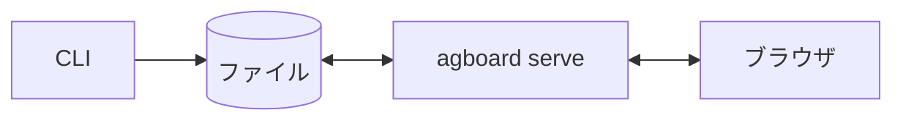

# 開発者ガイド

この章では、Agent Boardの開発に必要な構成・実装・検証方法を説明します。ボードの使い方は、[利用ガイド](../guide/index.md)を読んでください。

Agent Boardは、CLIとWebサーバーを兼ねる一つのRust製プログラム`agboard`です。データはすべてファイルに保存され、CLI・Markdownの直接編集・ブラウザから同じデータを読み書きできます。

## この章の構成

| 分類 | 内容 | 読む場面 |
| --- | --- | --- |
| [はじめる](./getting-started/setup.md) | 開発環境のセットアップ、最初の変更を追う、Storybook、検証とプルリクエスト。 | ビルドして何かを変えたいとき。 |
| [基本の考え方](./concepts/overview.md) | 仕組みをテーマごとに説明します。全体の設計、タスクと状態、履歴と判断依頼、保存と復旧、通知、サーバー、エージェント、モバイルモニター、セキュリティ。 | 変更する前に、仕組みを理解したいとき。 |
| [リファレンス](./reference/files.md) | 必要に応じて参照する仕様をまとめています。共有ファイル、Web API、エラーコード、エージェントが受け取るJSON、モニターのルート、コード構成。 | 探しているものが分かっているとき。 |
| [トラブルシューティング](./troubleshooting.md) | 症状・原因・対処。 | 何かが失敗するとき。 |
| [ドキュメントと画像](./docs-and-images.md) | サイトのプレビュー、UIのStory、スクリーンショットや動画の作り直し。 | `docs/`やUIを変えるとき。 |

## 初めて開発する場合の読み順

1. [開発環境のセットアップ](./getting-started/setup.md): ビルドして、一時的なボードで動かします。
2. [Agent Boardの仕組み](./concepts/overview.md): 全体像を読み、変更が各処理を経て画面に反映されるまでを確認します。
3. [最初の変更を追う](./getting-started/first-change.md): 一つの規則を、CLIからファイル、テストまで追います。
4. [タスクと状態](./concepts/tasks-and-states.md)を読み、変更する領域の解説に進みます。
5. [検証とプルリクエスト](./getting-started/pull-request.md)。

## ドキュメントの更新方針

- Agent Boardの**現在の**仕組みを記述します。計画と判断の経緯はリポジトリの外で管理します。
- 振る舞いを変えるときは、同じ変更でこれらのページも更新します。
- 英語版が正本で、`docs/ja/dev/`の日本語版は開発者向けの翻訳です。同じ変更で更新してください。
- リポジトリの`AGENTS.md`は、コーディングエージェント向けにこれらのページの索引を持ちます。
