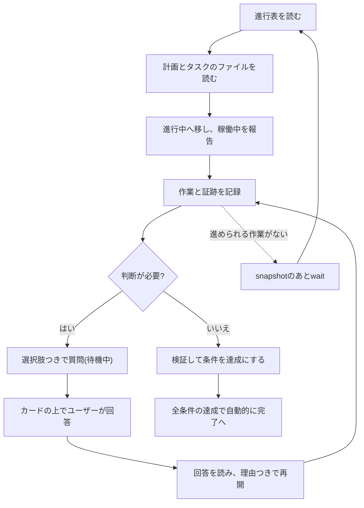

# エージェントとの連携

エージェントはあなたと同じボードで作業します。フックが短い進行表を渡し、エージェントはカードを選んで作業を報告し、判断が必要なときはあなたに尋ね、回答を待ちます。

## エージェントを接続する

フックは[Claude CodeとCodexの連携ガイド](https://github.com/FooQoo/agent-board/blob/main/integrations/README.md)に従って設定します。設定のテンプレートはリポジトリの`integrations/`フォルダにあるため、このページはガイドを複製せず要点をまとめます。

- **フォルダからの解決。** フックのテンプレートは、プロジェクト名もセッションIDも含まない固定のコマンド`agboard hook --agent claude`を使います。フックは入力の`cwd`を読み、登録済みの最も近い親フォルダに解決します。`--project NAME`を明示するとフォルダの登録より優先されます。登録がない、または壊れているときは`AGBOARD_ERROR`を返し、別のプロジェクトを推測することはありません。フォルダは`agboard project create`または`agboard project bind`で登録します。
- **進行表。** フックは`agboard progress`と同じ簡潔な表を渡します。完了、アーカイブ済み、待機中のカードは含まれません。表が256 KiBを超える、または読み取れないときは、エージェントに`AGBOARD_ERROR`が渡され、ボードに依存する変更をしてはいけません。
- **共有ファイル。** エージェントが編集できるのは、プロジェクトの`README.md`が許す範囲で、下書きではないカードの`TASK.md`とエピックの`PLAN.md`だけです。`task.json`にはメタデータを保存し、変更にはCLIを使います。`TASK.md`には本文・受け入れ条件・操作履歴を保存します。履歴は`TASK.md`のfrontmatterだけに保存し、各項目は`at`と`reason`だけを持ちます。カード操作は自動追記され、AIは`history add`で意味のある進捗を記録します。通常編集では履歴を保持し、本文には計画・検証結果・証跡への参照を記述して、時系列の履歴は残さないでください。エージェントは`epic.json`や`project.json`を編集せず、カードやエピックのフォルダも削除せず、マシン固有の絶対パスを共有ファイルに書きません。[編集と証跡](./editing#共有markdownファイルを編集する)を参照してください。
- **Claude Code。** `integrations/claude-code/settings.json`をプロジェクトの`.claude/settings.json`へマージし、`/hooks`で確認します。
- **Codex CLIとCodex App。** `integrations/codex/hooks.json`をプロジェクトの`.codex/hooks.json`へマージし、`/hooks`で確認します。
- **回答の待機。** 進められる作業がないとき、エージェントは`snapshot`と`wait`で待ちます(下の作業ループを参照)。

フックとエージェントのスキルは`PATH`上の`agboard`を実行するため、開発ビルドではなくインストール済みのバージョンを使います。[インストールと開始](./getting-started)を参照してください。

## 作業ループ



1. `agboard progress --json`を読み、そのエピックに保存されたタスクの順序に従って、着手できるAI担当のカードを選びます。選んだエピックの`PLAN.md`とタスクの`TASK.md`だけを読み、履歴や有効な質問が必要なときは`show`を使います。
2. AI担当のカードは理由を添えて進行中へ移し、稼働中を報告します。ユーザー担当のカードは、作業に関係するときだけ確認します。
3. 実際の作業と検証に基づく簡潔な内容で、`history add`を使い、意味のある進捗を自動記録します。本文には計画・検証結果・証跡への参照、証跡ファイルには全文ログを残します。判断が必要なときは待機中にして質問します。列や状態の変更は履歴を自動追記するので重複記録しません。
4. 回答があったら、カードと履歴を読み、計画を見直し、理由を添えて再開します。受け入れ条件は検証したあとにだけ達成にします。対象のAIカードは、すべての条件を達成すると自動で完了へ移ります。
5. 進められる作業がないときは、同じプロジェクトのスナップショットのカーソルを使って変更を待ちます。

質問と回答の方法は[判断依頼](./decisions)、進行表は[エピックと進行表](./epics)を参照してください。

## 変更を待つ

```sh
agboard --project "My project" snapshot --json
agboard --project "My project" wait --after "<cursor>" --json
```

カーソルの形式は`f1:<project-id>:<version>`です。`snapshot`が返した値として扱い、自分で組み立てないでください。`wait`は同じデータ領域で`agboard serve`が動いている必要があり、ポーリングせずに変更を待ち受けます。名前の変更後も同じプロジェクトIDを追い続けるので、以降のコマンドとフックでは新しい名前を使ってください。

`wait`はプロジェクト名を一度だけ解決し、そのプロジェクトを追い続けます。ほかのプロジェクトの変更では終わりません。プロジェクトが削除されると`project_not_found`で失敗します。`wait_timeout`、`board_unavailable`、`cursor_invalid`、`project_not_found`はエラーであり、回答ではありません。戻ってきたら、スナップショットと履歴の全体を読み、ユーザーの理由を踏まえて、再開するか追加の質問をします。

## 下書きとエラー

下書き(`isDraft: true`)はエージェントから読み取り専用で、`edit`、`mv`、`state`は`card_is_draft`で失敗します。ユーザーが確定するまでは、ほかのカードに取り組んでください。`AGBOARD_ERROR`、プロジェクトが見つからない、接続の技術的な失敗、ボードを読めないときは、問題を報告し、有効な進行表が得られるまでボードに依存する変更を止めます。待機のタイムアウトや中断は、質問に回答したことにも、質問を失効させることにもなりません。
