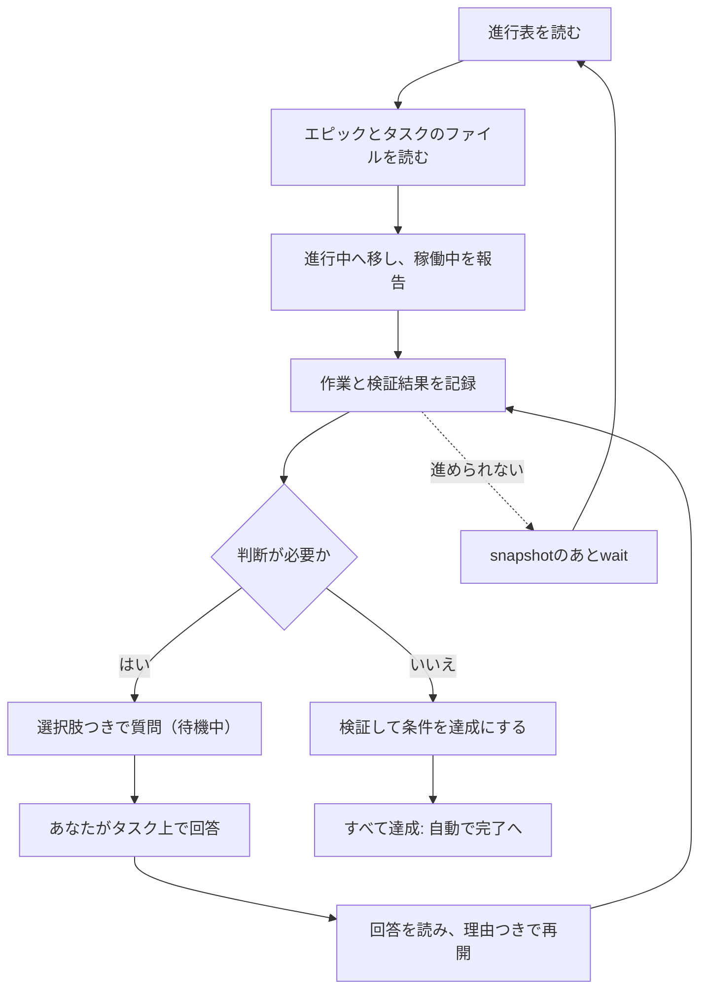

# エージェントとの連携

エージェントは、あなたと同じボードで作業します。Hookから進行表を受け取り、タスクを選んで進捗を報告します。ユーザーの判断が必要になったら質問し、回答を待ちます。このページでは、連携の設定方法と作業の流れを説明します。[クイックスタート](../quickstart)では、同じ流れをコマンドで体験できます。

## エージェントをつなぐ

連携には、次の三つをそれぞれ手動で設定します。

1. **共有フォルダを準備する。** エージェントがそこへ書けるよう、`agboard setup`を一度実行します。CodexとClaude Codeのユーザー設定にデータフォルダを加えるだけで、Hookもスキルもインストールしません。[共有フォルダをセットアップする](../operations/data#共有フォルダをセットアップする)を参照してください。
2. **Hookを登録する。** エージェントに進行表を渡すHookです。
3. **エージェントのスキルを入れる。** ボードを使った作業手順を定める`agent-board`スキルです。

Hookの設定テンプレートはリポジトリの`integrations/`フォルダにあります。設定の詳細は、[Claude CodeとCodexの連携ガイド](https://github.com/FooQoo/agent-board/blob/main/integrations/README.md)に従ってください。

- **Claude Code。** `integrations/claude-code/settings.json`をプロジェクトの`.claude/settings.json`に統合し、`/hooks`で確認します。
- **Codex CLIとCodex App。** `integrations/codex/hooks.json`をプロジェクトの`.codex/hooks.json`に統合し、`/hooks`で確認します。

Hookがどのプロジェクトのものか分かるよう、プロジェクトのフォルダを`agboard project create`か`agboard project bind`で登録します。

HookとエージェントのスキルはPATHの`agboard`を実行するので、開発中のビルドではなく、インストールした版を使います。[インストールと起動](../getting-started#更新する)を参照してください。

### Hookが行うこと

- **フォルダの解決。** Hookのコマンドは固定の`agboard hook --agent claude`で、プロジェクト名もセッションIDもありません。入力の`cwd`を読み、最も近い登録済みの祖先フォルダを使います。明示した`--project NAME`は紐付けより優先されます。紐付けがない、または壊れているときは`AGBOARD_ERROR`を返し、Hookが別のプロジェクトを推測することはありません。
- **進行表。** Hookは、`agboard progress`と同じ簡潔な表を渡します。完了・アーカイブ済み・待機中のタスクは含みません。表が256 KiBを超える、または読めないときは、エージェントに`AGBOARD_ERROR`が渡され、ボードに依存する変更をしてはいけません。

### エージェントが編集してよいもの

- エージェントが編集してよいのは、プロジェクトの`README.md`が許す範囲で、下書きでないタスクの`TASK.md`と、エピックの`EPIC.md`だけです。
- `task.json`はメタデータを持ち、CLIで変更します。`TASK.md`は本文・受入条件・履歴を持ちます。
- タスクの操作は履歴を自動で追加します。エージェントは意味のある進捗を`history add`で記録し、計画と簡潔な検証結果は本文に置きます。
- エージェントは、`epic.json`や`project.json`を編集せず、タスクやエピックのフォルダを削除せず、共有ファイルにマシン固有の絶対パスを書きません。

形式は[Markdownファイルの形式](./file-format)にあります。

AIは履歴をタスク本文と同じ言語で記録します。ブラウザー操作で自動生成する履歴は、選択した画面言語を使います。CLI操作と自動完了では、本文に日本語の文字があれば日本語、それ以外は英語にし、本文が空か標準テンプレートならタイトルを使います。保存済みの履歴や入力した理由は変わりません。

## 作業の流れ



1. **選ぶ。** `agboard progress --json`を読み、エピックに保存されたタスクの順序に従って、進められるAI担当のタスクを選びます。選んだエピックの`EPIC.md`とタスクの`TASK.md`だけを読み、履歴や未回答の質問が必要なときは`show`を使います。
2. **始める。** タスクを理由つきで進行中に移し、稼働中を報告します。ユーザー担当のタスクは、作業に関わるときだけ確認します。
3. **作業して記録する。** 実際の作業と検証に基づく簡潔な理由で、意味のある進捗を`history add`で記録します。計画と簡潔な結果は本文に置き、見た目の確認が有用な場合は画像を添付します。移動や状態の変更はすでに履歴を追加するので、重複させません。
4. **詰まったら尋ねる。** 判断が必要なときは、待機中で質問します（[判断依頼](../use/decisions)を参照）。
5. **再開する。** 回答のあと、タスクと履歴を読み、計画を考え直して、理由つきで再開します。
6. **終える。** 受入条件は、検証が済んでから達成にします。条件がすべて達成になると、対象のAI担当タスクは自動で完了に移ります。
7. **待つ。** 進められる作業がないときは、変更を待ちます（下を参照）。

進行表は[エピックと進行表](../use/epics)を参照してください。

AIは編集できるAI担当タスクを読んだあと、タイトルが分かりにくければ、着手前に対象と変更内容が伝わる短いタイトルへ整理します。元の依頼文と添付画像は保持し、すでに分かりやすいタイトルは変えません。組手を含むAIセッション内の動作で、フォームでの登録時には依頼の最初の空でない行をタイトルにします。完了済みのタスクをAIが改名することはありません。

エージェントは、確認・希望・承認など作業に関する質問をボード上でのみ行います。選択肢を付け、標準で回答を待ちます（`"wait": {}`）。チャットでは、ボードに質問があることだけを案内します。ボードに接続できないときは問題を報告し、質問できるようになるまで待ちます。

## 変更を待つ

```sh
agboard --project "My project" snapshot --json
agboard --project "My project" wait --after "<cursor>" --json
```

cursorの形式は`f1:<project-id>:<version>`です。`snapshot`が返す値を使い、自分で組み立てないでください。

- `wait`は、同じデータ領域で動いている`agboard serve`を必要とし、ポーリングせずに変更を待ちます。
- 名前変更をまたいで同じプロジェクトを追うので、以後のコマンドとHookでは新しい名前を使います。ほかのプロジェクトの変更では終わりません。プロジェクトが削除されると、`project_not_found`で失敗します。
- `wait_timeout`・`board_unavailable`・`cursor_invalid`・`project_not_found`はエラーで、回答ではありません。
- `wait`が返ったら、スナップショットと履歴をすべて読み、ユーザーの理由を考慮して、再開するか、追加の質問をします。

## 次のタスクを待つ

起動済みのCodexまたはClaude Codeのセッションを一つ使い、同じプロジェクトのAI担当タスクを順番に進められます。同じデータ領域で`agboard serve`を起動してから、明示的にリッスンを始め、対象がない状態が何秒続いたらコマンドを終えるか指定します。

```sh
agboard --project "My project" wait --until task --idle-timeout 300 --json
```

待機秒数は必須で、1〜86,400秒を指定します。既定値はありません。Todoにある起票済みタスクに加え、`agentStatus`が`idle`のままDoingにあるAIタスクも対象です。リッスンの開始・再開時にAIタスクの`agentStatus`を確認し、`running`または`pending`があれば、その作業を先に解決します。レーンがDoingであることだけではリッスンを止めません。一回の呼び出しで取得するのは一件です。そのタスクの作業を終えるか中断したあと、同じセッションで`wait`をもう一度呼び出して次へ進みます。対象の順序は進行表と同じで、エピックID順に、各エピックの保存済み優先順とタスクID、最後に未所属タスクのID順です。AI担当・TodoまたはDoing・Idle・下書きでない・アーカイブされていないタスクだけが対象です。タスクの取得は内容変更や占有を行いません。作業が承認され、開始できることを判断する前に、エピックの`EPIC.md`（ある場合）・本文・添付・最新状態を確認してください。従来どおり手動でタスクを作成でき、作成したタスクも後から取得されます。

Pendingへの判断依頼を含む全体の手順と、中断後の復帰方法は[agent-boardスキルのリッスン手順](https://github.com/FooQoo/agent-board/blob/main/.agents/skills/agent-board/references/listening.md)を参照してください。Pendingのタスクは回答が届くまで同じセッションで待ち、別のタスクへ飛びません。Pending中の時間は対象なし時間に含まれません。回答後は内容を読み、そのタスクを再開してから次のタスクを待ちます。

`idle_timeout`は終了コード0の正常終了です。指定した時間に対象タスクがなかったことだけを示します。サーバー切断、不正なボードデータ、プロジェクト削除、引数の誤りはエラーであり、対象なしとして報告してはいけません。出力とエラーコードは[CLIリファレンス](./cli#変更またはタスクを待つ)を参照してください。

## 下書きとエラー

下書き（`isDraft: true`）はエージェントから読み取り専用です。`edit`・`mv`・`state`は`task_is_draft`で失敗します。ユーザーが確定するまで、ほかのタスクを進めます。

`AGBOARD_ERROR`が出た場合や、プロジェクトが見つからない・接続できない・ボードを読み込めない場合は、その問題を報告します。有効な進行表を取得できるまで、ボードの情報に依存する変更は行いません。待機が時間切れになったり中断されたりしても、質問は未回答のまま残ります。原因と対処は[トラブルシューティング](../operations/troubleshooting)を参照してください。

## 次に読む

- [CLIリファレンス](./cli): エージェントが使うすべてのコマンド。
- [判断依頼](../use/decisions): エージェントの尋ね方と、あなたの答え方。
