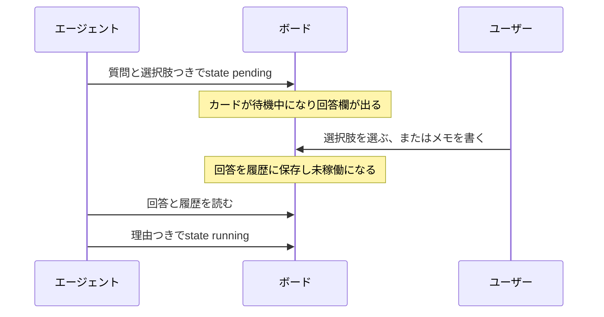

# 判断依頼

## ブラウザで回答する

未着手と進行中のカードに現在の待機中の依頼があると、カード上に質問と回答欄が表示されます。提示された選択肢を選ぶか、メモを書くか、その両方を行って回答を送信します。PCのボードでは、回答欄を使っている間も、カードの見出しから詳細を開け、カードをドラッグできます。カードを完了へ移すと、回答欄の入力は消えます。回答は記録され、エージェントの状態は現在の列で未稼働になります。エージェントは回答を読んでから、どう再開するかを決めます。

{.screenshot}

カードには、質問、選択肢、メモを書く欄が表示されます。回答は履歴に保存されます。

待機中の質問に期限はありません。回答されるか、依頼が取り下げられるか変更されるまで残ります。CLIの`wait.timeoutSeconds`は、その待機コマンドだけを制限し、質問を失効させません。

## スマホで回答する

モバイルモニターでは、カードをタップすると、本文・受け入れ条件・履歴・エピックのドロワーが開きます。横にスワイプするとタブを切り替えられます。スマホの接続は[モバイルモニター](./mobile-monitor)を参照してください。

{.screenshot .screenshot--narrow}

## 判断依頼の出し方と答え方



AIが担当するカードは、稼働中になるには進行中にある必要があります。待機中の質問は、未着手でも進行中でも出せます。ユーザーへの質問には必ず選択肢があります。質問と2〜10個の選択肢をJSONにして`--request-json`に渡します。コマンドラインに直接書くか、`-`で標準入力から読み込みます。

```json
{
  "question": "Which launch approach should we use?",
  "choices": [
    { "id": "preview", "label": "Publish a preview first" },
    { "id": "public", "label": "Launch publicly" }
  ]
}
```

コマンドラインに直接書く場合:

```sh
agboard --project "My project" state 1 pending --actor ai --request-json '{"question":"Which launch approach should we use?","choices":[{"id":"preview","label":"Publish a preview first"},{"id":"public","label":"Launch publicly"}]}'
```

標準入力から読み込む場合:

```sh
cat question.json | agboard --project "My project" state 1 pending --actor ai --request-json -
```

JSONに`wait`オブジェクトを加えると、質問と回答待ちを1つのコマンドで行えます。`agboard serve`が起動している必要があります。空のオブジェクトは無期限に待ち、依頼に回答があると、その回答(選択肢、メモ、カード)を出力します。

```json
{
  "question": "Which launch approach should we use?",
  "choices": [
    { "id": "preview", "label": "Publish a preview first" },
    { "id": "public", "label": "Launch publicly" }
  ],
  "wait": {}
}
```

この待機コマンドを制限するには`"timeoutSeconds": 600`を加えます。値は1〜86,400(1日)です。`wait`がなければ、コマンドは質問して戻ります。タイムアウトやCtrl+Cは待機を止めますが、依頼は待機中のまま残ります。サーバーとの接続が切れると、技術的なエラー`board_unavailable`を返し、依頼は待機中のまま残ります。カードの移動で質問が取り下げられると、コマンドは`request_changed`で終了します。サーバーが起動していなければ、何も質問されません。

`choices`は2〜10個です。それより少ない、または多い依頼は拒否され、`--request-json`のない待機中への変更も拒否されます。依頼にはIDが付き、現在の依頼は`show`か`snapshot`で読めます。ユーザーはブラウザで回答するか、その依頼IDをCLIに渡して回答できます。

```sh
agboard --project "My project" state 1 idle --actor human --request "<request-id>" --choice preview --reason "Get feedback before the public launch"
```

ユーザーは、選択肢、`--reason`によるメモ、またはその両方を渡せます。エージェントは回答と履歴をすべて読んでから再開できます。

```sh
agboard --project "My project" state 1 running --actor ai --reason "Preparing the preview requested by the user"
```
