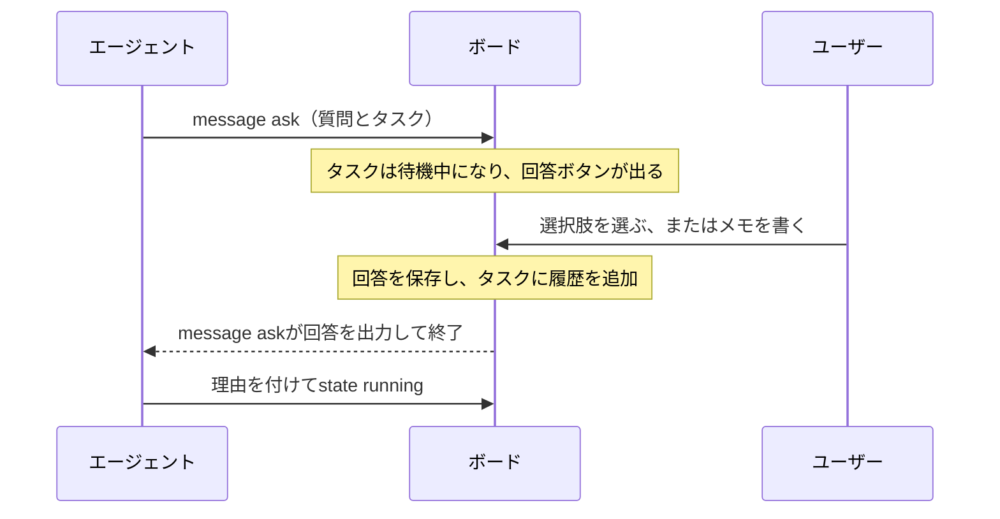

# 判断依頼

判断依頼は、エージェントがユーザーの判断を必要とするときに出す質問です。聞かれたら答える場所で、エージェントは止まって待ち、あなたの回答で作業を再開します。このページでは、PCやスマホから回答する方法と、エージェント側の質問の出し方を説明します。概要は[仕事のモデル](../work-model#decisions)を参照してください。聞かれなくても介入したいときは、[ボード](../watch/board)を参照してください。

## 質問に気づくには

質問はプロジェクトに属し、タスクはその質問を参照します。未回答の質問を参照しているAI担当のタスクは**待機中**です。未着手や進行中のタスクでは、カードに「未回答の質問 2 件」のように待っている質問の数と、**質問に回答する**ボタンが表示されます。回答したものの送っていない場合は、ボタンの表示が**回答を続ける**に変わります。待機中のタスクは[リモートアクセス](../watch/remote-access)でも見られます。

プロジェクトの未回答の質問は、レーンの上にある**未回答の質問**の帯にも並びます。帯は常に表示され、最初は閉じています。見出しにはタイトルと未回答の質問の件数が出て、**まとめて答える**（回答を保持しているときは**続きから答える**と**確認して送る**）のボタンも見出しに残ります。見出しか矢印を選ぶと一覧が開き、もう一度選ぶと閉じます。帯は開閉の状態を覚えないので、ページを読み込み直すと閉じた状態に戻ります。

開いた一覧の各項目には、その質問を参照しているタスク（なければ「タスクなし」）と、2行までの質問のタイトルが表示されます。回答して送っていない項目には「回答済み・未送信」の印が付きます。項目が収まらないときは、開いている間に出る矢印ボタンで帯を横にスクロールします。質問がないときは、見出しの件数が0になり、開くものはありません。

## ブラウザで回答する

帯からの答え方は2通りあります。

- **質問を1つずつ答える。** 開いた一覧の項目を選びます。ダイアログにはその質問だけが表示され、**送る**を選ぶと確認のステップを経ずにすぐ送られます。ほかの質問は未回答のまま残ります。
- **すべての質問に順に答える。** 帯の見出しにある**まとめて答える**を選ぶと、開いているすべての質問を順に回り、最後にまとめて送ります。**まとめて送る**を選ぶまでは何も送られず、待っているエージェントも動きません。

1つのタスクの質問だけに答えてすぐ送るときは、カードから始めます（[カードから回答する](#カードから回答する)を参照）。

すべての質問に順に答えるときは、次の手順です。

1. 帯の**まとめて答える**を選びます。まだ答えていない最初の質問からダイアログが開きます。答えた質問があると、ボタンの表示は**続きから答える**に変わります。**確認して送る**を選ぶと、確認のステップから開きます。
2. 左の質問を読み、右の欄で答えます。選択肢を選ぶか、メモを入力するか、両方を入力します。ヘッダーには、タスクと「2 / 5」のような位置が表示されます。複数のタスクにかかる質問では、先頭のタスクだけの名前ではなく、タスクのIDと「3 件のタスク」が表示されます。
3. **次へ**で次の質問に、**前へ**で前の質問に移ります。ヘッダーの下のステップで、どの質問に答えたかがわかります。ステップを選ぶと、その質問に移ります。
4. 最後の質問の次は、**確認して送る**のステップです。すべての質問と答えが一覧で表示されます。**変更**で答えを直し、飛ばした質問は**答える**で答えます。
5. **まとめて送る**を選びます。答えた質問の回答がまとめて送られ、飛ばした質問は未回答のまま残ります。

ウィンドウの幅が900pxより狭いときは、質問と回答を縦に一列に並べます。

{.screenshot}

回答は、その質問を参照しているすべてのタスクの履歴に保存されます。履歴では、質問と回答の各部分が別々のブロックとして表示されます。回答してもタスクの列は変わりません。タスクの質問がすべて回答されると、エージェントの状態が未稼働に戻ります。エージェントは、あなたの返事を読んでから、どう再開するかを決めます。

- **閉じる**は、いつでも閉じるボタン、Escキー、ダイアログの外側のクリックで行えます。確認は出ず、答えは残ります。続けるときは、帯かカードからもう一度開くか、帯の**確認して送る**を選びます。
- 送っていない答えがある間は、別のプロジェクトに切り替えられません。先に送るか、**入力をクリア**で消してください。
- 答えは、ページを開いている間は残ります。ページを再読み込みすると消えます。
- 質問に有効期限はありません。回答されるか、エージェントが取り下げるまで、未回答のまま残ります。タスクを移動しても、アーカイブしても、質問は取り下げられません。

### カードから回答する

カードの**質問に回答する**を選ぶと、そのタスクが待っている質問だけが開きます。確認のステップはありません。最後の質問で**送る**を選ぶと、そのタスクの質問への答えがすぐに送られます。

タスクが複数の質問を待っているときは、**次へ**で順に答えてから送ります。ほかのタスクの質問に入力した答えは送られず、帯には引き続き**確認して送る**が表示されます。

### ほかの場所で回答された、または取り下げられたとき

答えている間に、質問がチャットなど別の場所で回答されることがあります。また、エージェントは不要になった質問を取り下げることがあります。そのときは、ダイアログがその質問に印を付けます。

- その質問のステップには、「この質問は取り下げられました。回答は送れません。」などと表示されます。質問と入力は読めますが、変更はできません。
- 確認のステップでは、その答えに送れないことを示す印が付き、**消す**で取り除けます。**まとめて送る**は、ほかの答えだけを送ります。

ダイアログを開いている間にエージェントが新しく質問すると、その質問はステップの最後に加わります。

### 送信に失敗したとき

答えは残り、「保存できませんでした。もう一度お試しください。」と表示されます。**再試行**を選んでください。その間にほかの場所で回答または取り下げられた質問があると、何も送られません。その質問に印が付くので、もう一度送ると残りの答えを送れます。

## スマホで回答する

リモートアクセスでは、レーンのタブの上に同じ**未回答の質問**の帯があり、待機中のタスクには同じ**質問に回答する**ボタンが表示されます。帯の動きはPCと同じで、最初は閉じていて、見出しに件数が出て、見出しを選ぶと開閉します。帯のボタンは1つで、**まとめて答える**、送っていない答えがある間は**確認して送る**です。このボタンは見出しに残ります。開いた一覧の項目を選ぶと、その質問だけのシートが開き、**送る**を選ぶとすぐ送られます。質問がないときは、見出しの件数が0になり、開くことはできません。

回答のシートは画面の下から開きます。タスクと「2 / 5」のような位置、質問、回答の欄の順に並び、ドットで進み具合がわかります。**前へ**と**次へ**はシートの下に固定されるので、スクロールしても届く位置にあります。最後の質問の次は確認の画面で、**まとめて送る**で送ります。タスクの**質問に回答する**ボタンから開いたときは、そのタスクの質問だけが表示され、最後の質問で**送る**を選ぶと確認の画面を経ずに送られます。帯の項目から開いたときも、その1つの質問について同じ動きです。

{.screenshot .screenshot--narrow}

タスク自体をタップすると、本文・受入条件・履歴・エピックのドロワーが開きます。左右にスワイプしてタブを切り替えます。スマホの接続は[リモートアクセス](../watch/remote-access)を参照してください。

送っていない答えがあるままシートを閉じ、その後に質問がほかの場所で回答されたり取り下げられたりすると、確認の画面にその答えが送れないものとして残ります。**消す**で取り除けます。

## チャットで回答する

エージェントと会話をしている間は、同じ質問が選択肢とおすすめ付きの文章としてチャットにも出ます。チャットに自分の言葉で答えるか、選択肢のidやラベルを伝えてください。エージェントがその答えを`message answer --via chat`でボードに記録し、履歴にはチャットで受けた回答であることが残ります。先に記録された回答が採られます。ボードにすでに違う回答があれば、エージェントはどちらが記録されたかを伝え、その回答で続けます。もう一方の場所で同じ質問を尋ね直すことはありません。エージェントの待ち方は[質問](./agents#質問)を参照してください。

## エージェントから質問する

ここは、エージェントを作る人や設定する人向けの説明です。やり取りは次のとおりです。



エージェントは`message ask`で質問します。質問は1件ずつ、プロジェクトの中で連番の`Q-12`のようなIDを持つメッセージとして保存されます。1回のコマンドで最大20件の質問を出し、未回答の質問がなくなるまで待ちます。`--task`を付けると、そのコマンドのすべての質問をタスクが参照します。複数のタスクに参照させるときは繰り返します。質問は`--questions-json`にJSONで渡します。直接書くか、`-`で標準入力から読みます。

```json
{
  "questions": [
    {
      "body": "公開の進め方はどれにしますか？",
      "choices": [
        { "id": "preview", "label": "まずプレビューを公開する" },
        { "id": "public", "label": "そのまま公開する" }
      ],
      "recommendedChoiceId": "preview"
    }
  ]
}
```

```sh
cat question.json | agboard --project "My project" message ask --actor ai --task 1 --questions-json - --json
```

- `questions`は1〜20件です。
- `body`はMarkdownで書け、1〜5,000文字です。タスク本文と同じ部品で表示されるので、見出し、リスト、コード、リンク、同じタスクに添付した画像が本文と同じように表示されます。`http`か`https`のURLの画像も表示されます。
- `choices`は任意で、2〜10件です。`id`は英数字と`_`、`-`による1〜64文字、`label`は1〜200文字です。選択肢のない質問には、文章で回答します。
- `recommendedChoiceId`は任意で、エージェントがおすすめする選択肢を示します。
- 質問ごとに`"tasks": [421, 422]`のように書くと、その質問だけを指定したタスクに参照させます。

回答のメモは2,000文字までです。質問に選択肢がないときは、メモが必須です。

対象のタスクはAI担当で、未着手か進行中でなければなりません。待っている間は、稼働中にできません。タスクを別の列に移したりアーカイブしたりしても、質問は取り下げられません。

### コマンドの出力

`--json`を付けると、1行に1つのJSONオブジェクトを出力します。付けないときは、同じ内容を短い文で出力します。

| イベント | 意味 | 終了コード |
| --- | --- | --- |
| `registered` | 質問を保存した。質問IDを含む。 | — |
| `waiting` | まだ未回答の質問がある。60秒ごとに出力する（`--heartbeat`で10〜600秒を指定できる）。 | — |
| `answered` | 全問の回答が揃った。すべての回答を含む。 | 0 |
| `timeout` | 待機時間が終わった。質問は未回答のまま残る。 | 5 |
| `withdrawn` | 未回答の質問がなくなり、取り下げられた質問があった。取り下げられたIDと、付いた回答を含む。 | 6 |
| `error` | 質問を保存したあと、サーバーが止まったなどの理由で待機に失敗した。質問は未回答のまま残る。 | 1 |

待機は既定で600秒です。`--timeout`には1〜86,400秒、または上限なしで待つ`none`を指定できます。待機にはサーバーが必要です。CLIは何かを保存する前にサーバーを確認し、動いていなければバックグラウンドで起動します。起動できないときは何も保存せず、`board_unavailable`で失敗します。`--no-wait`は、質問を保存して`registered`を出力し、サーバーなしですぐに戻ります。

タイムアウトやエラーのあとにもう一度待つときは、質問IDを渡します。質問を再び出すことはありません。

```sh
agboard --project "My project" message wait Q-12 Q-13 --json
```

### 質問を読む・取り下げる・参照する

```sh
agboard --project "My project" message ls --json
agboard --project "My project" message show Q-12 --json
agboard --project "My project" message withdraw Q-12 --actor ai
agboard --project "My project" message link Q-12 --task 3
agboard --project "My project" message unlink Q-12 --task 3
```

- `message ls`は、未対応のメッセージ（質問と依頼）を一覧にします。`--status closed`は回答済みの質問と受け付け済みの依頼、`--status withdrawn`は取り下げられたもの、`--status all`はすべてを出します。`--type question`か`--type request`で片方に絞れ、`--task`を付けると、そのタスクが参照する質問に絞ります。
- `message show`は、メッセージを全文で表示します。質問なら、選択肢、回答、参照しているタスクも出します。
- `message withdraw`は、まだ回答のない質問を取り下げます。質問を取り下げられるのはエージェントだけです（`--actor ai`）。待っている`message ask`は、未回答の質問がなくなると`withdrawn`で終わります。回答のある質問は取り下げられません。
- `message link`と`message unlink`は、タスクに質問を加えたり外したりします。タスクの`TASK.md`にある`questions`の一覧と、質問側の`tasks`が一緒に変わります。

### コマンドラインで回答する

人はCLIからも、質問IDを指定して回答できます。1回のコマンドで答えられる質問は1件です。

```sh
agboard --project "My project" message answer Q-12 --actor human --via cli --choice preview --text "公開前にフィードバックをもらいたい"
```

選択肢のある質問には`--choice`が、ない質問にはメモが必要です。メモは`--text`か`--text-file`で渡します。ユーザーがチャットで答えたときは、エージェントがその言葉を`--via chat`で記録します。最初に記録された回答が確定します。回答済みの質問に答えようとすると`question_answered`で失敗し、記録済みの回答が表示されます。

回答と履歴を読んだエージェントは、再開します。

```sh
agboard --project "My project" state 1 running --actor ai --reason "ユーザーに頼まれたプレビューを準備する"
```

## 依頼

依頼は、質問とは逆向きのメッセージです。人がエージェントに向けて書きます。質問と同じ連番の`Q-13`のようなIDで保存され、`message ls --type request`で一覧にできます。

```sh
agboard --project "My project" message send --actor human --text "ガイドにWindowsの節を足して" --image ./sketch.png
agboard --project "My project" message accept Q-13 --actor ai --by "<agent-id>"
agboard --project "My project" message withdraw Q-13 --actor human
```

- `message send`は、`--text`か`--text-file`で1〜20,000文字の依頼を記録します。`--image`を繰り返すと画像を添付できます。
- `message accept`は、未対応の依頼を、`--by`で指定したエージェントが受け付けたものとして記録します。受け付けられるのはエージェントだけで、1回だけです。
- 依頼を取り下げられるのは人だけで、未対応のあいだに限ります。受け付け済みの依頼は取り下げられません。

## 次に読む

- [エージェントとの連携](./agents): 質問と回答待ちを含む、作業全体の流れ。
- [トラブルシューティング](../operations/troubleshooting): 回答が拒否される、質問が消えた。
