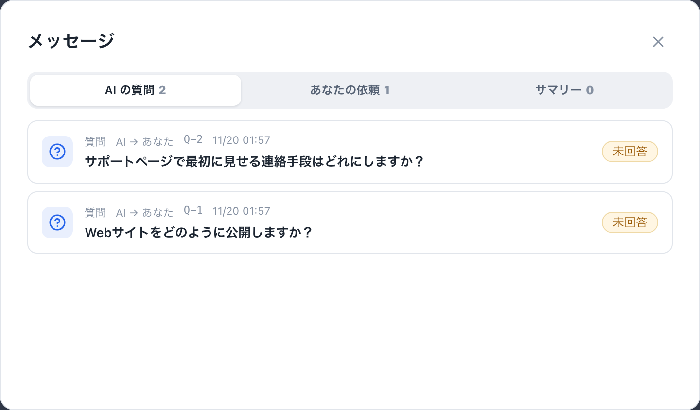
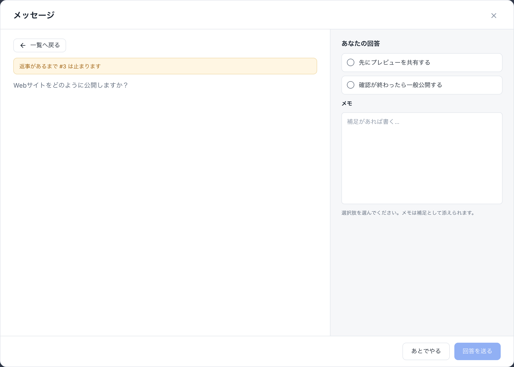
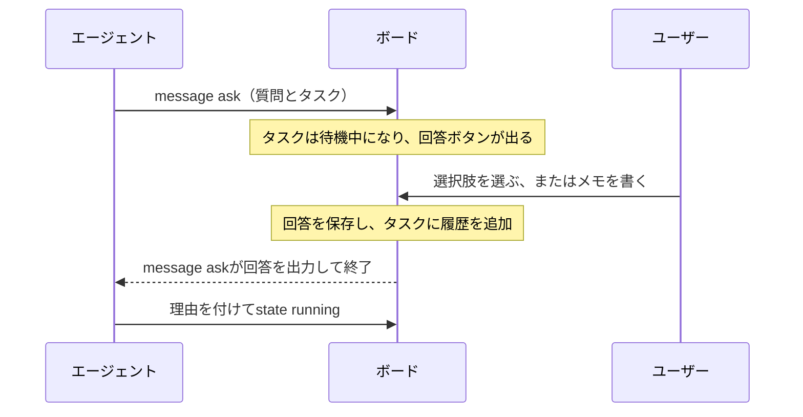

# 判断依頼

判断依頼は、エージェントがユーザーの判断を必要とするときに出す質問です。聞かれたら答える場所で、エージェントは止まって待ち、あなたの回答で作業を再開します。このページでは、PCやスマホから回答する方法と、エージェント側の質問の出し方を説明します。概要は[仕事のモデル](../work-model#decisions)を参照してください。聞かれなくても介入したいときは、[ボード](../watch/board)を参照してください。

## 質問に気づくには

質問はプロジェクトに属し、タスクはその質問を参照します。未回答の質問を参照しているAI担当のタスクは**待機中**です。未着手や進行中のタスクでは、カードに「未回答の質問 2 件」のように待っている質問の数と、**質問に回答する**ボタンが表示されます。待機中のタスクは[リモートアクセス](../watch/remote-access)でも見られます。

プロジェクトの未回答のメッセージは、レーンの上にある**メッセージ**の帯に数として表示されます。帯は常に表示され、2つの数が並びます。

- **AI の質問**は、あなたの回答を待っている質問の数です。
- **あなたの依頼**は、あなたが送った依頼のうち、どのエージェントもまだ受け取っていないものの数です。「（受け取り待ち）」と表示されます。

件数を選ぶと、そのタブで一覧が開きます。**AI の質問**は質問のタブ、**あなたの依頼**は依頼のタブです。何も開いていないときは、数が0になります。**一覧を開く**を選ぶと、**AI の質問**のタブでメッセージを読めます。

## メッセージの一覧

**一覧を開く**を選ぶと、PCではモーダルで一覧が開きます。**AI の質問**と**あなたの依頼**の2つのタブがあり、それぞれ件数が付きます。各行には、種類（質問・依頼）、向き、ID、時刻、最初の1行が表示され、右側に状態が付きます。

| 状態 | 意味 |
| --- | --- |
| **未回答** | あなたの回答を待っている質問です。 |
| **回答済み・AI の受け取り待ち** | あなたが回答した質問のうち、どのエージェントもまだ回答を受け取っていないものです。あなたを待っているものとしては数えません。 |
| **受け取り待ち** | あなたが送った依頼のうち、どのエージェントもまだ受け取っていないものです。 |

一覧には、まだ終わっていないメッセージが出ます。回答した質問は、エージェントが回答を受け取るまで**回答済み・AI の受け取り待ち**として一覧に残り、受け取られると消えます。エージェントが受け取った依頼と、取り下げたメッセージも一覧から消えます。

{.screenshot}

質問か依頼を選ぶと、一覧の代わりにその内容が開きます。回答済みで受け取り待ちの質問は、質問と**あなたの回答**を読み取り専用で表示し、「AI があなたの回答を受け取ると、この質問は一覧から消えます。」という注記が付きます。**一覧へ戻る**で一覧に戻ります。カードから直接開いた質問は一覧を経ていないので、このボタンは出ません。

## ブラウザで回答する

一覧で質問を選ぶか、カードの**質問に回答する**を選ぶと、そのタスクが待っている最初の質問で一覧が開きます。質問は、左右2列の広いモーダルで開きます。

- 左には質問が、タスクの本文と同じ形式で表示されます。質問を待っているタスクがあるときは、その上に「返事があるまで #21 #22 は止まります」のような注意が出ます。
- 右はあなたの回答です。選択肢を1つ選び、必要ならメモを添えます。

**あとでやる**と**回答を送る**は下に固定されるので、質問が長くても届く位置にあります。**回答を送る**を選ぶと、答えがすぐ送られて一覧に戻ります。**あとでやる**は何も送らずに一覧を閉じます。閉じるボタン、Escキー、モーダルの外側のクリックでも閉じられ、確認は出ません。

選択肢がある質問では、選択肢を選ぶ必要があります。メモだけでは送れず、選ぶまで**回答を送る**は押せません。メモは選択肢に添える補足になります。選択肢がない質問では、メモが必要です。メモは2,000文字までです。回答は1つの質問ごとに送られ、確認のステップや、ページに残る送信前の答えはありません。

ウィンドウの幅が900pxより狭いときは、質問と回答を縦に一列に並べます。

{.screenshot}

回答は、その質問を参照しているすべてのタスクの履歴に保存されます。履歴では、質問と回答の各部分が別々のブロックとして表示されます。回答してもタスクの列は変わりません。タスクの質問がすべて回答されると、エージェントの状態が未稼働に戻ります。エージェントは、あなたの返事を読んでから、どう再開するかを決めます。

質問に有効期限はありません。回答されるか、エージェントが取り下げるまで、未回答のまま残ります。タスクを移動しても、アーカイブしても、質問は取り下げられません。

### ほかの場所で回答された、または取り下げられたとき

答えている間に、質問がチャットなど別の場所で回答されることがあります。また、エージェントは不要になった質問を取り下げることがあります。そのような質問は一覧から消え、答えを書いていた質問は一覧に戻ります。回答済みまたは取り下げ済みの質問に答えを送ると、何も保存されず、「この質問はほかの場所で回答されたか、取り下げられました。」と表示されます。

### 送信に失敗したとき

選んだ選択肢とメモは残り、「送れませんでした。もう一度試してください。」と表示されます。もう一度**回答を送る**を選んでください。

## あなたの依頼

**AI に依頼**で送った依頼は、エージェントが受け取るまで、**あなたの依頼**のタブに**受け取り待ち**として表示されます。開くと、送った内容と画像を読めます。待っている間は、**取り下げる**で取り戻せます。取り下げた依頼は一覧から消えます。エージェントが受け取ると一覧から消え、取り下げることはできなくなります。

## スマホで回答する

リモートアクセスでは、レーンのタブの上に同じ**メッセージ**の帯があり、待機中のタスクには同じ**質問に回答する**ボタンが表示されます。帯の数もPCと同じです。**一覧を開く**を選ぶと、画面の下から開くシートで一覧が表示されます。スマホから依頼を送れるときは、その隣に**AI に依頼**が並びます。

シートの動きはモーダルと同じで、タブと行も同じです。一覧は左右にスワイプして**AI の質問**と**あなたの依頼**を切り替えることもでき、選択中のタブは指に合わせて動きます。一覧のスクロール、行のタップ、シートを下に引いて閉じる操作はこれまでどおりです。質問を開くと、質問の下に回答が積み重なって表示されます。シートはスクロールし、**あとでやる**と**回答を送る**は下に固定されるので、親指が届く位置にあります。タスクの**質問に回答する**ボタンから開いたときは、そのタスクの最初の質問でシートが開きます。

{.screenshot .screenshot--narrow}

タスク自体をタップすると、本文・完了条件・履歴・エピックのドロワーが開きます。左右にスワイプしてタブを切り替えます。スマホの接続は[リモートアクセス](../watch/remote-access)を参照してください。

## チャットで回答する

エージェントと会話をしている間は、同じ質問が選択肢とおすすめ付きの文章としてチャットにも出ます。チャットに自分の言葉で答えるか、選択肢のidやラベルを伝えてください。エージェントがその答えを`message answer --via chat`でボードに記録し、履歴にはチャットで受けた回答であることが残ります。先に記録された回答が採られます。ボードにすでに違う回答があれば、エージェントはどちらが記録されたかを伝え、その回答で続けます。もう一方の場所で同じ質問を尋ね直すことはありません。エージェントの待ち方は[質問](./agents#質問)を参照してください。

## エージェントから質問する

ここは、エージェントを作る人や設定する人向けの説明です。やり取りは次のとおりです。



エージェントは`message ask`で質問します。質問は1件ずつ、プロジェクトの中で連番の`Q-12`のようなIDを持つメッセージとして保存されます。1回のコマンドで最大20件の質問を出し、未回答の質問がなくなるまで待ちます。`--task`を付けると、そのコマンドのすべての質問をタスクが参照します。複数のタスクに参照させるときは繰り返します。質問は`--questions-json`にJSONで渡します。直接書くか、`-`で標準入力から読みます。

```json
{
  "questions": [
    {
      "body": "公開の進め方はどれにしますか？",
      "choices": [
        { "id": "preview", "label": "まずプレビューを公開する" },
        { "id": "public", "label": "そのまま公開する" }
      ],
      "recommendedChoiceId": "preview"
    }
  ]
}
```

```sh
cat question.json | agboard --project "My project" message ask --actor ai --task 1 --questions-json - --json
```

- `questions`は1〜20件です。
- `body`はMarkdownで書け、1〜5,000文字です。タスク本文と同じ部品で表示されるので、見出し、リスト、コード、リンク、同じタスクに添付した画像が本文と同じように表示されます。`http`か`https`のURLの画像も表示されます。
- `choices`は任意で、2〜10件です。`id`は英数字と`_`、`-`による1〜64文字、`label`は1〜200文字です。選択肢のない質問には、文章で回答します。
- `recommendedChoiceId`は任意で、エージェントがおすすめする選択肢を示します。
- 質問ごとに`"tasks": [421, 422]`のように書くと、その質問だけを指定したタスクに参照させます。

回答のメモは2,000文字までです。質問に選択肢がないときは、メモが必須です。

対象のタスクはAI担当で、未着手か進行中でなければなりません。待っている間は、稼働中にできません。タスクを別の列に移したりアーカイブしたりしても、質問は取り下げられません。

### コマンドの出力

`--json`を付けると、1行に1つのJSONオブジェクトを出力します。付けないときは、同じ内容を短い文で出力します。

| イベント | 意味 | 終了コード |
| --- | --- | --- |
| `registered` | 質問を保存した。質問IDを含む。 | — |
| `waiting` | まだ未回答の質問がある。60秒ごとに出力する（`--heartbeat`で10〜600秒を指定できる）。 | — |
| `answered` | 全問の回答が揃った。すべての回答を含む。 | 0 |
| `timeout` | 待機時間が終わった。質問は未回答のまま残る。 | 5 |
| `withdrawn` | 未回答の質問がなくなり、取り下げられた質問があった。取り下げられたIDと、付いた回答を含む。 | 6 |
| `error` | 質問を保存したあと、サーバーが止まったなどの理由で待機に失敗した。質問は未回答のまま残る。 | 1 |

待機は既定で600秒です。`--timeout`には1〜86,400秒、または上限なしで待つ`none`を指定できます。待機にはサーバーが必要です。CLIは何かを保存する前にサーバーを確認し、動いていなければバックグラウンドで起動します。起動できないときは何も保存せず、`board_unavailable`で失敗します。`--no-wait`は、質問を保存して`registered`を出力し、サーバーなしですぐに戻ります。

タイムアウトやエラーのあとにもう一度待つときは、質問IDを渡します。質問を再び出すことはありません。

```sh
agboard --project "My project" message wait Q-12 Q-13 --json
```

### 質問を読む・取り下げる・参照する

```sh
agboard --project "My project" message ls --json
agboard --project "My project" message show Q-12 --json
agboard --project "My project" message withdraw Q-12 --actor ai
agboard --project "My project" message link Q-12 --task 3
agboard --project "My project" message unlink Q-12 --task 3
```

- `message ls`は、未対応のメッセージ（質問と依頼）を一覧にします。`--status closed`は回答済みの質問と受け付け済みの依頼、`--status withdrawn`は取り下げられたもの、`--status all`はすべてを出します。`--type question`か`--type request`で片方に絞れ、`--task`を付けると、そのタスクが参照する質問に絞ります。
- `message show`は、メッセージを全文で表示します。質問なら、選択肢、回答、参照しているタスクも出します。
- `message withdraw`は、まだ回答のない質問を取り下げます。質問を取り下げられるのはエージェントだけです（`--actor ai`）。待っている`message ask`は、未回答の質問がなくなると`withdrawn`で終わります。回答のある質問は取り下げられません。
- `message link`と`message unlink`は、タスクに質問を加えたり外したりします。タスクの`TASK.md`にある`questions`の一覧と、質問側の`tasks`が一緒に変わります。

### コマンドラインで回答する

人はCLIからも、質問IDを指定して回答できます。1回のコマンドで答えられる質問は1件です。

```sh
agboard --project "My project" message answer Q-12 --actor human --via cli --choice preview --text "公開前にフィードバックをもらいたい"
```

選択肢のある質問には`--choice`が、ない質問にはメモが必要です。メモは`--text`か`--text-file`で渡します。ユーザーがチャットで答えたときは、エージェントがその言葉を`--via chat`で記録します。最初に記録された回答が確定します。回答済みの質問に答えようとすると`question_answered`で失敗し、記録済みの回答が表示されます。

回答と履歴を読んだエージェントは、再開します。

```sh
agboard --project "My project" state 1 running --actor ai --reason "ユーザーに頼まれたプレビューを準備する"
```

## 依頼

依頼は、質問とは逆向きのメッセージです。人がエージェントに向けて書きます。質問と同じ連番の`Q-13`のようなIDで保存され、`message ls --type request`で一覧にできます。

```sh
agboard --project "My project" message send --actor human --text "ガイドにWindowsの節を足して" --image ./sketch.png
agboard --project "My project" message accept Q-13 --actor ai
agboard --project "My project" message withdraw Q-13 --actor human
```

- `message send`は、`--text`か`--text-file`で1〜20,000文字の依頼を記録します。`--image`を繰り返すと画像を添付できます。
- `message accept`は、未対応の依頼を受け付け済みにし、その時刻を記録します。回答済みの質問の回答も受け取れます。`message accept Q-12 --actor ai`は`Accepted the answer of Q-12.`と出力します。受け付けられるのはエージェントだけで、1回だけです。回答のない質問は`question_open`、すでに受け取った質問は`answer_accepted`で失敗します。
- Hook・進行表・`wait --until task`で回答を見たエージェントは、`message accept`で回答を受け取ります。`message ask`と`message wait`は、返した回答を自分で受け取り、チャットから記録した回答は書かれた時点で受け付け済みです。
- 依頼を取り下げられるのは人だけで、未対応のあいだに限ります。受け付け済みの依頼は取り下げられません。

## 次に読む

- [エージェントとの連携](./agents): 質問と回答待ちを含む、作業全体の流れ。
- [トラブルシューティング](../operations/troubleshooting): 回答が拒否される、質問が消えた。
