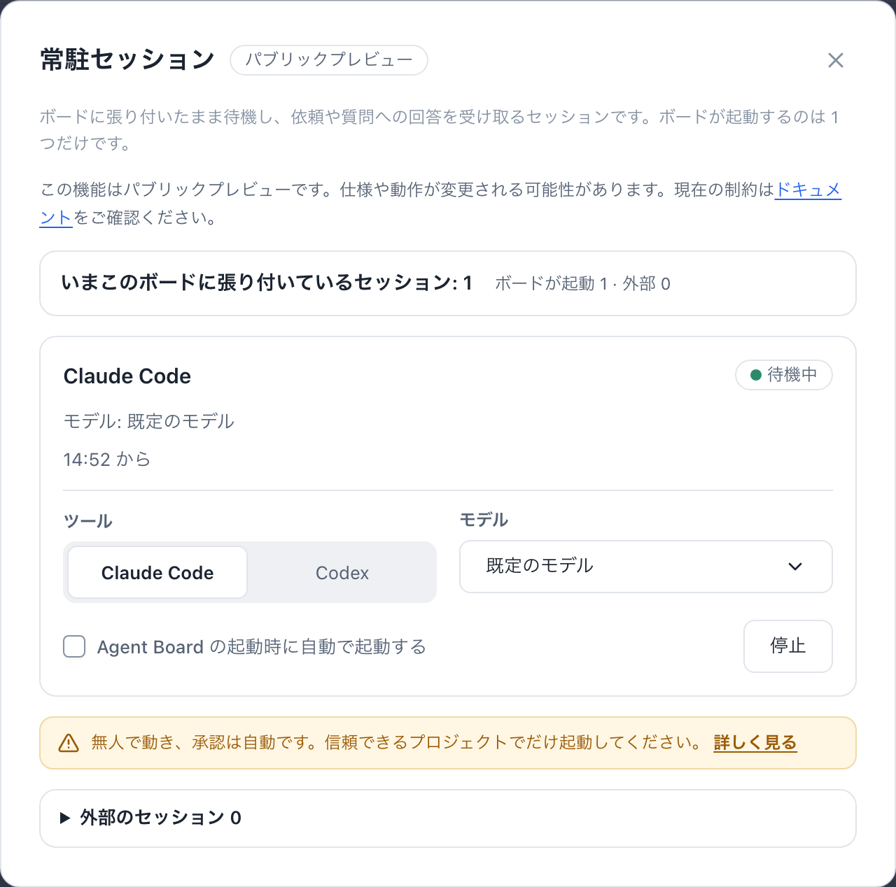

# 常駐セッション

常駐セッションは、Agent Boardが起動してボードに張り付かせておくエージェントのセッションです。ボードが、あなたの依頼、セッション自身の質問への回答、着手可能なタスクを、セッションが待機中のときだけ送ります。未対応の依頼はまとめて1通、回答もまとめて1通、タスクは1つずつです。そのため、先にターミナルでエージェントを起動したり、waitコマンドを動かし続けたりする必要がありません。ターミナルで自分で起動したセッションには影響せず、これまでどおりボードを待ち、外部セッションとして数えられます。起動と停止は**設定**から行います。

::: info パブリックプレビュー
この機能はパブリックプレビューです。仕様や動作が変更される可能性があります。現在の制約は[機能の提供段階](../feature-stages#resident-sessions)をご確認ください。
:::

::: warning 無人で動き、承認は自動です
ボードが起動したセッションは、人が見ていない状態で動き、実行する操作を自分で承認します。信頼できるプロジェクトでだけ起動してください。プロジェクトに結び付けたフォルダーで動き、そこのファイルを変更できます。
:::

## 起動と停止 {#start-and-stop}

1. **設定**を開き、**常駐セッションの設定**を選びます。行には `Claude Code · 作業中` や `起動していません` のような1行の概要が出ます。自分で起動したセッションも張り付いているときは `· 外部 1` が付きます。
2. **ツール**で**Claude Code**か**Codex**を選びます。ボードが起動できるのは全体で1つだけなので、別のツールを使うには、動いているセッションを先に止めます。
3. **モデル**は**既定のモデル**のままにするか、一覧から選びます。一覧を読み取れないときは、その理由が表示され、既定のモデルだけが選べます。
4. **起動**を選びます。要求の処理中は操作が無効になり、ボタンは**起動しています…**になります。終了するには**停止**、失敗したあとは**再起動**を選びます。

{.screenshot}

選んだツールとモデルは次回の起動から反映されます。別の選択で動いている間は、ダイアログに `次回の起動: …` と表示されます。

ツールがインストールされていない、またはログインしていないときは、カードに理由とターミナルで実行するコマンドが出ます。直したら**もう一度確認**を選びます。フォルダーが結び付いていないプロジェクトでは起動できません。`agboard project bind` で結び付けてください。

## 自動で起動する {#start-automatically}

**Agent Board の起動時に自動で起動する**をオンにすると、ボードが起動するたびにセッションを起動します。覚えておく選択は全体で1つで、ツール・モデル・開いていたプロジェクトです。オフにしても、動いているセッションは止まりません。

## 状態 {#states}

| 状態 | 意味 |
| --- | --- |
| **タスク作業中** | セッションは動いていて、ターンの最中です。たとえばタスクや、あなたが送った依頼に取り組んでいます。 |
| **待機中** | セッションは動いていて、待機中です。次の依頼、回答、タスクがあればすぐ、ボードが渡します。 |
| **再起動中** | セッションが終了し、ボードがもう一度起動します。次の試行と再起動の回数が表示されます。 |
| **停止中** | 何も動いていません。 |
| **失敗** | 短い間に何度も終了するなどして、ボードが再起動をあきらめた状態です。原因が表示されます。直してから**再起動**を選びます。 |

ダイアログには、ボードに張り付いているセッションの数も、ボードが起動したものと自分で起動した**外部のセッション**に分けて表示されます。ボードのフッターには、セッションを起動しているか自動起動がオンのあいだ、同期の状態のすぐ左にツール名と点が出ます。クリックするとダイアログが開きます。

## セッションが処理しないとき {#not-handled}

セッションが項目を処理しないままターンを終えると（たとえば依頼を受領しなかったとき）、ボードは少し待ってからその項目をもう一度送り、最大3回まで繰り返します。それ以降は、失敗するターンが繰り返されないよう、その項目を送るのをやめ、ほかの項目は続けて送ります。ボード上で項目を自分で処理するか、セッションを止めて起動し直してください。ボードから無くなった項目は、一覧から消えます。

ボードはこの状態を2か所に表示します。

- ダイアログに「処理できない項目があります」という通知が出ます。項目の名前（たとえば「依頼 Q-3」「Q-5 への回答」「タスク #12」）、直前のターンが失敗した理由、解消のしかたが載ります。
- PCでは、フッターの表示に項目数つきの警告が出ます。クリックするとダイアログが開きます。スマホの表示には警告アイコンだけが出て、その説明に項目の名前が入ります。

## エージェントがエラーで止まったとき {#stopped-on-error}

エージェントのターンが失敗したとき、またはあなたが止めていないのにターンの途中でプロセスが止まったときは、作業していたタスクが実行中のまま、誰も続けない状態になります。ボードは、そのようなタスクそれぞれの履歴に1件追記します。常駐エージェントがエラーで止まったこと、短い理由、別のエージェントへの引き継ぎが必要なことを書き、タスクのエージェントをIdleに戻すので、どのエージェントでも拾えます。履歴の言語はタスクの本文の言語に合わせます。まだIdleのままのタスクや、すでにDoingにないタスクには何もしません。あなたがエージェントを止めたときも、何も書きません。

## リモートアクセス {#remote-access}

起動・停止・自動起動の選択はPCだけでできます。[リモートアクセス](../watch/remote-access)では、フッターの表示は見るだけです。スマホのボードでは、下の状態表示に接続状態に続けて同じ表示（ツール名、短い状態の言葉、点）が出ます。ここでは見るだけで、ボタンはなく、何も起動しておらず自動起動もオフのときは出ません。幅の狭いスマホでは、最終取得の時刻の代わりに表示されます。そのローカルのページでは**設定**に同じ**常駐セッション**の行があり、ダイアログはボトムシートで開きます。
