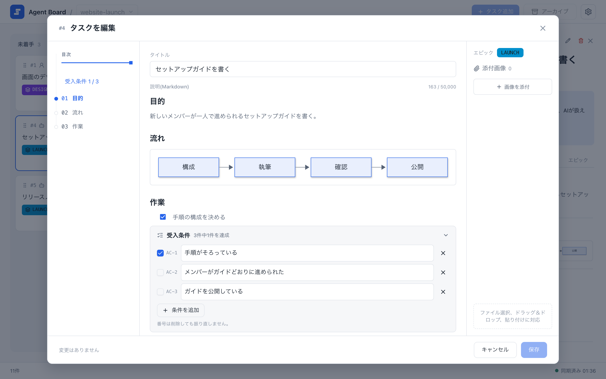

# 編集と証跡

カードとエピックはMarkdownエディタで書きます。カードの受け入れ条件は本文の下のパネルに置き、画像やテキストの証跡をカードに添付できます。エージェントは同じ内容を、プロジェクトの共有フォルダのファイルとして編集します。

## エディタでカードと計画を書く

{.screenshot}

エディタは、左に目次、中央にMarkdownの本文、右にエピックと添付画像を表示します。カードの編集では、受け入れ条件パネルを本文の下に固定し、本文だけが単独でスクロールします。

カードの追加とカードの編集では、受け入れ条件を本文のスクロール領域の下に固定したパネルに置きます。最初は折りたたまれています。条件を編集するときは展開してください。条件が多いときはパネルの中でスクロールし、本文を操作できるようパネルの高さは制限されます。条件のIDは固定で、並べ替えはできません。目次から本文の見出しへ移動したり、受け入れ条件パネルを開いたりできます。カードの詳細では、受け入れ条件を独立した「受入条件」タブで読みます。エピックの参考条件は本文にMarkdownで記述し、専用の条件パネルはありません。

Markdownエディタは、見出し、タスクリスト、表、コードブロック、Mermaid図、画像に対応します。ダイアログ内の変更はまとめて保存またはキャンセルします。必須の[共有Markdownファイルの形式](#共有markdownファイルを編集する)を守り、受け入れ条件にチェックを付ける前に検証結果を記録してください。画像やMermaid図をクリックすると拡大できます。

エピックのダイアログ(名称、色、計画、タスクの順序)は[エピックと進行表](./epics)、下書きは[ボード](./board)を参照してください。

## 画像と証跡を追加する

ブラウザのエディタで画像を選択、ドロップ、または貼り付けて、カードの本文に挿入できます。添付できる画像はPNG、JPEG、WebP、GIFです。CLIでは次のようにします。

```sh
agboard --project "My project" attachment add 1 --file diagram.png --actor ai
agboard --project "My project" attachment ls 1 --json
agboard --project "My project" attachment get 1 "<attachment-id>" --output diagram-copy.png
```

画像は、カードのMarkdown内で`attachment:<attachment-id>`という永続的な参照を使います。スナップショットには添付ファイルのメタデータが含まれますが、進行表とフックには含まれません。画像のバイト列はローカルファイルに保存されます。`attachment get`は既存の出力ファイルを上書きしません。

UTF-8のログなどのテキストは証跡として追加でき、返された証跡IDで読み出せます。

```sh
agboard --project "My project" evidence add 1 test-output.log
agboard --project "My project" evidence show 1 "<evidence-id>"
```

## 共有Markdownファイルを編集する

ファイルの場所を決め打ちせず、次のコマンドで調べます。

```sh
agboard --project "My project" workspace --json
```

結果には`folder`(プロジェクトの絶対パス)、`projectId`、`readme`、`tasks`、`epics`が含まれます。ファイルを編集する前に、プロジェクトの`README.md`を読んでください。

エージェントは、そのREADMEが許す範囲で、下書きではないカードの`TASK.md`とエピックの`PLAN.md`を編集できます。直接編集するときは、同じフォルダに一時ファイルを書き、元のファイルへリネームで置き換えます。ボードはファイルの変更を自動で追従します。メタデータや状態の変更にはCLIを使い、`task.json`、`epic.json`、`project.json`、`.internal/`のロックファイルは直接編集せず、カードやエピックのフォルダも直接削除しないでください。個人の絶対パスは共有ファイルに書かないでください。

### TASK履歴と受け入れ条件のfrontmatter

`task.json`には現在のレーンや担当などのカードメタデータを保存し、形式の版は3です。履歴は保存しません。カードの本文・受け入れ条件・操作履歴の正本は`TASK.md`です。PLAN.mdは進行順をpriorityメタデータに保存し、エピックの参考条件は本文へ直接書きます。操作履歴はカードだけに保存します。

TASK.mdは、受け入れ条件とすべての進捗・操作履歴をファイル先頭のYAML frontmatterに持ちます。履歴の各項目は日時の`at`と内容の`reason`だけです。自由なMarkdown本文にはタスクの計画・受け入れ条件の検証結果・成果物や証跡への参照を記述します。見出しは必須ではありません。時系列の履歴を本文や実行ログ欄に記述せず、全文ログは証跡ファイルに保存してください。次は新しいカードへの入力例です。`history`は省略するか空のリストにでき、カード作成時にAgent Boardが最初の履歴を生成します。

```markdown
---
acceptance:
  - id: AC-1
    text: The setup guide covers the supported installation steps.
    done: false
  - id: AC-2
    text: Deleting a card asks for confirmation.
    done: true
history: []
---

## Background

Any headings and text you need.
```

各条件は3つのキーを持ちます。`id`(`AC-`に先頭ゼロのない正の数が続く形で、ファイル内で一意)、`text`(前後の空白を除いて1〜2,000文字)、`done`(`true`または`false`)です。frontmatterのほかのキーは、ボードがファイルを書き込むときも保持されます。frontmatterのないPLAN.mdは全文が本文になります。エピックの参考条件は本文のMarkdownとして扱い、条件データとしては解析しません。形式の版が3の`TASK.md`には、`acceptance`リストが空でも、有効なトップレベル`history`リストが必要です。

次はUTCのRFC3339日時を使った保存済み履歴の例です。新しいタスクにコピーするための実績ではありません。

```yaml
history:
  - at: "2026-10-15T01:30:00Z"
    reason: "Verified the setup guide links and saved the build output as evidence."
```

保存済みのファイルでも空のリストは有効です。APIとCLIの履歴も同じ`at`/`reason`形式です。質問と回答は引き続きユーザーとエージェントが参照できます。

カードの操作があると、Agent Boardはレーンやエージェント状態の変更、質問と回答、アーカイブや復元などの履歴を追記します。画面の理由欄は任意で、省略や空白の場合は現在の状態に応じて内容を生成します。履歴タブと`show`、`snapshot`は同じ履歴を読みます。

AIは[`history add`](./cli#作業を報告する)で意味のある進捗を自動記録し、記録ごとの承認は求めません。列や状態の操作は自身の履歴を残すので、同じ操作を重複記録しないでください。CLIは日時を付け、履歴を原子的に追記し、AIの権限を判定します。AIは下書き・アーカイブ済み・完了カードには追記できません。Markdownを直接編集する場合も、`at`と`reason`だけの項目を追加し、既存の履歴・本文・条件・未知のメタデータを保持してください。履歴の追記だけのためにファイル全体を書き直さないでください。

通常の本文・受け入れ条件編集は最新の履歴を保持します。`edit --desc-file`は入力からの履歴変更を受け付けません。`PLAN.md`には履歴を保存せず、参考条件は本文のままです。

frontmatterを読み取れない場合(YAMLの誤り、キーの欠落、IDの重複、空のtext)、ボードはファイル、項目、理由を問題として報告します。そのカードは進捗を表示せず、本文を全文表示します。ボードが修正のためにファイルを書き換えることはありません。

### 条件のチェックと自動で完了

条件は、検証したあとにだけ`done: true`にし、結果と証跡への参照を本文に残し、最後の条件を達成にして保存する前に検証を履歴へ記録してください。`agboard serve`の実行中は、下書きでなくアーカイブされていない、有効な条件を1件以上持つAI担当の未着手または進行中のカードが、すべての条件を達成すると自動で完了へ移ります。サーバーは起動時にも既存のカードを確認します。待機中のカードは回答されるまで待ちます。ユーザー担当のカード、下書き、不正な受け入れ条件データ、条件が空のカードは自動では完了しません。条件のチェックを外さずにカードを再開すると、再び完了することがあります。エピックの参考条件は本文に書くもので、アプリは管理しません。

### エピックの優先順

エピックのfrontmatterには、重複しない正のカードIDの`priority`リストを置けます。ボードのレーン順とは独立に、エピックの進行表とCLIの進行表の順序を決めます。

```yaml
priority: [3, 1, 2]
```

新しいカードは空の`acceptance`リストで、エピックは空のMarkdown計画で始まります。タスクの形式の版が1と2のファイルは未対応として報告し、変更しません。移行、旧形式へのフォールバック、削除・初期化は行いません。ほかの共有JSONファイルは形式の版が1のままです。既存`PLAN.md`のacceptanceキーは未解釈のメタデータとして保持し、条件の自動変換は行いません。
