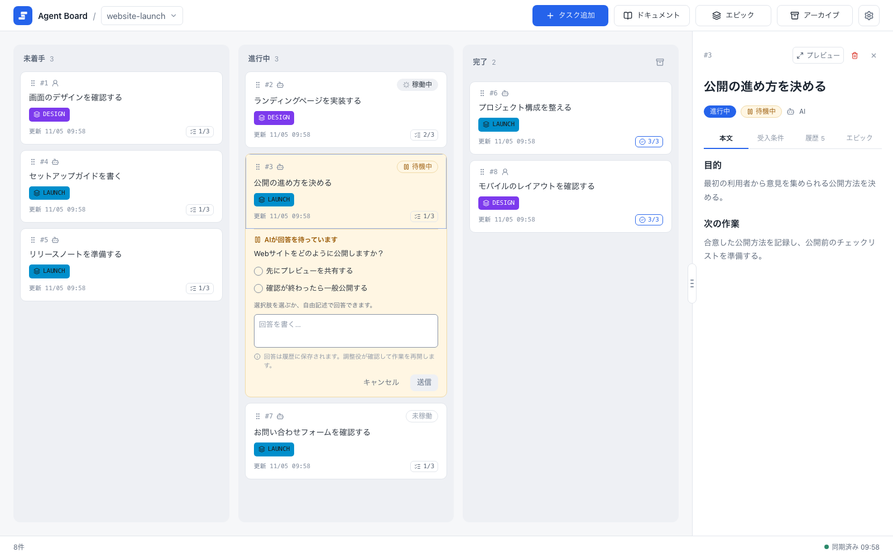

# インストールと起動

このページを読み終えると、Homebrewで`agboard`をインストールし、作業フォルダにプロジェクトを作り、エージェントをつなぎ、ブラウザでボードを開けます。続いて[クイックスタート](./quickstart)で基本操作を試してください。

手順は、インストール、プロジェクトの作成またはbind、エージェントの接続、サーバーの起動の順です。

## 始める前に

- macOS 15以降を搭載した、Apple SiliconまたはIntelのMac。
- [Homebrew](https://brew.sh)。Homebrew自体にも、環境によってはCommand Line Toolsなどの前提があります。その内容はHomebrewのドキュメントに従ってください。
- 接続の手順で使う、`PATH`上のClaude CodeまたはCodex CLI。

Agent Boardを自分でビルドする必要はありません。Homebrewで入るのは、Web画面を内蔵したビルド済みのコマンドです。Rust、Node.js、pnpmは不要で、リポジトリをcloneすることもありません。ソースからビルドする場合は、[開発環境のセットアップ](../dev/getting-started/setup)を参照してください。

## インストール

```sh
brew install fooqoo/tap/agboard
agboard --version
```

このコマンドは、Developer ID証明書で署名され、Appleの公証を受けています。macOSが実行を拒否したときは、Gatekeeperを無効にせず、[トラブルシューティング](./operations/troubleshooting#macos-will-not-run-agboard)を参照してください。

Agent BoardはMITライセンスで公開しています。ライセンスと、同梱する第三者コンポーネントの通知は、Homebrewのprefix配下の`share/agboard`（`$(brew --prefix)/share/agboard`）にインストールされます。

## プロジェクトを作成またはbindする {#create-or-bind-a-project}

作業しているフォルダに移動します。プロジェクトは、bindしたフォルダに属し、そのサブフォルダも同じプロジェクトを使います。フォルダごとに一度だけ行います。

```sh
cd my-project
agboard project create "My project"
```

`project create`は、プロジェクトを作成し、現在のフォルダをそのプロジェクトにbindします。プロジェクトがすでにある場合は、代わりにこのフォルダをbindします。

```sh
agboard project bind "My project"
```

プロジェクトの名前変更や、ほかのフォルダの登録は、[データとバックアップ](./operations/data#projects-and-folders)を参照してください。

## エージェントをつなぐ

```sh
agboard connect
```

`connect`は、ターミナルで質問に答えながら進める設定です。Claude Code、Codex、または両方に、SkillとHookを導入します。HookとProjectスコープは、フォルダのプロジェクトに依存するため、bind済みのフォルダで実行する必要があります。聞かれる内容、書き込み先、その後の操作は、[エージェントをつなぐ](./automation/agents#connect-your-agent)を参照してください。`connect`と`update`は[パブリックプレビュー](./feature-stages#connect-and-update)です。

## ボードを開始する

サーバーを起動します。

```sh
agboard serve
```

[http://127.0.0.1:7420/](http://127.0.0.1:7420/)を開き、ヘッダーでプロジェクトを選びます。ボードを使っている間や、エージェントが回答を待っている間は、サーバーを起動したままにしてください。止めるには、そのターミナルでCtrl+Cを押します。サーバーは`127.0.0.1`だけで待ち受けます。7420が使われているときは、`--port`で別のポートを選びます。

{.screenshot}

選んだプロジェクトがヘッダーに表示されてボードが開きます。タスクは未着手・進行中・完了の列に並びます。

ほとんどのコマンドでは、`--project NAME`で対象のプロジェクトを指定します。このガイドの例は`My project`を使っています。自分のプロジェクト名に置き換え、CLIが返すタスクIDを使ってください。プロジェクトの名前変更とフォルダの登録は、[データとバックアップ](./operations/data#projects-and-folders)を参照してください。

## 更新する

Homebrewでコマンドを更新し、続けて`connect`が導入したSkillとHookを更新します。

```sh
brew upgrade fooqoo/tap/agboard
agboard --version
agboard update
```

`brew upgrade`が置き換えるのは、コマンドとその中のWeb画面です。エージェントの設定にあるSkillやHookは変わりません。それを更新するのが`agboard update`で、対象は`connect`が導入したものだけです。変更内容を表示して確認を求めます。`agboard update --yes`は質問を省きますが、あなた自身の編集は上書きしません。詳しくは[連携を更新する](./automation/agents#refresh-the-integrations)を参照してください。

更新したら、新しいコマンドと画面を使うために、`agboard serve`を止めて起動し直します。開いているボードやモニターは、サーバーが戻ると自動で再読み込みします。編集中や回答の入力中は、それが終わるまで待ちます。

更新後、ターミナルで通常のコマンドを実行すると、導入済みのSkillとHookがコマンドより古いときに知らせます。通知は一度だけエラー出力に出て、コマンドの結果は変わりません。

Hookとエージェントのスキルは、`PATH`の`agboard`を実行するので、インストールした版を使います。開発中のビルド（`cargo build`、`cargo run`、`target/debug/agboard`）は別の実行ファイルです。

## 次に読む

- [クイックスタート](./quickstart): 一つのタスクを作成から完了まで進めます。
- [エージェントとの連携](./automation/agents): `connect`が尋ねる内容と、エージェントがボードで作業する流れです。
- [機能の提供段階](./feature-stages): 一般提供の機能と、パブリックプレビューの機能を確認します。
