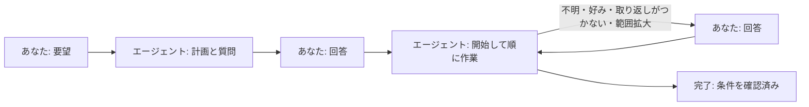
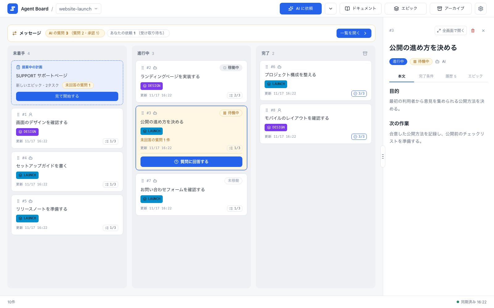

# はじめに

<video class="demo-video" :src="withBase('/videos/demo.ja.mp4')" :poster="withBase('/videos/demo.ja.jpg')" autoplay muted loop playsinline></video>

タスクへの着手から完了までの流れを紹介します。エージェントが質問すると、ユーザーはタスクの回答欄から返答します。エージェントは回答を受けて作業を再開し、すべての完了条件を満たすと、タスクが自動で完了の列へ移ります。

実際に触ってみたい場合は、[デモを試す](https://fooqoo.github.io/agent-board/demo/)からブラウザで操作できます。インストールは不要です。サンプルデータで初回の案内が始まります。ブラウザの言語が日本語なら日本語で、それ以外なら英語で表示されます。ページを再読み込みすると最初からやり直せます。

## 課題: 大きな仕事は、張り付いていないと進まない

大きな仕事をAIエージェントに渡しても、最後まで一人で走りきることはまれです。要望を計画に直す、止まったり脱線したりしていないかを見る、チャットに流れた質問を拾う、新しいセッションで経緯を説明し直す、終わったかどうかを最後に確かめる。こうした作業を人が担うことになり、エージェントが働いている間も、人は見張り続けることになります。

Agent Boardは、この張り付きを減らすためのものです。エージェントを動かすのではなく、エージェントが作業する枠組みを用意します。依頼を伝え、聞かれたときに答え、それ以外の時間は離れていられるようにします。

## Agent Boardとは: 仕事のハーネス

Claude CodeやCodexのようなエージェントには、動くための道具、コンテキスト、実行のループがすでにあります。足りないのは、仕事そのものを表す共通のモデルです。Agent Boardは、エージェントの上にかぶせるその層、つまり**仕事のハーネス**です。ハーネスは、馬具や安全帯のように、力を出す側に付けて進む向きと止まる場所を与える装具です。Agent Boardも、エージェントの力はそのままに、仕事の進め方と止まるところを与えます。次の4つを一か所で持ちます。

- **計画。** エピックが仕事をまとめて順序を決め、タスクが単独でレビューできる作業の単位になります。エージェントは順序を読んで次にやることを知ります。
- **完了条件。** 各タスクが、何を満たせば終わりかを先に宣言します。エージェントは、確かめてから完了にします。
- **止まって聞く質問。** 判断があなたのものであるとき、エージェントは選択肢を添えて質問し、待ちます。質問と回答は、どのモニターから答えても一つだけ記録されます。
- **履歴。** 移動、質問、回答、確認のすべてが理由つきで記録されます。新しいセッションや別のエージェントは、前の続きから始められ、あなたも何が起きたかを後から辿れます。

データはすべて手元のマシンに通常のファイルとして保存され、あなたもエージェントも同じファイルを読み書きします。要素・状態・Agent Boardが守ることは、[仕事のモデル](./work-model)で説明します。

## 任せる流れ

計画を書くのはあなたではありません。頼めば、エージェントがボード上で計画します。

1. **要望。** やりたいことを、チャットで普通の言葉で伝えます。
2. **計画。** エージェントはすぐに、エピックと、作業順に並べたタスク（それぞれに完了条件つき）を計画としてボードに置きます。タスクは**下書き**バッジの付いた通常の未着手カードとして表示されます。自分では決められないことは、質問として尋ねます。
3. **回答のあとで開始。** 質問に答えます。回答がそろい、計画が清書されると、エージェントが自分で計画を開始します。開始にあなたの承認は要らず、質問が未回答のあいだは何も始まりません。
4. **順に作業。** エージェントはタスクを順に進め、やったことを記録し、それ以外のことは自分で決めます。
5. **必要なときだけ止まる。** 開始のあと、エージェントがあなたを呼ぶのは、意図が分からないとき、好みで決まるとき、取り消せない操作をするとき、頼まれた範囲を超えるときの4つだけです。
6. **自動で完了。** エージェントがタスクのすべての完了条件を確かめ、あなたを待つものがなくなると、タスクは自動で完了に移ります。

[クイックスタート](./quickstart)で一度体験でき、[エージェントとの連携](./delegate/agents)で詳しく説明しています。

## 見守り方と答え方

ボードは、仕事を見るモニターの一つです。モニターは見るだけの場所ではなく、スマホ、チャット、CLIからも同じ仕事を見て、答えて、介入できます。どこから見ても、関わり方は二つあります。

- **聞かれたら答える（Human-in-the-Loop）。** エージェントが判断を求めて止まったとき、ボード、スマホ、チャット、CLIのどこからでも答えられます。答えは一度だけ記録され、エージェントは作業を再開します。[判断依頼](./delegate/decisions)を参照してください。
- **見守って介入する（Human-on-the-Loop）。** エージェントは動き続け、あなたはそれを見ます。カードを差し戻す、完了条件にチェックを付ける、計画を書き換える。エージェントは、次にボードを読むときにその変更に従います。[ボード](./watch/board)を参照してください。

{.screenshot}

ボードには、未着手・進行中・完了の列があります。この画面では、進行中のタスクがあなたの回答を待っていて、各タスクには完了条件の達成数が表示されています。外出先では、[リモートアクセス](./watch/remote-access)で同じ仕事をスマホから見られます。エージェント自身のモニターはチャットで、`agboard`コマンドはエージェントやスクリプトが使う入口です。

## どこから読むか

はじめてなら、最初の4ページを順に読んでください。

1. [インストールと起動](./getting-started): `agboard`をインストールし、エージェントを設定して、ボードを開きます。
2. [クイックスタート](./quickstart): 最初の仕事を任せ、完了まで見届けます。
3. [仕事のモデル](./work-model): 操作の前提となる考え方を理解します。
4. [エージェントとの連携](./delegate/agents): エージェントが計画し、質問し、完了する流れを知ります。

## 目的から探す

| したいこと | 読むページ |
| --- | --- |
| エージェントに仕事を任せる | [クイックスタート](./quickstart)と[エージェントとの連携](./delegate/agents) |
| エージェントの質問に答える | [判断依頼](./delegate/decisions) |
| タスクを追加・移動・確認する | [ボード](./watch/board) |
| タスクをまとめ、次にやることを見る | [エピックと進行表](./watch/epics) |
| タスクを書き、画像を添付する | [編集と画像添付](./watch/editing) |
| プロジェクトのMarkdown文書を読み、編集する | [プロジェクトのドキュメント](./watch/docs) |
| スマホからボードを確認する | [リモートアクセス](./watch/remote-access) |
| コマンドを調べる | [CLIリファレンス](./reference/cli) |
| `TASK.md`や`EPIC.md`を手で編集する | [Markdownファイルの形式](./reference/file-format) |
| ファイルの場所を知る、バックアップを取る | [データとバックアップ](./operations/data) |
| うまくいかないことを直す | [トラブルシューティング](./operations/troubleshooting) |

Agent BoardプラグインがClaude CodeとCodexに導入するものは、[プラグインのガイド（英語）](https://github.com/FooQoo/agent-board/blob/main/plugins/agent-board/README.md)を参照してください。Agent Board自体を変更したいときは、[開発者ガイド](../dev/)を読んでください。
