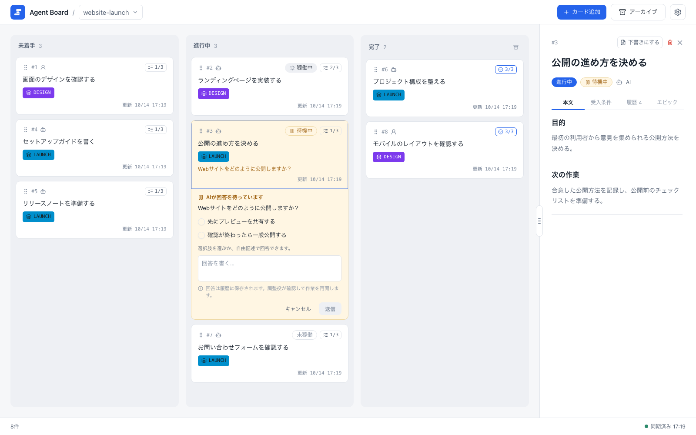
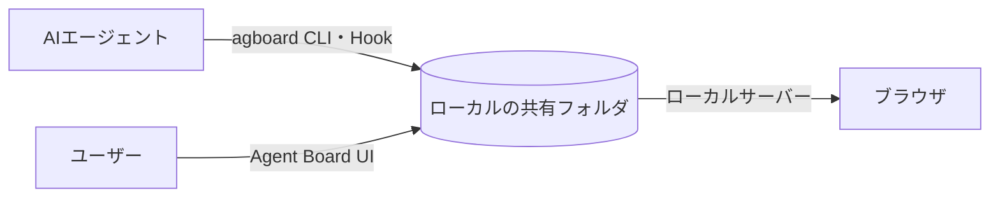

# はじめに

<video class="demo-video" :src="withBase('/videos/demo.ja.mp4')" :poster="withBase('/videos/demo.ja.jpg')" autoplay muted loop playsinline></video>

1枚のカードの流れです。エージェントが着手して質問し、ユーザーがカード上で回答すると、エージェントが作業を再開します。すべての受け入れ条件を達成すると、カードは自動で完了の列に移ります。

## Agent Boardとは

Agent Boardは、ユーザーとAIエージェントが共有するローカルの作業ボードです。プロジェクトごとにカード、エピック、履歴を持ちます。作業の確認と編集にはブラウザを、エージェントによる更新とプロジェクトの管理には`agboard`を使います。

エージェントに長い作業を任せると、どの作業が進み、何を待ち、何の返事が必要なのか分かりにくくなります。Agent Boardはユーザーとエージェントが同じ履歴つきボードを見て、作業の往復を続けられるようにします。

{.screenshot}

スクリーンショットは未着手・進行中・完了の3列のボードです。進行中のカードが回答を待っており、各カードに受け入れ条件の達成数が表示されます。

## 誰が何をするか

- **ユーザー**はブラウザで作業します。カードの追加と編集、判断依頼への回答、進捗の確認を行います。
- **エージェント**は`agboard` CLIとHookを通して作業します。進捗の報告、質問、結果の記録を行います。
- **ローカルの共有フォルダ**が正本です。双方が同じプレーンファイルを読み書きし、ローカルサーバーがブラウザを最新の状態に保ちます。データはすべてローカルのデータ領域に保存され、アカウントやクラウドサービスは不要です。

## 次に読むページ

- [インストールと開始](./getting-started): `agboard`をインストールし、プロジェクトを作ってボードを開きます。
- [ボード](./board): カード、列、エージェントの状態、下書き、アーカイブ、設定。
- [判断依頼](./decisions): カード上の質問と回答を、CLI・ブラウザ・スマホで扱います。
- [エピックと進行表](./epics): カードをエピックにまとめ、進行表を読みます。
- [編集と証跡](./editing): Markdownエディター、画像、証跡、共有ファイルの形式。
- [エージェントとの連携](./agents): エージェントの作業手順とHookの設定。
- [CLIリファレンス](./cli): `agboard`のコマンド。
- [モバイルモニター](./mobile-monitor): スマホからボードを見ます。
- [データとバックアップ](./data): ファイルの場所とバックアップの方法。

Claude CodeとCodexのHook設定は、[連携ガイド(英語)](https://github.com/FooQoo/agent-board/blob/main/integrations/README.md)を参照してください。
