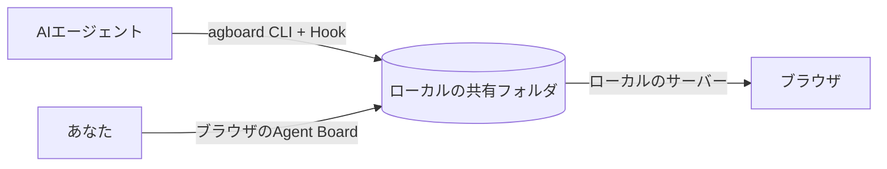

# はじめに

<video class="demo-video" :src="withBase('/videos/demo.ja.mp4')" :poster="withBase('/videos/demo.ja.jpg')" autoplay muted loop playsinline></video>

タスクへの着手から完了までの流れを紹介します。エージェントが質問すると、ユーザーはタスクの回答欄から返答します。エージェントは回答を受けて作業を再開し、すべての受入条件を満たすと、タスクが自動で完了の列へ移ります。

## Agent Boardとは

Agent Boardは、ユーザーとAIエージェントが一緒に使う、ローカルで動く作業ボードです。長時間の作業でも、進捗や回答待ちの質問を一か所で確認できます。タスクの移動や質問への回答は履歴に残るため、何が起きたかを振り返りながら作業を進められます。

{.screenshot}

ボードには、未着手・進行中・完了の3つの列があります。この画面では、進行中のタスクがあなたの回答を待っていて、各タスクには受入条件の達成数が表示されています。

## 仕組み

- **ユーザー**はブラウザを使います。タスクを追加・編集し、エージェントの質問に回答し、進捗を確認します。
- **エージェント**は`agboard`コマンドとHookを通して作業します。進捗を報告し、質問し、結果を記録します。
- **ローカルの共有フォルダ**に、ボードのデータをファイルとして保存します。ユーザーとエージェントが同じファイルを読み書きし、ローカルサーバーが変更をブラウザへ反映します。データはすべて手元のマシンにあり、アカウントやホスティングサービスは不要です。

## どこから読むか

はじめてなら、最初の3ページを順に読んでください。

1. [インストールと起動](./getting-started): `agboard`をビルドして、ボードを開きます。
2. [クイックスタート](./quickstart): 約10分で、一つのタスクを作成から完了まで進めます。
3. [基本の考え方](./concepts): プロジェクト、タスク、エージェントの状態など、操作の前提となる概念を理解します。

## 目的から探す

| したいこと | 読むページ |
| --- | --- |
| タスクを追加・移動・確認する | [ボード](./use/board) |
| エージェントの質問に答える | [判断依頼](./use/decisions) |
| タスクをまとめ、次にやることを見る | [エピックと進行表](./use/epics) |
| タスクを書き、画像やログを添付する | [編集と証跡](./use/editing) |
| Claude CodeやCodexをつなぐ | [エージェントとの連携](./automation/agents) |
| コマンドを調べる | [CLIリファレンス](./automation/cli) |
| `TASK.md`や`EPIC.md`を手で編集する | [Markdownファイルの形式](./automation/file-format) |
| スマホからボードを確認する | [モバイルモニター](./operations/mobile-monitor) |
| ファイルの場所を知る、バックアップを取る | [データとバックアップ](./operations/data) |
| うまくいかないことを直す | [トラブルシューティング](./operations/troubleshooting) |

Claude CodeとCodexのHookの設定は、[連携ガイド](https://github.com/FooQoo/agent-board/blob/main/integrations/README.md)を参照してください。Agent Board自体を変更したいときは、[開発者ガイド](../dev/)を読んでください。
