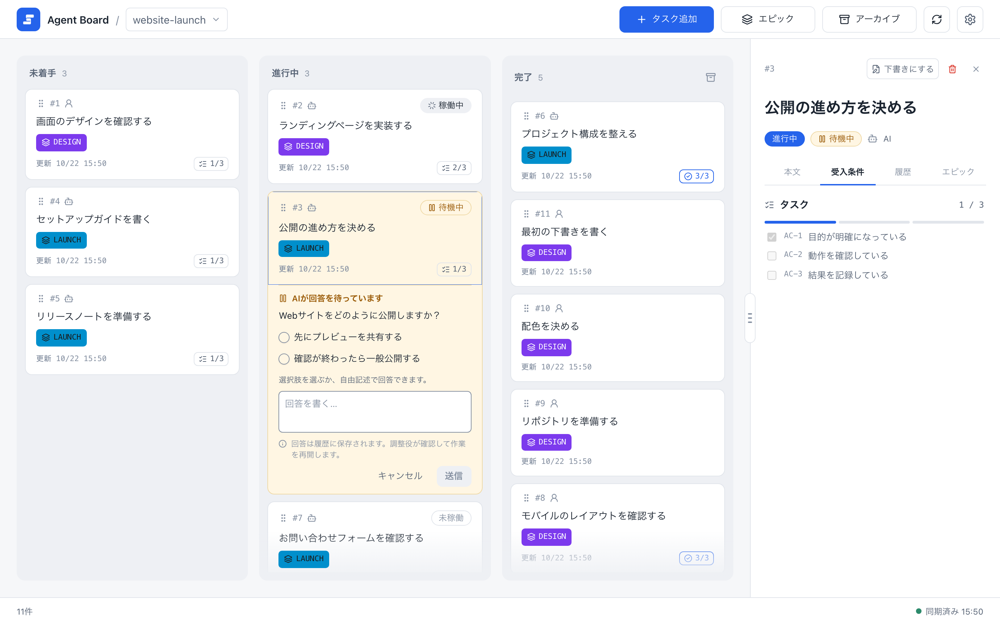
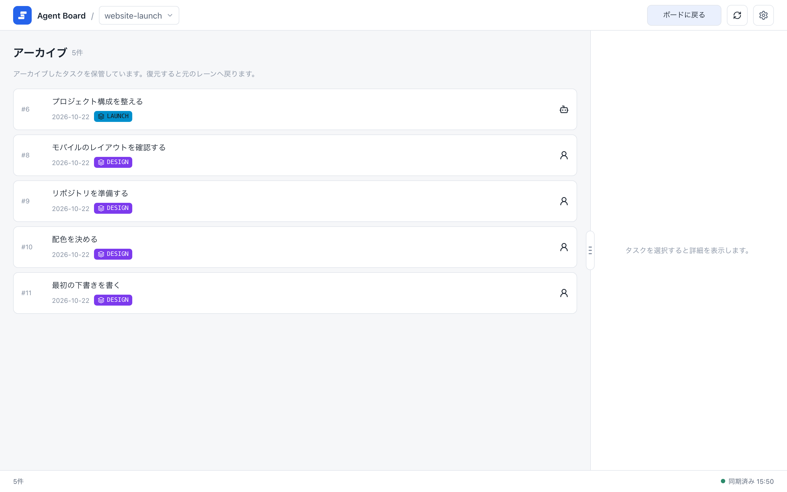
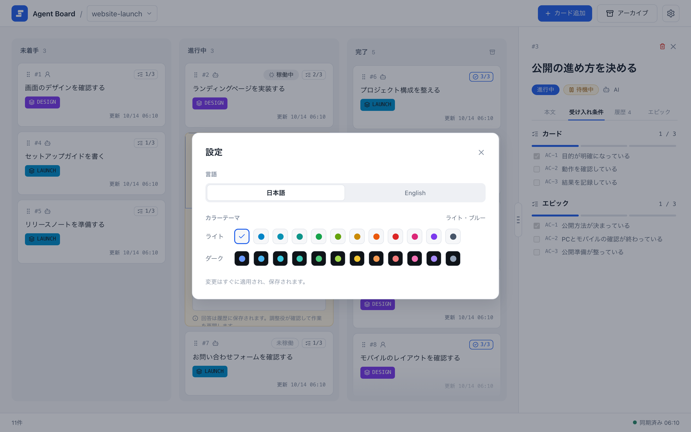
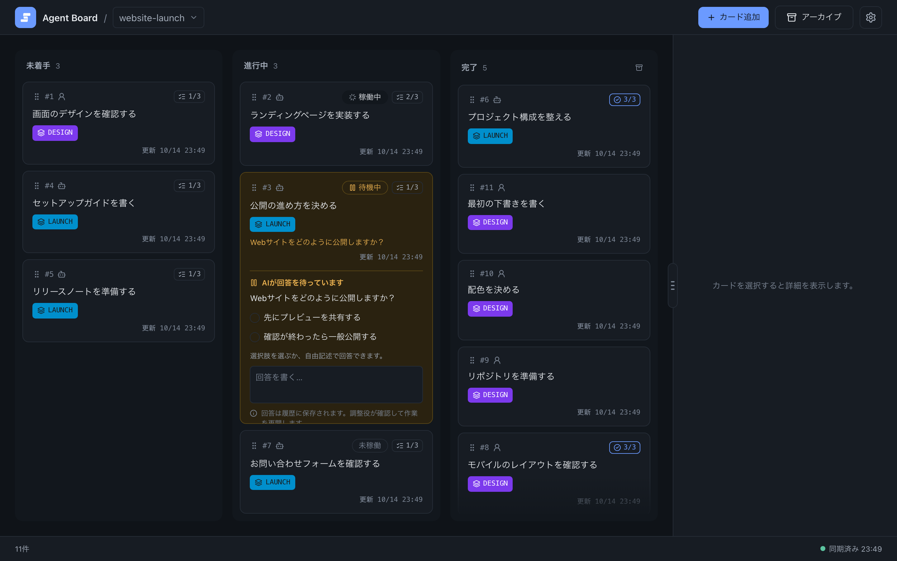

# ボード

ボードは、タスクを追加し、エージェントの作業を追い、結果を確認する場所です。このページでは日々の操作を扱います。操作の前提となる概念は[基本の考え方](../concepts)を参照してください。

## タスクを追加する

1. ヘッダーでプロジェクトを選び、**タスク追加**を選びます。
2. 簡単な依頼を入力して登録します。AI担当のタスクが作られ、最初の空でない行がタイトルになります。

タイトル・担当・受入条件・下書きを自分で設定するには、依頼フォームで**手動で作成**を選び、従来のエディターを使います。詳しくは[編集と画像添付](./editing#依頼を送る)を参照してください。担当はタスク作成後に変更できません。

新しいタスクは、未着手の列の末尾に追加されます。

## タスクを読む

タスクを選ぶと、右側に詳細が開きます。タブの内容は次のとおりです。

| タブ | 表示するもの |
| --- | --- |
| **本文** | タスクの本文。 |
| **受入条件** | そのタスクの受入条件と、その進捗。 |
| **履歴** | 操作や進捗の記録。日時と理由を新しい順に表示。 |
| **エピック** | タスクが属するエピックの詳細（あれば）。 |

{.screenshot}

右側のパネルに選択したタスクが表示されます。受入条件のタブには、そのタスクの条件だけが進捗バーつきで並びます。エピックの参考条件は、詳細の本文に書きます。

## タスクを移動する

タスクを別の列にドラッグして、移動を確認します。理由欄は任意です。空欄の場合は、移動内容に応じた理由が自動で記録されます。列の意味は次のとおりです。

| 列 | 意味 |
| --- | --- |
| 未着手(Todo) | まだ始めていない作業。 |
| 進行中(Doing) | 作業中。AIが担当するタスクにはエージェントの状態も表示されます。 |
| 完了(Done) | 完了した作業。 |

進行中のAI担当タスクには、**未稼働**・**稼働中**・**待機中**のいずれかが表示されます。エージェントが着手前に質問した場合は、未着手のタスクも待機中になります。ユーザー担当のタスクと完了のタスクは、常に未稼働です。稼働中はエージェントが作業していること、待機中はあなたの回答が必要なことを表し、回答はタスク上で行います（[判断依頼](./decisions)を参照）。列を移すとエージェントの状態は未稼働に戻り、未回答の質問は取り下げられます。変更とその理由は、すべて履歴に残ります。

## タスクを変更する

タスクを編集したりエピックに割り当てたりするには、詳細パネルで**下書きにする**を選び、本文を編集して、準備ができたら**確定する**を選びます。エディターは[編集と画像添付](./editing)を参照してください。

## 下書き

下書きにすると、編集中のタスクをエージェントが変更できなくなります。エージェントは、`TASK.md`も含めて、下書きを変更できません。

- 下書きを作るには、タスクの追加時に**下書き**にチェックを入れます。
- 既存のタスクを編集するには、詳細パネルで**下書きにする**を選び、本文を編集して保存し、エージェントが使えるようになったら**確定する**を選びます。エディターで保存しても下書きの状態は変わらず、エディターには下書きのチェックボックスがありません。
- 稼働中のタスクは下書きにできません。

確定を忘れると、エージェントはそのタスクを動かせず、更新できません。下書きのタスクには**下書き**ラベルが表示されます。

## アーカイブ

完了したタスクをアーカイブすると、何も削除せずにボードを片付けられます。

- 個別のタスクは詳細からアーカイブできます。完了の列の**完了タスクをアーカイブ**を選ぶと、まとめてアーカイブできます。
- ヘッダーの**アーカイブ**を開くと、アーカイブ済みのタスクを確認し、元の列へ復元し、完全に削除できます。完全削除はアーカイブからだけ行えます。

{.screenshot}

アーカイブ画面には、アーカイブ済みのタスクがID、タイトル、担当、日付と、所属していたエピック（ある場合）とともに並びます。タスクを選ぶと詳細を確認できます。

アーカイブ済みタスクの詳細は、通常のタスクと同じ構成です。右上の**復元**と、ごみ箱アイコンの完全削除が閉じるボタンの隣に並びます。完全削除の前には確認が出ます。

## 設定

**設定**を開くと、言語（英語か日本語）と24のテーマ（12色、それぞれライトとダーク）から選べます。

選んだ内容は、このPCに保存されます。そのため、このPCのどのブラウザでも同じ言語とテーマで表示されます。変更は、開いているほかのページ（別のブラウザのウィンドウやモバイルモニターを含む）にも、再読み込みなしですぐに反映されます。初期設定は英語とライトブルーで、ブラウザやOSの設定には従いません。利用者が入力したタスクの内容は翻訳されません。CLIのhelp・エラー・JSONの値は英語のままです。

詳細欄の幅は、この設定には含まれません。幅はブラウザごとに保存されます。

同じダイアログの**モバイル接続**から、ngrokでスマホからボードを確認するための設定を開けます。詳しくは[モバイルモニターのガイド](../operations/mobile-monitor)を参照してください。

{.screenshot}

ダイアログには、言語の切り替えと、ライト・ダーク各12色のテーマが並びます。

{.screenshot}

ダークテーマを選んだあとの同じボードです。

## 初回の案内

案内の 2 枚のサンプルカードは、ほかのカードと同じレーンに表示されます。案内が画面に出ているあいだは、ボードの残りの部分が覆われるので、案内が終わるまでカードを開いたり動かしたりできません。エージェントはこれらを取り上げません。進行表には載らず、`wait --until task` も返しません。案内が終わるか途中で終えると、2 枚ともアーカイブされます。[始める前に](../quickstart.md#始める前に-初回の案内)を参照してください。

## 次に読む

- [判断依頼](./decisions): エージェントの質問に答えます。
- [エピックと進行表](./epics): タスクをまとめ、次にやることを見ます。
