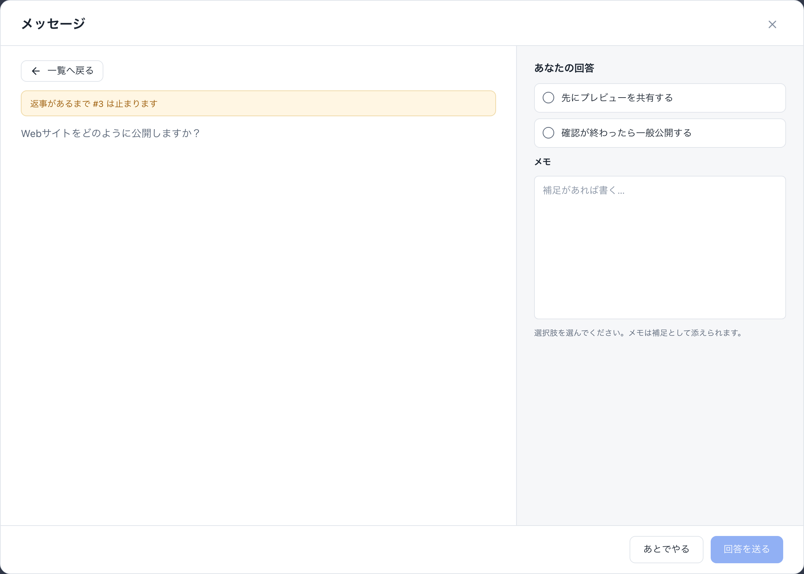
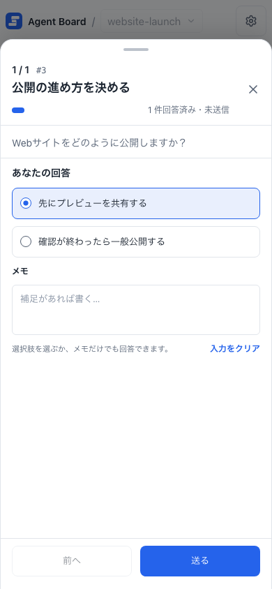
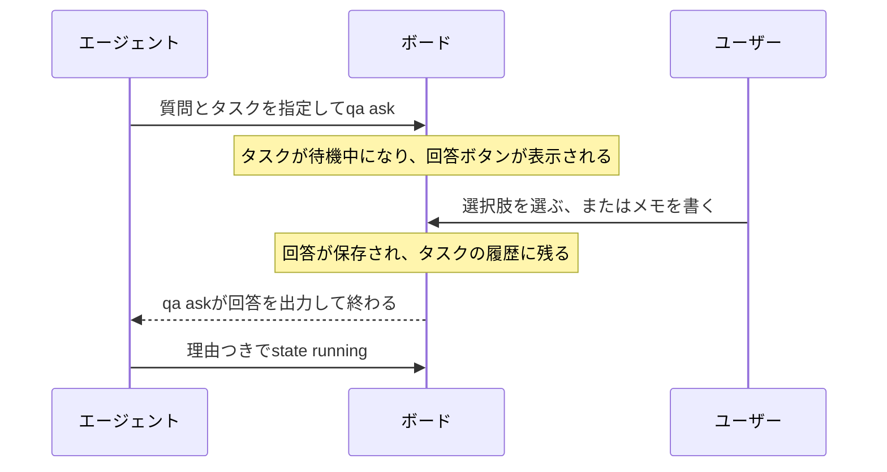

# 判断依頼

判断依頼は、エージェントがユーザーの判断を必要とするときに出す質問です。このページでは、PCやスマホから回答する方法と、エージェント側の質問の出し方を説明します。概要は[基本の考え方](../concepts#判断依頼)を参照してください。

## 質問に気づくには

質問はプロジェクトに属し、タスクはその質問を参照します。未回答の質問を参照しているAI担当のタスクは**待機中**です。未着手や進行中のタスクでは、カードに「未回答の質問 2 件」のように待っている質問の数と、**質問に回答する**ボタンが表示されます。回答したものの送っていない場合は、ボタンの表示が**回答を続ける**に変わります。計画の質問に回答済みでも、開始を承認するまでは待機中のままです。このときカードには「開始の承認待ち」と表示され、回答ボタンはありません。待機中のタスクは[モバイルモニター](../operations/mobile-monitor)でも見られます。

プロジェクトの未回答の質問は、レーンの上にある**未回答の質問**の帯にも並びます。帯の見出しには件数が出ます。各項目には、その質問を参照しているタスク（なければ「タスクなし」）と、2行までの質問のタイトルが表示されます。回答して送っていない項目には「回答済み・未送信」の印が付きます。質問がないときも帯は場所を保ち、「未回答の質問はありません」と表示します。項目が収まらないときは、帯を横にスクロールします。

## ブラウザで回答する

質問には順番に答え、最後にまとめて送ります。**まとめて送る**を選ぶまでは何も送られず、待っているエージェントも動きません。

1. 次のどれかで回答のダイアログを開きます。
   - 帯の**まとめて答える**は、まだ答えていない最初の質問から始めます。答えた質問があると、表示は**続きから答える**に変わります。
   - 帯の項目を選ぶと、その質問が開きます。
   - カードの**質問に回答する**を選ぶと、そのタスクの最初の質問が開きます。
2. 左の質問を読み、右の欄で答えます。選択肢を選ぶか、メモを入力するか、両方を入力します。ヘッダーには、タスクと「2 / 5」のような位置が表示されます。計画や開始の承認のように複数のタスクにかかる質問では、先頭のタスクだけの名前ではなく、タスクのIDと「3 件のタスク」が表示されます。
3. **次へ**で次の質問に、**前へ**で前の質問に移ります。ヘッダーの下のステップで、どの質問に答えたかがわかります。ステップを選ぶと、その質問に移ります。
4. 最後の質問の次は、**確認して送る**のステップです。すべての質問と答えが一覧で表示されます。**変更**で答えを直し、飛ばした質問は**答える**で答えます。
5. **まとめて送る**を選びます。答えた質問の回答がまとめて送られ、飛ばした質問は未回答のまま残ります。

ウィンドウの幅が900pxより狭いときは、質問と回答を縦に一列に並べます。

{.screenshot}

回答は、その質問を参照しているすべてのタスクの履歴に保存されます。履歴では、質問と回答の各部分が別々のブロックとして表示されます。回答してもタスクの列は変わりません。タスクの質問がすべて回答されると、エージェントの状態が未稼働に戻ります。エージェントは、あなたの返事を読んでから、どう再開するかを決めます。

- **閉じる**は、いつでも閉じるボタン、Escキー、ダイアログの外側のクリックで行えます。確認は出ず、答えは残ります。続けるときは、帯かカードからもう一度開くか、帯の**確認して送る**を選びます。
- 送っていない答えがある間は、別のプロジェクトに切り替えられません。先に送るか、**入力をクリア**で消してください。
- 答えは、ページを開いている間は残ります。ページを再読み込みすると消えます。
- 質問に有効期限はありません。回答されるか、エージェントが取り下げるまで、未回答のまま残ります。タスクを移動しても、アーカイブしても、質問は取り下げられません。

### ほかの場所で回答された、または取り下げられたとき

答えている間に、質問がチャットなど別の場所で回答されることがあります。また、エージェントは不要になった質問を取り下げることがあります。そのときは、ダイアログがその質問に印を付けます。

- その質問のステップには、「この質問は取り下げられました。回答は送れません。」などと表示されます。質問と入力は読めますが、変更はできません。
- 確認のステップでは、その答えに送れないことを示す印が付き、**消す**で取り除けます。**まとめて送る**は、ほかの答えだけを送ります。

ダイアログを開いている間にエージェントが新しく質問すると、その質問はステップの最後に加わります。

### 送信に失敗したとき

答えは残り、「保存できませんでした。もう一度お試しください。」と表示されます。**再試行**を選んでください。その間にほかの場所で回答または取り下げられた質問があると、何も送られません。その質問に印が付くので、もう一度送ると残りの答えを送れます。

## スマホで回答する

モバイルモニターでは、件数の下に同じ**未回答の質問**の帯があり、待機中のタスクには同じ**質問に回答する**ボタンが表示されます。帯のボタンは1つで、**まとめて答える**、送っていない答えがある間は**確認して送る**です。

回答のシートは画面の下から開きます。タスクと「2 / 5」のような位置、質問、回答の欄の順に並び、ドットで進み具合がわかります。**前へ**と**次へ**はシートの下に固定されるので、スクロールしても届く位置にあります。最後の質問の次は確認の画面で、**まとめて送る**で送ります。

{.screenshot .screenshot--narrow}

タスク自体をタップすると、本文・受入条件・履歴・エピックのドロワーが開きます。左右にスワイプしてタブを切り替えます。スマホの接続は[モバイルモニター](../operations/mobile-monitor)を参照してください。

送っていない答えがあるままシートを閉じ、その後に質問がほかの場所で回答されたり取り下げられたりすると、確認の画面にその答えが送れないものとして残ります。**消す**で取り除けます。

## チャットで回答する

エージェントと会話をしている間は、同じ質問が選択肢とおすすめ付きの文章としてチャットにも出ます。チャットに自分の言葉で答えるか、選択肢のidやラベルを伝えてください。エージェントがその答えを`qa answer --via chat`でボードに記録し、履歴にはチャットで受けた回答であることが残ります。先に記録された回答が採られます。ボードにすでに違う回答があれば、エージェントはどちらが記録されたかを伝え、その回答で続けます。もう一方の場所で同じ質問を尋ね直すことはありません。エージェントの待ち方は[質問](../automation/agents#質問)を参照してください。

## 計画を承認する

複数のタスクにわたる依頼を計画すると、エージェントはまず計画について尋ね、答えに合わせて計画を直します。そのあと、直した計画で始めてよいかを`start_approval`という種類の質問で尋ねます。計画のタスクはすべて両方の質問を参照し、最初の質問から、承認にあたる選択肢を選ぶまで待機中のままです。計画を直すほうを選ぶと、エージェントが計画を直して尋ね直すまで、タスクは待機中のままです。[依頼をタスクに分ける](../automation/agents#依頼をタスクに分ける)を参照してください。

## エージェントから質問する

ここからは、エージェントの開発・設定を行う方向けに、コマンドで質問を出す方法を説明します。



エージェントは`qa ask`で質問します。1回のコマンドで出す質問のまとまりを「リクエスト」と呼び、コマンドはその中の質問すべてに回答が揃うまで待ちます。`--task`を付けると、そのタスクがまとまりの質問すべてを参照します。複数のタスクに付けるときは繰り返します。質問は`--request-json`でJSONとして渡します。引数に直接書くことも、標準入力から`-`で読むこともできます。

```json
{
  "questions": [
    {
      "question": "Which launch approach should we use?",
      "choices": [
        { "id": "preview", "label": "Publish a preview first" },
        { "id": "public", "label": "Launch publicly" }
      ],
      "recommendedChoiceId": "preview"
    }
  ]
}
```

```sh
cat question.json | agboard --project "My project" qa ask --actor ai --task 1 --request-json - --json
```

- `questions`は1〜20件です。質問には、プロジェクトの中で連番の`Q-12`のようなIDが付きます。
- `question`はMarkdownで書け、上限は5,000文字です。タスク本文と同じ部品で表示されるので、見出し、リスト、コード、リンク、同じタスクに添付した画像が本文と同じように表示されます。`http`か`https`のURLの画像も表示されます。
- `choices`は2〜10件です。`id`は英数字と`_`、`-`による1〜64文字、`label`は1〜200文字です。
- `recommendedChoiceId`は任意で、エージェントがおすすめする選択肢を示します。
- `kind`を省くと`task`です。`plan`は計画を立てるときの質問を表します。`start_approval`は開始の承認を求める質問で、承認にあたる選択肢を`approvingChoiceIds`で指定します。そのどれかで回答されるまで、参照しているタスクは待機中のままです。`plan`の質問を参照しているタスクも、その質問に答えたあと、承認された`start_approval`の質問を参照するまで待機中のままです。取り下げた`plan`の質問は数えません。
- 質問ごとに`"tasks": [421, 422]`のように書くと、その質問だけを指定したタスクに参照させます。

回答のメモの上限は2,000文字です。

質問できるのは、未着手か進行中にあるAI担当のタスクです。待っている間、そのタスクを稼働中にはできません。タスクを別の列へ移動しても、アーカイブしても、質問は取り下げられません。

### コマンドの出力

`--json`を付けると、1行に1つのJSONを出力します。付けなければ、同じ流れを短い英文で出力します。

| イベント | 意味 | 終了コード |
| --- | --- | --- |
| `registered` | 質問を保存した。リクエストIDと質問IDを含む。 | — |
| `waiting` | まだ全問の回答が揃っていない。60秒ごとに出力する（`--heartbeat`で10〜600秒を指定できる）。 | — |
| `answered` | 全問の回答が揃った。すべての回答を含む。 | 0 |
| `timeout` | 待機時間が終わった。質問は未回答のまま残る。 | 5 |
| `withdrawn` | リクエストが取り下げられた。 | 6 |
| `error` | 質問を保存したあと、サーバーが止まったなどの理由で待機に失敗した。質問は未回答のまま残る。 | 1 |

既定の待機時間は600秒です。`--timeout`には1〜86,400秒か、無期限を表す`none`を指定できます。待機にはサーバーが必要です。CLIは何かを保存する前に確認し、動いていなければ裏で起動します。起動できなければ何も保存せず、`board_unavailable`で終わります。`--no-wait`を付けると、質問を保存して`registered`を出力し、すぐに戻ります。この場合はサーバーが要りません。

時間切れやエラーのあとに待ち直すときは、リクエストIDを渡します。質問は出し直しません。

```sh
agboard --project "My project" qa wait "<request-id>" --json
```

### 質問を読む・取り下げる・参照する

```sh
agboard --project "My project" qa ls --json
agboard --project "My project" qa show Q-12 --json
agboard --project "My project" qa withdraw "<request-id>" --actor ai --reason "No longer needed"
agboard --project "My project" qa link Q-12 --task 3
agboard --project "My project" qa unlink Q-12 --task 3
```

- `qa ls`は未回答の質問を一覧にします。`--status answered`、`withdrawn`、`all`でほかの質問も出せます。`--task`を付けると、そのタスクが参照する質問に絞ります。
- `qa show`は質問IDかリクエストIDを受け取り、質問の全文、選択肢、回答、参照しているタスクを表示します。
- `qa withdraw`はリクエストのうち未回答の質問をすべて取り下げます。待っている`qa ask`は`withdrawn`で終わります。全問に回答済みのリクエストは取り下げられません。
- `qa link`と`qa unlink`は、タスクに質問を加えたり外したりします。タスクの`TASK.md`にある`questions`の一覧が変わります。

### コマンドラインで回答する

人はCLIからも、質問IDを指定して回答できます。

```sh
agboard --project "My project" qa answer Q-12 --actor human --via cli --choice preview --text "Get feedback before the public launch"
```

選択肢か、`--text`や`--text-file`によるメモの少なくとも一方を指定します。両方の指定も可能です。`--answers-json`を使うと、複数の質問にまとめて回答できます。まとめた回答は、すべて保存されるか、何も保存されないかのどちらかです。ユーザーがチャットで答えたときは、エージェントがその言葉を`--via chat`で記録します。最初に記録された回答が確定します。回答済みの質問に答えようとすると`question_answered`で失敗し、記録済みの回答を表示します。

エージェントは、回答と履歴を読んでから再開します。

```sh
agboard --project "My project" state 1 running --actor ai --reason "Preparing the preview requested by the user"
```

## 次に読む

- [エージェントとの連携](../automation/agents): 質問と回答待ちを含む、作業全体の流れ。
- [トラブルシューティング](../operations/troubleshooting): 回答が拒否される、質問が消えた。
