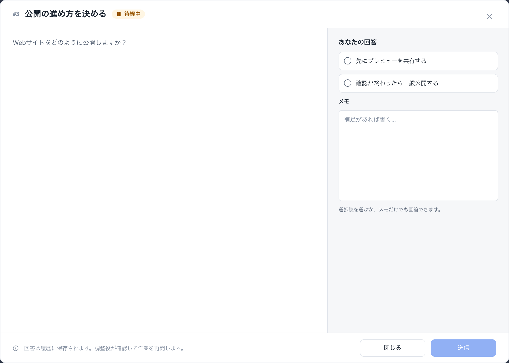
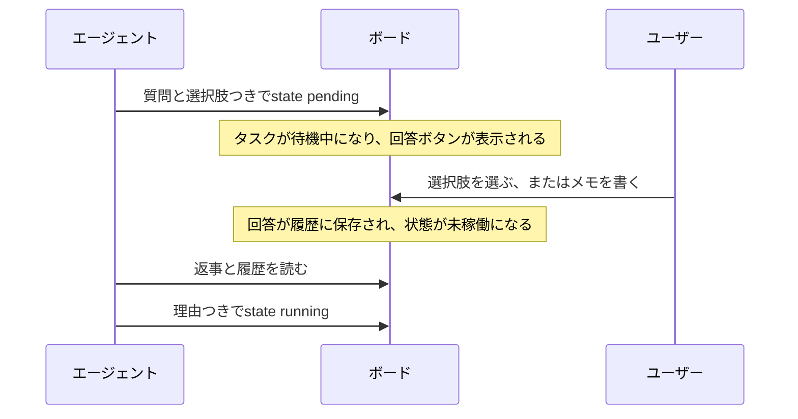

# 判断依頼

判断依頼は、エージェントがユーザーの判断を必要とするときに出す質問です。このページでは、PCやスマホから回答する方法と、エージェント側の質問の出し方を説明します。概要は[基本の考え方](../concepts#判断依頼)を参照してください。

## 質問に気づくには

質問のあるタスクは**待機中**です。未着手や進行中のタスクでは、カードに**質問に回答する**ボタンが表示されます。回答を入力したものの送っていない場合は、ボタンの表示が**回答を続ける**に変わります。待機中のタスクは[モバイルモニター](../operations/mobile-monitor)でも見られます。

## ブラウザで回答する

カードの**質問に回答する**を選ぶと、回答のダイアログが開きます。左に質問、右に回答の欄が並びます。選択肢を選ぶか、メモを入力して、両方を入力することもできます。入力したら**送信**を選びます。回答すると、タスクの列は変わらず、エージェントの状態が未稼働に戻ります。エージェントは、あなたの返事を読んでから、どう再開するかを決めます。

ウィンドウの幅が900pxより狭いときは、質問と回答を縦に一列に並べます。

{.screenshot}

回答は、タスクの履歴に保存されます。履歴では、質問と回答の各部分が別々のブロックとして表示されます。

- **閉じる**は、いつでも閉じるボタン、Escキー、ダイアログの外側のクリックで行えます。確認は出ず、入力は残ります。次に開くときは、カードの**回答を続ける**を選びます。
- 入力は、ページを開いている間は残ります。ページを再読み込みすると消えます。
- タスクを完了に移すと、入力した内容は消えます。
- 質問に有効期限はありません。回答されるか、タスクを移動するか、アーカイブで取り下げられるまで、未回答のまま残ります。

### 質問が差し替えられたとき

ダイアログを開いている間に、エージェントが新しい質問を出すと、「質問が新しくなりました。内容を確認して、もう一度回答してください。」と表示されます。選んでいた選択肢は外れるので、選び直してください。メモは残ります。

### 質問が取り下げられたとき

タスクを別の列に移したり、アーカイブしたりすると、質問は取り下げられます。ダイアログには「この質問は取り下げられました。回答は送れません。」と表示されます。質問と入力は読めるように残りますが、**送信**と**入力をクリア**は表示されず、**閉じる**だけが使えます。

### 送信に失敗したとき

入力は残り、「保存できませんでした。もう一度お試しください。」と表示されます。ダイアログから再試行してください。

## スマホで回答する

モバイルモニターでは、待機中のタスクに同じ**質問に回答する**ボタンが表示されます。ボタンを押すと、画面の下から回答のシートが開きます。シートでは、質問が先に、回答の欄が後に並びます。**送信**はシートの下に固定されるので、スクロールしても届く位置にあります。

タスク自体をタップすると、本文・受入条件・履歴・エピックのドロワーが開きます。左右にスワイプしてタブを切り替えます。スマホの接続は[モバイルモニター](../operations/mobile-monitor)を参照してください。

{.screenshot .screenshot--narrow}

送っていない回答があるままシートを閉じ、その後に質問が取り下げられたりタスクがボードから消えたりすると、モニターは「未送信の回答」として一覧に出します。この回答は送信されません。**回答を破棄**で削除できます。

## エージェントから質問する

ここからは、エージェントの開発・設定を行う方向けに、コマンドで質問を出す方法を説明します。



AI担当のタスクは、未着手でも進行中でも質問できますが、稼働中にできるのは進行中だけです。エージェントは、2〜10件の選択肢で尋ねます。CLIは、質問と2〜10件の選択肢を、`--request-json`でJSONとして受け取ります。引数に直接書くことも、標準入力から`-`で読むこともできます。

```json
{
  "question": "Which launch approach should we use?",
  "choices": [
    { "id": "preview", "label": "Publish a preview first" },
    { "id": "public", "label": "Launch publicly" }
  ]
}
```

引数に直接書いて送ります。

```sh
agboard --project "My project" state 1 pending --actor ai --request-json '{"question":"Which launch approach should we use?","choices":[{"id":"preview","label":"Publish a preview first"},{"id":"public","label":"Launch publicly"}]}'
```

標準入力から読むこともできます。

```sh
cat question.json | agboard --project "My project" state 1 pending --actor ai --request-json -
```

`choices`は2〜10件です。1件以下や11件以上、`--request-json`のない待機中の指定は拒否します。依頼にはIDが付き、`show`や`snapshot`で読めます。

質問はMarkdownで書け、上限は5,000文字です。タスク本文と同じ部品で表示されるので、見出し、リスト、コード、リンク、同じタスクに添付した画像が本文と同じように表示されます。`http`か`https`のURLの画像も、本文と同じように表示されます。回答のメモの上限は2,000文字です。

### 質問を差し替える

待機中のタスクは、今の質問を保ちます。待機中のタスクにもう一度`state pending`を実行しても、質問は差し替わりません。別の質問を出すには、先にタスクを別の列へ移動して、今の質問を取り下げます。移動すると依頼が消えるので、そのあとで新しい質問を出してください。

### 質問の回答を待つ

`pending --request-json`は、JSONに`wait`がなくても既定で回答まで待ちます。この待機には`agboard serve`の起動が必要です。依頼に回答されると、コマンドはタスクと回答を表示します。既存互換の`"wait": {}`も無期限待機になります。

用途に応じて、次の3通りで実行します。

waitを省略して、回答まで既定で待機します。

```sh
agboard --project "My project" state 1 pending --actor ai --request-json '{"question":"Which launch approach should we use?","choices":[{"id":"preview","label":"Publish a preview first"},{"id":"public","label":"Launch publicly"}]}'
```

質問を登録してすぐに戻る場合は、`--no-wait`を付けます。

```sh
agboard --project "My project" state 1 pending --actor ai --request-json '{"question":"Which launch approach should we use?","choices":[{"id":"preview","label":"Publish a preview first"},{"id":"public","label":"Launch publicly"}]}' --no-wait
```

600秒まで待つ例です（1〜86,400秒を指定できます）。

```sh
agboard --project "My project" state 1 pending --actor ai --request-json '{"question":"Which launch approach should we use?","choices":[{"id":"preview","label":"Publish a preview first"},{"id":"public","label":"Launch publicly"}],"wait":{"timeoutSeconds":600}}'
```

`--no-wait`では`agboard serve`は不要です。待機する2つの形式では`agboard serve`が必要で、CLIは質問を保存する前に起動状態を確認します。`--no-wait`と`wait: {}`は併用できますが、整数の`timeoutSeconds`との併用は`invalid_argument`（終了コード2）になり、質問・状態・履歴を変更しません。`wait: null`と`timeoutSeconds: null`は期限なしとして扱います。不正なJSON、未知の項目、型違い、範囲外timeoutは`invalid_value`（終了コード2）、`pending --request-json`以外での`--no-wait`は`invalid_argument`（終了コード2）です。

- 時間切れやCtrl+Cで待機は終了しますが、質問はPendingのままです。
- サーバーとの接続が切れると`board_unavailable`を返します。これは技術的なエラーで、質問はPendingのままです。
- タスクの移動で質問が取り下げられると、コマンドは`request_changed`で終わります。

### コマンドラインで回答する

人はCLIからも、依頼IDを渡して回答できます。

```sh
agboard --project "My project" state 1 idle --actor human --request "<request-id>" --choice preview --reason "Get feedback before the public launch"
```

選択肢か、`--reason`によるメモの少なくとも一方を指定します。両方の指定も可能です。エージェントは、返事と履歴をすべて読んでから、再開します。

```sh
agboard --project "My project" state 1 running --actor ai --reason "Preparing the preview requested by the user"
```

## 次に読む

- [エージェントとの連携](../automation/agents): 質問と回答待ちを含む、作業全体の流れ。
- [トラブルシューティング](../operations/troubleshooting): 回答が拒否される、質問が消えた。
