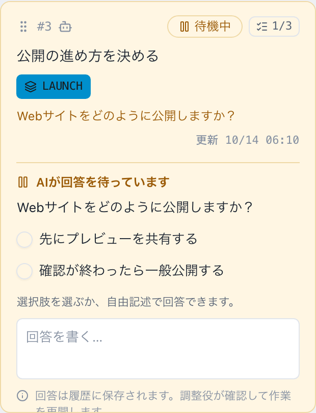
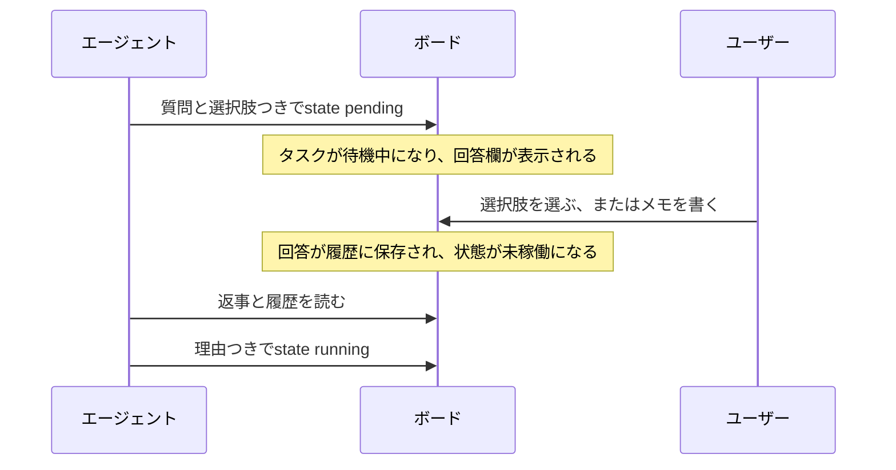

# 判断依頼

判断依頼は、エージェントがユーザーの判断を必要とするときに出す質問です。このページでは、PCやスマホから回答する方法と、エージェント側の質問の出し方を説明します。概要は[基本の考え方](../concepts#判断依頼)を参照してください。

## 質問に気づくには

質問のあるタスクは**待機中**で、未着手や進行中のタスク上に、質問と回答欄が表示されます。待機中のタスクは[モバイルモニター](../operations/mobile-monitor)でも見られます。

## ブラウザで回答する

選択肢を選ぶか、メモを入力して回答を送ります。両方を入力することもできます。回答すると、タスクの列は変わらず、エージェントの状態が未稼働に戻ります。エージェントは、あなたの返事を読んでから、どう再開するかを決めます。

{.screenshot}

タスクに、質問、選択肢、メモのテキスト欄が表示されます。あなたの回答はエージェントが読め、簡潔な理由が履歴に保存されます。

- PCのボードでは、回答欄を使っている間も、タスクの詳細を開いたりドラッグしたりできます。
- タスクを完了に移すと、回答欄に入力した内容は消えます。
- 質問に有効期限はありません。回答されるか、タスクの移動で取り下げられるか、エージェントが置き換えるまで未回答のまま残ります。

## スマホで回答する

モバイルモニターでは、待機中のタスクに同じ回答欄が表示されます。タスクをタップすると、本文・受入条件・履歴・エピックのドロワーが開きます。左右にスワイプしてタブを切り替えます。スマホの接続は[モバイルモニター](../operations/mobile-monitor)を参照してください。

{.screenshot .screenshot--narrow}

## エージェントから質問する

ここからは、エージェントの開発・設定を行う方向けに、コマンドで質問を出す方法を説明します。



AI担当のタスクは、未着手でも進行中でも質問できますが、稼働中にできるのは進行中だけです。エージェントは、2〜10件の選択肢で尋ねます。CLIは、質問と2〜10件の選択肢を、`--request-json`でJSONとして受け取ります。引数に直接書くことも、標準入力から`-`で読むこともできます。

```json
{
  "question": "Which launch approach should we use?",
  "choices": [
    { "id": "preview", "label": "Publish a preview first" },
    { "id": "public", "label": "Launch publicly" }
  ]
}
```

引数に直接書いて送ります。

```sh
agboard --project "My project" state 1 pending --actor ai --request-json '{"question":"Which launch approach should we use?","choices":[{"id":"preview","label":"Publish a preview first"},{"id":"public","label":"Launch publicly"}]}'
```

標準入力から読むこともできます。

```sh
cat question.json | agboard --project "My project" state 1 pending --actor ai --request-json -
```

`choices`は2〜10件で、1件以下や11件以上、`--request-json`のない待機中の指定は拒否します。依頼にはIDが付き、`show`や`snapshot`で読めます。

### 質問と待機を一つのコマンドで

JSONに`wait`オブジェクトを加えると、質問と回答の待機を一つのコマンドで行えます。`agboard serve`が動いている必要があります。`wait: {}`では期限を設けずに待ちます。依頼に回答されると、その回答（選択肢・メモ・タスク）を表示します。

```json
{
  "question": "Which launch approach should we use?",
  "choices": [
    { "id": "preview", "label": "Publish a preview first" },
    { "id": "public", "label": "Launch publicly" }
  ],
  "wait": {}
}
```

`"timeoutSeconds": 600`を加えると、待機時間を制限できます。値は1〜86,400（1日）です。`wait`がなければ、コマンドは質問を登録してすぐに終了します。

- 時間切れやCtrl+Cで待機は終了しますが、質問は待機中のままです。
- サーバーとの接続が切れると`board_unavailable`を返します。これは技術的なエラーで、質問は待機中のままです。
- タスクの移動で質問が取り下げられると、コマンドは`request_changed`で終わります。
- サーバーが起動していなければ、質問は登録されません。

### コマンドラインで回答する

人はCLIからも、依頼IDを渡して回答できます。

```sh
agboard --project "My project" state 1 idle --actor human --request "<request-id>" --choice preview --reason "Get feedback before the public launch"
```

選択肢か、`--reason`によるメモの少なくとも一方を指定します。両方の指定も可能です。エージェントは、返事と履歴をすべて読んでから、再開します。

```sh
agboard --project "My project" state 1 running --actor ai --reason "Preparing the preview requested by the user"
```

## 次に読む

- [エージェントとの連携](../automation/agents): 質問と回答待ちを含む、作業全体の流れ。
- [トラブルシューティング](../operations/troubleshooting): 回答が拒否される、質問が消えた。
