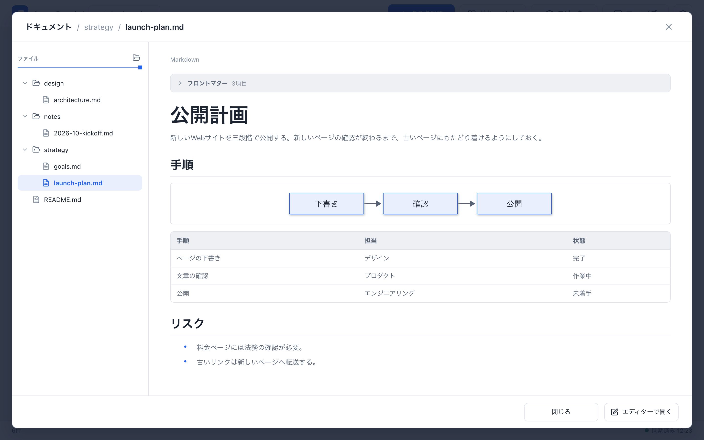
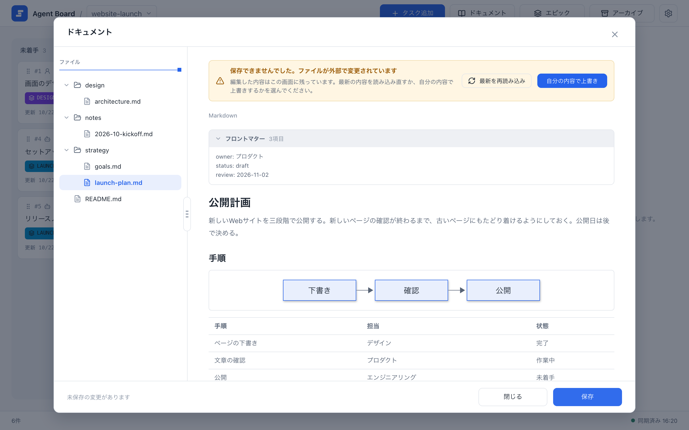

# プロジェクトのドキュメント

プロジェクトごとに、Markdown の文書を置く `docs/` フォルダがあります。戦略、仕様、設計、メモなどを置いておく場所です。ボードのヘッダーの **ドキュメント** から、フォルダの中を見て、ファイルを読み、その場で編集して保存できます。ドキュメントはボードとは別に扱われます。文書を保存しても、タスクやエピック、ボードの履歴は変わりません。

## ドキュメントを開く

ボードのヘッダーで **ドキュメント** を選びます。ダイアログの左にファイルの一覧、中央に開いたファイルが表示されます。

{.screenshot}

- **ファイルの一覧。** プロジェクトの `docs/` にあるフォルダとすべてのファイルを、フォルダを先にして表示します。ドットで始まる名前とシンボリックリンクは表示しません。ファイルの種類で扱いが変わります。Markdown（`.md`）は本文を開いて表示・編集でき、画像（PNG・JPEG・WebP・GIF）は本文の領域に表示するだけで編集できません。それ以外（`.pen`、`.json`、`.txt` など）は一覧に出しますが、本文には **表示対象外のファイルです。** とファイル名を示します。画像とそれ以外では保存は使えません。一覧の右端のつまみをドラッグすると、一覧の幅を変えられます。名前が長いときは省略せずに全体を表示し、一覧を横にスクロールできます。
- **フォルダを開く。** 見出し **ファイル** の右端のアイコンで、プロジェクトの`docs/`フォルダを、Finder などコンピュータのファイルマネージャで開けます。開くアプリはOSによって違います。表示されるのはコンピュータの画面だけで、電話の幅の画面には出ません。開けなかったときは、見出しの下に短いメッセージが出ます。
- **本文。** ファイルを選ぶまでは、中央に **ファイルを選択してください** と表示されます。ファイルを選ぶと内容が表示されます。表、コードブロック、Mermaid の図、画像は整形して表示されます。
- **フロントマター。** ファイルの先頭にある `---` で囲まれた YAML は、本文の上の **フロントマター** の欄に分けて表示されます。欄は折りたためますが、ここでは編集できません。保存しても元のまま残ります。
- **画像。** `` のように相対パスで書いた画像は、そのファイルがあるフォルダを基準に探します。`docs/` の中にある PNG・JPEG・WebP・GIF の画像を表示します。`http` と `https` のアドレスの画像は、ボードと同じように読み込みます。

ファイルの一覧はダイアログを開いたときに1回、ファイルの内容は選んだときに読み込みます。ダイアログを開いている間に追加したファイルを見るには、いったん閉じてから **ドキュメント** を開き直してください。別のプロジェクトに切り替えると、ダイアログは最初の状態に戻ります。

プロジェクトにファイルがないときは、**このプロジェクトにはDocsがありません** と表示され、データ領域の中のフォルダのパス `shared/projects/<プロジェクトID>/docs/` と、パスをコピーするボタンが出ます。

電話の幅の画面では、ファイルの一覧が画面全体に表示されます。ファイルを選ぶと、一覧の代わりに内容が表示されます。別のファイルを選ぶには、ダイアログを閉じて **ドキュメント** を開き直してください。

## 編集して保存する

本文は、タスクやエピックと同じ Markdown エディタです。整形された表示のまま、直接編集できます。編集モードの切り替えはありません。

1. 本文をクリックして変更します。フッターの表示が **変更はありません** から **未保存の変更があります** に変わります。
2. **保存** を選びます。**保存** は、変更があるときだけ押せます。
3. 保存してもダイアログは閉じません。そのまま編集を続けることも、別のファイルを開くこともできます。

ファイルを開いて閉じるだけでは、ファイルは書き換わりません。未保存の変更があるまま、別のファイルを選ぶ、ダイアログを閉じる、ファイルを読み込み直す、のいずれかをすると、変更を破棄してよいかを確認します。**編集を続ける** を選ぶと、入力した内容に戻れます。

OS で読み取り専用になっているファイルには、**このファイルは読み取り専用です。編集と保存はできません。** と表示されます。ほかの理由で保存できなかったときは、フッターに理由が表示されます。入力した内容はエディタに残るので、もう一度保存できます。

## ファイルがほかで変更されていたとき

編集している間に、テキストエディタや `git`、エージェントなど別のプログラムが同じファイルを変更することがあります。保存するとき、Agent Board はファイルが開いたときのままかを確かめます。変わっていた場合は何も書き込まず、**保存できませんでした。ファイルが外部で変更されています** と表示します。編集した内容は画面に残ります。

{.screenshot}

- **最新を再読み込み** は、ファイルの今の内容を表示します。保存していない編集は失われるので、先に確認します。
- **自分の内容で上書き** は、新しくなったファイルに自分の内容を上書きして保存します。ほかでの変更は失われます。

2つの内容を並べて比べる機能はありません。両方の変更が必要なときは、自分の内容を別の場所に写してから再読み込みし、手で合わせてください。

この確認は、このダイアログからの保存に対して働きます。保存とまったく同じ瞬間に別のプログラムがファイルを書き込んだ場合、Agent Board はそのプログラムと調整しないので、その書き込みが失われることがあります。同じファイルを2か所で同時に編集しないでください。

## 保存すると書き方が変わる記法

開いて閉じただけのファイルは、1バイトも変わりません。一度編集すると、エディタは本文全体を自分の Markdown の書き方で書き出します。内容は同じですが、次の記法が変わります。

| 元の書き方 | 保存後 |
| --- | --- |
| Setext 形式の見出し（`===` や `---` の下線を引いた行） | `#` と `##` の見出し |
| 末尾に `#` を付けた見出し | 末尾の `#` がない見出し |
| `*` や `+` で始まる箇条書き | `-` で始まる箇条書き（すぐ前に別の箇条書きがあると `*` になることがあります） |
| `1)` 形式の番号付きリスト | `1.` 形式の番号付きリスト |
| 4つの空白で字下げした入れ子のリスト | 2つの空白の字下げ |
| `* * *` | `***` |
| `~~~` で囲んだコードブロック | バッククォート3つで囲んだコードブロック |
| 行末の空白2つによる改行 | 行末のバックスラッシュ |
| むき出しの URL | 山かっこで囲んだ URL（`<https://…>`） |
| 本文中の `*` | `\*` |
| 別の行に `[ref]: …` を書く参照リンク | インラインのリンク（参照の行は消えます） |
| 表 | 列の幅をそろえた表。配置の行は `:-`、`:-:`、`-:` の形 |
| Windows の改行（CRLF） | LF の改行 |

フロントマターは書き換わりません。書き方をそのまま保ちたいファイルは、テキストエディタで編集してください。

## ファイルを追加・整理する

このダイアログで編集できるのは、すでにあるファイルだけです。ファイルやフォルダの作成、名前の変更、移動、削除はできません。これらはフォルダそのものに対して、Finder やエクスプローラー、テキストエディタ、エージェントで行います。

```sh
agboard --project "My project" workspace --json
```

結果の `folder` がプロジェクトのフォルダで、文書はその中の `docs/` にあります。ここに `.md` ファイルを置き（サブフォルダに分けても構いません）、**ドキュメント** を開き直すと表示されます。

- `docs/` は、プロジェクトを作成したときに作られます。中には、アプリの言語で書かれた短い `README.md` が置かれます。`docs/` がない古いプロジェクトでは、サーバーの起動時に作られます。自分で消した `README.md` は元に戻りません。
- 開いて保存できるのは、2 MiB までのファイルです。UTF-8 のテキストで、名前が `.md` で終わる必要があります。
- `agboard project rm` でプロジェクトを削除すると、その `docs/` も削除されます。残したいファイルは先にコピーしてください。
- ドキュメントは [モバイルモニター](../operations/mobile-monitor) には表示されません。

## 次に読む

- [編集と画像添付](./editing): タスクとエピックで使う同じエディタ。
- [データとバックアップ](../operations/data): データ領域の場所とバックアップの方法。
