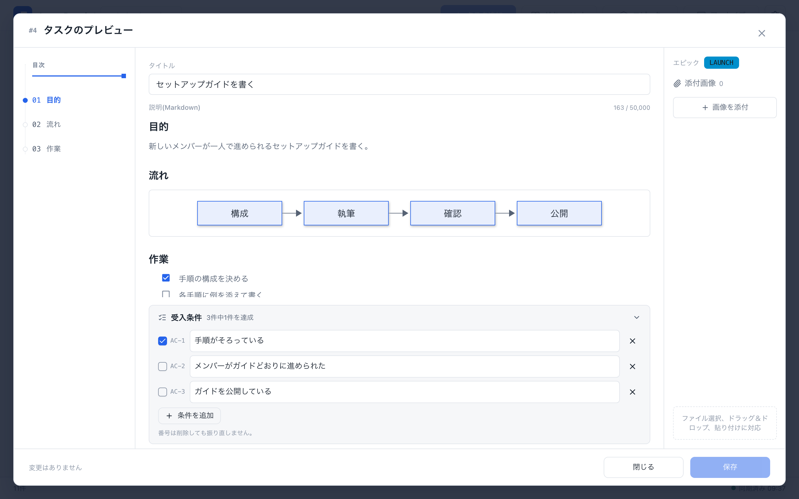
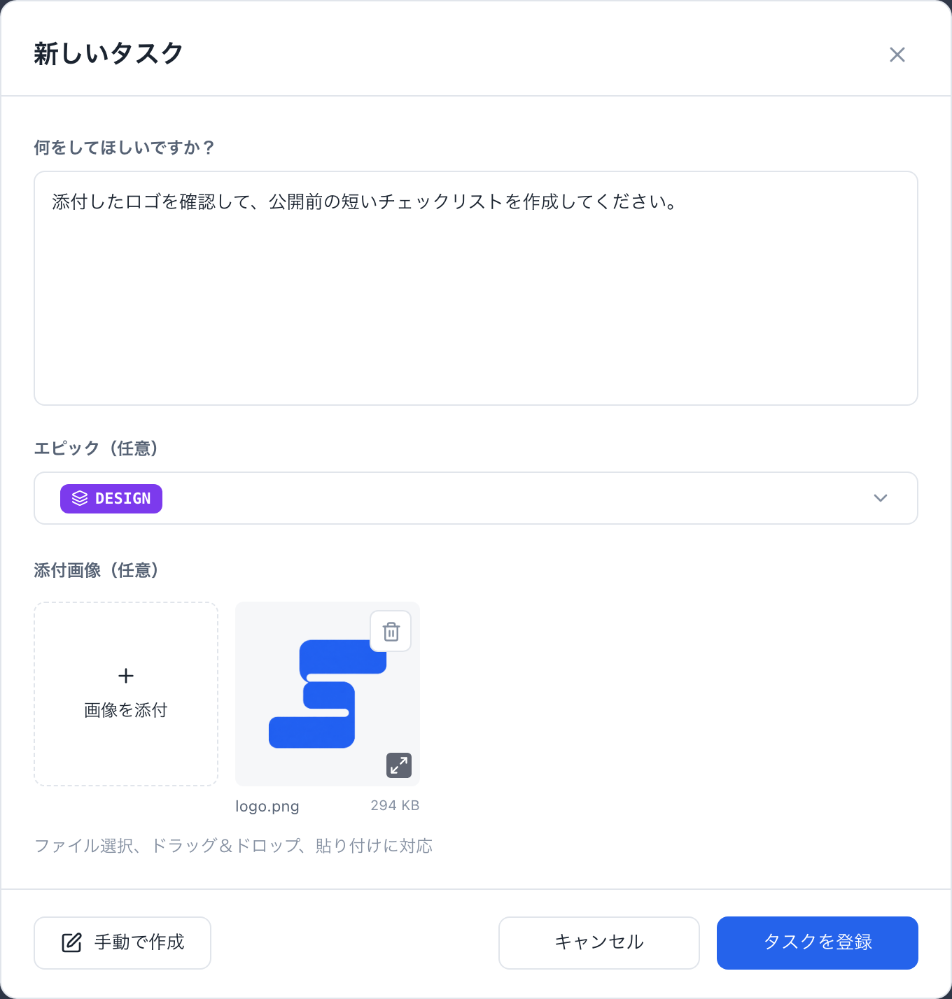

# 編集と画像添付

タスクとエピックは、Markdownのエディターで書きます。タスクの完了条件は本文の下のパネルにあり、タスクには画像を添付できます。検証結果はタスクの本文や履歴に記録します。エージェントも、共有フォルダに保存された同じファイルを編集します。このページはエディターと画像を扱い、ファイルの形式は[Markdownファイルの形式](../automation/file-format)にあります。

## エディターでタスクとエピックの詳細を書く

{.screenshot}

エディターは、左に目次、中央にMarkdown本文、右にエピックと画像の添付を表示します。

- **書式:** 見出し、タスクリスト、表、コードブロック、Mermaid図、画像に対応しています。画像や図をクリックすると拡大します。
- **目次:** 目次から本文の見出しへ移動できます。受入条件は本文の下にあるパネルで編集します。
- **保存:** **保存**は、ダイアログのすべての変更をまとめて書き込みます。完了条件にチェックを入れる前に、検証を記録してください。
- **受入条件:** タスクを作成・編集するとき、受入条件は本文の下のパネルにあり、最初は折りたたまれています。開いて編集します。長い一覧はパネルの中でスクロールします。条件には固定のIDがあり、並べ替えられません。既存のタスクの条件を読むには、**受入条件**タブを使います。エピックには専用の条件パネルがありません。参考となる完了条件は、詳細の本文にMarkdownで記述します。

エピックのダイアログ（名前・色・詳細・タスクの順序）は[エピックと進行表](./epics)、下書きは[ボード](./board#下書き)を参照してください。

## プレビューと保存 {#preview-and-save}

タスクのプレビューは、詳細ツールバーの**全画面で開く**で開きます。エピックのプレビューは、タスクのエピックタブでエピックのラベルの右にある**全画面で開く**か、エピック詳細の鉛筆ボタン（**エピックを編集**）で開きます。アーカイブ済みのタスクも同じプレビューで開き、読み取り専用になります。理由には「**アーカイブ済みのため、読み取り専用です。**」と表示されます。

プレビューの見出しは**タスクのプレビュー**か**エピックのプレビュー**で、**閉じる**ボタンが使えます。開いただけでは、タスクを下書きにせず、履歴も変わりません。変更がないあいだは、エージェントや別のブラウザによる最新の内容に追従し、左下に更新時刻を表示します。

タイトル・本文・完了条件・画像（エピックは名前・色・詳細・画像・タスクの順序も）を最初に変えると、次のことが起きます。

- タスクまたはエピックが下書きになり、ヘッダーに**下書き**のラベルが出ます。
- 左下に「**未保存の変更があります。**」と表示されます。タスクの場合は「**保存するまで、エージェントはこのタスクを変更できません。**」、エピックの場合は「**保存するまで、エージェントはこのエピックを変更できません。**」が続けて表示されます。
- **保存**が使えるようになり、プレビューは追従を止めます。

**保存**は、変更の書き込みと下書きの解除を一度に行います。プレビューを開く前から下書きだった場合は、下書きのまま残ります。macOS の Cmd+S、または Ctrl+S でも保存できます。**保存**が使えないときは、これらのキーを押しても何も起きません。

変更を取り消すには、**キャンセル**を選んでから**破棄して閉じる**を選びます。文章は保存済みの内容に戻り、下書きは解除されます。プレビューを開く前から下書きだった場合は、下書きのまま残ります。元の文章に戻しても、プレビューを閉じるまでは下書きのままです。

次の場合は保存できません。入力は残り、左下に理由が表示されます。

- 最初の変更のあとに、タスクが稼働中になった。エージェントが作業を始めた可能性があります。
- 開いている間に内容が変わっていて、保存すると新しい内容を上書きしてしまう。**キャンセル**、**破棄して閉じる**の順に選び、プレビューを開き直して最新の内容を確認してください。

稼働中のタスクは、**稼働中**のラベルと理由「エージェントが作業中のため、読み取り専用です。」を表示して、読み取り専用で開きます。入力と画像の追加はできません。エージェントが作業を終えると、編集できる状態に戻ります。保存が通信エラーで失敗した場合は、入力を残したままなので、もう一度試せます。

## 依頼を送る

ボード上部の**タスクを追加**を選ぶと、簡易依頼フォームが開きます。依頼内容を入力し、必要に応じてエピックと画像を指定して登録します。AI担当の新しいタスクがTodoに追加され、入力した依頼全体が本文に保存されます。最初の空でない行から、Unicode文字数で最大100文字をタイトルにします。

{.screenshot}

AIセッションがリッスン中なら、この依頼はTodoの起票済みタスクと同じように取得されます。リッスン中のセッションがなければ、タスクはボードに残り、あとから着手できます。依頼フォームの**手動で作成**を選ぶと、従来のタスク編集画面が開きます。ここでは、タイトル・説明・担当・下書き・受入条件・画像を自分で設定できます。これまでのタスク編集と保存も引き続き利用できます。

依頼・任意のエピック・画像はまとめて保存されます。エピックは、選択候補と選択後のどちらも、設定色を使ったIDのラベルで表示します。ラベルにカーソルを合わせると正式名を確認できます。保存に失敗した場合、入力した文章と選んだ画像をフォームに残すため、そのまま再試行できます。画像は省略でき、通常のタスク添付と同じPNG・JPEG・WebP・GIFの制限が適用されます。

画像欄の左端にある正方形の**画像を添付**を押してファイルを選びます。追加枠と画像プレビューは上端が揃い、画像を追加しても行の位置は変わりません。プレビューを横にスクロールしても、追加枠は左端に残ります。フォームの高さは内容に合わせ、添付欄の下に大きな空白を残しません。依頼の入力欄への画像の貼り付けや、添付欄へのドロップにも対応しています。高さが足りない画面では入力欄をスクロールでき、**キャンセル**と**タスクを登録**は画面内に残ります。

## 画像を追加する

ブラウザのエディターで、画像を選ぶ、ドロップする、貼り付けるのいずれかを行い、本文に挿入します。画像はPNG・JPEG・WebP・GIFで、1件10 MiBまで、タスクごとに20件・合計50 MiBまでです。

コマンドラインでは次のようにします。

```sh
agboard --project "My project" attachment add 1 --file diagram.png --actor ai
agboard --project "My project" attachment ls 1 --json
agboard --project "My project" attachment get 1 "<attachment-id>" --output diagram-copy.png
```

画像は、Markdownでは`attachment:<attachment-id>`として参照し、画像データはローカルのファイルに保存されます。スナップショットには画像のメタデータが含まれ、進行表とHookには含まれません。`attachment get`は、既存の出力ファイルを上書きしません。

## ファイルを直接編集する

ユーザーもエージェントも、タスクの`TASK.md`とエピックの`EPIC.md`を直接編集できます。保存すると、ボードが変更を検知して表示に反映します。場所を推測せず、プロジェクトのフォルダを調べます。

```sh
agboard --project "My project" workspace --json
```

結果には、`folder`（プロジェクトの絶対パス）、`projectId`、`readme`、`tasks`、`epics`が含まれます。まずプロジェクトの`README.md`を読みます。ボードが書きかけのファイルを読まないよう、同じフォルダに一時ファイルを書いて、元のファイルへ名前を変更して置き換えます（rename）。メタデータや状態の変更にはCLIを使い、`task.json`・`epic.json`・`project.json`・ロックのファイルは編集せず、タスクやエピックのフォルダを手で削除しません。共有ファイルに個人の絶対パスを書かないでください。

これらのファイルに必要な構造は、[Markdownファイルの形式](../automation/file-format)にあります。

## 次に読む

- [Markdownファイルの形式](../automation/file-format): frontmatter、履歴、自動完了。
- [CLIリファレンス](../automation/cli): すべてのコマンド。
