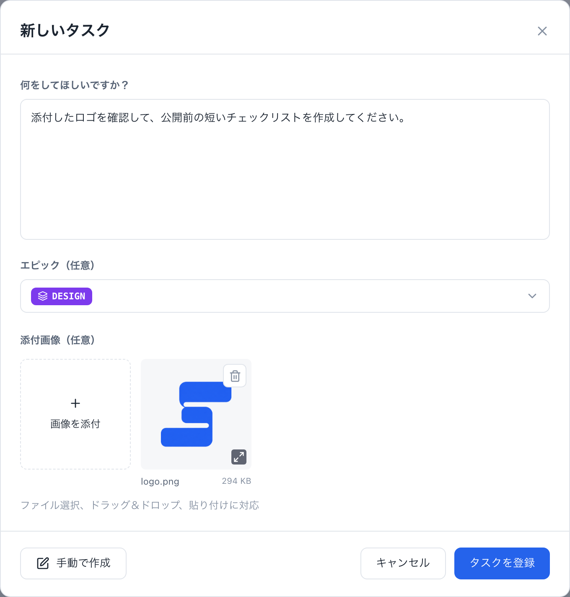

# 編集と証跡

タスクとエピックは、Markdownのエディターで書きます。タスクの完了条件は本文の下のパネルにあり、タスクには画像とテキストの証跡を添付できます。エージェントも、共有フォルダに保存された同じファイルを編集します。このページはエディター・画像・証跡を扱い、ファイルの形式は[Markdownファイルの形式](../automation/file-format)にあります。

## エディターでタスクと計画を書く

{.screenshot}

エディターは、左に目次、中央にMarkdown本文、右にエピックと画像の添付を表示します。

- **書式:** 見出し、タスクリスト、表、コードブロック、Mermaid図、画像に対応しています。画像や図をクリックすると拡大します。
- **目次:** 目次から、本文の見出しへ移動したり、条件のパネルを開いたりできます。
- **保存:** ダイアログの変更は、まとめて保存するか、取り消します。完了条件にチェックを入れる前に、検証を記録してください。
- **受入条件:** タスクを作成・編集するとき、受入条件は本文の下のパネルにあり、最初は折りたたまれています。開いて編集します。長い一覧はパネルの中でスクロールします。条件には固定のIDがあり、並べ替えられません。既存のタスクの条件を読むには、**受入条件**タブを使います。エピックには専用の条件パネルがありません。参考となる完了条件は、計画の本文にMarkdownで記述します。

エピックのダイアログ（名前・色・計画・タスクの順序）は[エピックと進行表](./epics)、下書きは[ボード](./board#下書き)を参照してください。

## 依頼を送る

ボード上部の**タスクを追加**を選ぶと、簡易依頼フォームが開きます。依頼内容を入力し、必要に応じてエピックと画像を指定して登録します。AI担当の新しいタスクがTodoに追加され、入力した依頼全体が本文に保存されます。最初の空でない行から、Unicode文字数で最大100文字をタイトルにします。

{.screenshot}

AIセッションがリッスン中なら、この依頼はTodoの起票済みタスクと同じように取得されます。リッスン中のセッションがなければ、タスクはボードに残り、あとから着手できます。依頼フォームの**手動で作成**を選ぶと、従来のタスク編集画面が開きます。ここでは、タイトル・説明・担当・下書き・受入条件・画像を自分で設定できます。これまでのタスク編集と保存も引き続き利用できます。

依頼・任意のエピック・画像はまとめて保存されます。エピックは、選択候補と選択後のどちらも、設定色を使ったIDのラベルで表示します。ラベルにカーソルを合わせると正式名を確認できます。保存に失敗した場合、入力した文章と選んだ画像をフォームに残すため、そのまま再試行できます。画像は省略でき、通常のタスク添付と同じPNG・JPEG・WebP・GIFの制限が適用されます。

画像欄の左端にある正方形の**画像を添付**を押してファイルを選びます。追加枠と画像プレビューは上端が揃い、画像を追加しても行の位置は変わりません。プレビューを横にスクロールしても、追加枠は左端に残ります。フォームの高さは内容に合わせ、添付欄の下に大きな空白を残しません。依頼の入力欄への画像の貼り付けや、添付欄へのドロップにも対応しています。高さが足りない画面では入力欄をスクロールでき、**キャンセル**と**タスクを登録**は画面内に残ります。

## 画像を追加する

ブラウザのエディターで、画像を選ぶ、ドロップする、貼り付けるのいずれかを行い、本文に挿入します。画像はPNG・JPEG・WebP・GIFで、1件10 MiBまで、タスクごとに20件・合計50 MiBまでです。

コマンドラインでは次のようにします。

```sh
agboard --project "My project" attachment add 1 --file diagram.png --actor ai
agboard --project "My project" attachment ls 1 --json
agboard --project "My project" attachment get 1 "<attachment-id>" --output diagram-copy.png
```

画像は、Markdownでは`attachment:<attachment-id>`として参照し、画像データはローカルのファイルに保存されます。スナップショットには画像のメタデータが含まれ、進行表とHookには含まれません。`attachment get`は、既存の出力ファイルを上書きしません。

## 証跡を追加する

証跡は、テストの出力など、結果を裏づけるUTF-8のログやテキストです。追加時に返される証跡IDを使って、内容を確認できます。

```sh
agboard --project "My project" evidence add 1 test-output.log
agboard --project "My project" evidence show 1 "<evidence-id>"
```

読む人が見つけられるよう、証跡IDをタスクの本文に書いておきます。

## ファイルを直接編集する

ユーザーもエージェントも、タスクの`TASK.md`とエピックの`PLAN.md`を直接編集できます。保存すると、ボードが変更を検知して表示に反映します。場所を推測せず、プロジェクトのフォルダを調べます。

```sh
agboard --project "My project" workspace --json
```

結果には、`folder`（プロジェクトの絶対パス）、`projectId`、`readme`、`tasks`、`epics`が含まれます。まずプロジェクトの`README.md`を読みます。ボードが書きかけのファイルを読まないよう、同じフォルダに一時ファイルを書いて、元のファイルへ名前を変更して置き換えます（rename）。メタデータや状態の変更にはCLIを使い、`task.json`・`epic.json`・`project.json`・ロックのファイルは編集せず、タスクやエピックのフォルダを手で削除しません。共有ファイルに個人の絶対パスを書かないでください。

これらのファイルに必要な構造は、[Markdownファイルの形式](../automation/file-format)にあります。

## 次に読む

- [Markdownファイルの形式](../automation/file-format): frontmatter、履歴、自動完了。
- [CLIリファレンス](../automation/cli): すべてのコマンド。
