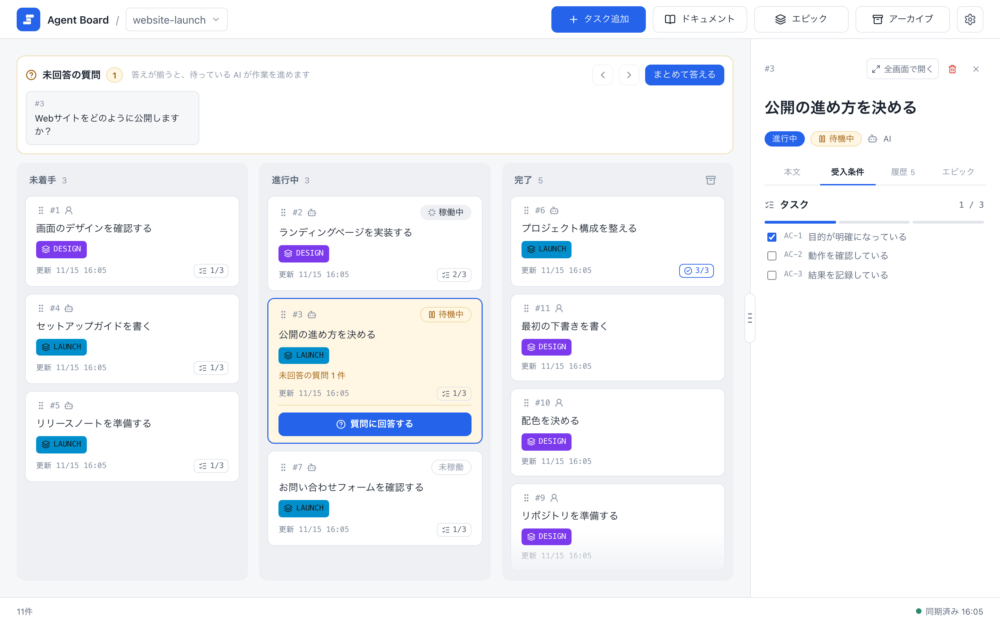

# ボード

ボードは、仕事を見守り、エージェントを止めずに介入する場所です。何が動き、何が待っているかが見えます。カードを動かす、条件にチェックを付ける、タスクを書き換える、といった操作は、エージェントを止めずに行えます。エージェントは、次にボードを読むときにその変更に従います。このページでは日々の操作を扱います。操作の前提となる概念は[仕事のモデル](../work-model)を参照してください。エージェントが止まってあなたに尋ねるときの回答は、[判断依頼](../delegate/decisions)で行います。

## 仕事を追加する

1. ヘッダーでプロジェクトを選び、**AI に依頼**を選びます。
2. やってほしいことを書き、必要なら画像を添付して**依頼する**を選びます。依頼はタスクではなく、メッセージとしてエージェントに届きます。エージェントが受け取るまでは、レーンの上の帯の**あなたの依頼**に数えられ、一覧には**受け取り待ち**と表示されます。
3. 依頼を送ると、PC でもスマホでもメッセージの一覧が**あなたの依頼**タブで開き、送った依頼をすぐ確認できます。送信に失敗したときは、入力した文章と画像を残したままフォームが開いたままになります。

スマホでは、依頼のフォームを開いたまま下部のバーで別の項目を選ぶと、フォームが閉じてその項目が表示されます。入力した文章や添付した画像がある場合は、破棄してよいかを確認し、編集に戻るを選ぶとフォームに留まります。

ボードには、手でタスクを追加するフォームはありません。タスクは依頼をもとにエージェントが作るほか、`agboard add`でも追加できます（[CLI](../reference/cli)を参照）。新しいタスクは未着手の列の末尾に追加されます。担当はタスク作成後に変更できません。

## タスクを読む {#read-a-task}

タスクを選ぶと、右側に詳細が開きます。タブの内容は次のとおりです。

| タブ | 表示するもの |
| --- | --- |
| **本文** | タスクの本文。 |
| **完了条件** | そのタスクの完了条件と、その進捗。 |
| **成果** | エージェントが見せるために届けたもの。新しい順に表示。[成果を読む](#成果を読む)を参照。 |
| **履歴** | 操作や進捗の記録。日時と理由を新しい順に表示。 |
| **エピック** | タスクが属するエピックの詳細（あれば）。 |

{.screenshot}

右側のパネルに選択したタスクが表示されます。完了条件のタブには、そのタスクの条件だけが進捗バーつきで並びます。各条件はタスクの本文と同じようにMarkdownで表示されるので、リンク、コード、画像を入れられます。エピックの参考条件は、詳細の本文に書きます。

完了条件のタブでは、条件のチェックを付けたり外したりできます。変更はすぐ画面に出て、その場で保存されます。保存できなかったときは、チェックが元に戻り、そのことを表示します。保存は最新のファイルに対して行うので、開いたあとにエージェントがタスクを変えていても、あなたの選択が優先されます。ファイルのほかの部分（エージェントのほかの変更を含む）はそのまま残ります。履歴には、人が条件を付け外ししたことが残ります。

- 未着手か進行中のAI担当のタスクで最後の条件にチェックを付けると、エージェントがチェックしたときと同じく、タスクは自動で完了に移ります。
- 完了のタスクでチェックを外しても、完了のままです。作業を続けるときは、自分で移動してください。
- アーカイブ済みのタスクの条件は変えられません。条件の文言を変えるときは、タスクを復元してからプレビューを開きます。

タッチ操作の画面では、パネルを左右にスワイプすると隣のタブへ移ります。スマートフォンでタスクのタブを切り替えるときと同じく、隣のタブが指に合わせて動きます。マウスではパネルは動かないので、文字を選択できます。ボタン、リンク、コード、画像、横にスクロールする表の上から始めたスワイプは、その要素の操作になります。

各タブは、開いたときに内容を読みます。**履歴**タブの件数は、履歴の読み込みが終わってから表示されます。

### 成果を読む {#成果を読む}

エージェントが`agboard result add`で成果を届けると（[成果を届ける](../reference/cli.md#deliver-a-result)を参照）、**成果**タブに表示されます。成果は新しい順に並び、それぞれ次を表示します。

- **途中経過**または**最終**のバッジ、版の番号、届いた日時。
- タイトル（成果の見出し）。エージェントが付けたタイトルで、付けていないときは要約の最初の1文です。
- 要約。
- 画像（あれば）。1枚のときは大きく、複数のときは横にスクロールできるサムネイルの列で表示します。選ぶと大きく表示します。大きな表示では、横にスワイプ（または左右の矢印キー）で他の画像へ移り、画像の下に「2 / 4」のように位置を示します。縦に長い画像は幅に合わせて表示し、ビューアの中で上下にスクロールできます。ビューアはスマートフォンの下部バーに重ならない範囲に収まります。
- 主な成果物のリンクや保存先（あれば）。`http:`または`https:`のURL（プルリクエストなど）のときはリンクになり、タップまたは選択すると新しいタブで開きます（iPhoneのホーム画面アプリではSafariで開きます）。ファイルのパスや`file:`のアドレスなど、それ以外の値はテキストとして表示するだけです。成果物はPCにしかない場合があるためです。

成果は、プロジェクト・タスク・版を指定したアドレス（`https://<host>/?project=<ProjectId>&task=<id>&result=<version>`）から、直接読むこともできます。開くと、そのタスクの詳細が**成果**タブで開き、該当の成果までスクロールして強調表示します。スマホでは[リモートアクセス](./remote-access.md#成果のリンクから開く)から、PCのボードでも使え、直前に別のプロジェクトを表示していても開けます。タスクにその版がないときは、タブにそのことを表示し、あるものを一覧します。

## タスクを移動する

タッチ画面では、カード上部の左にあるグリップを押して指を動かすと、すぐにドラッグできます。カードの別の場所でも、少し押し続けるとドラッグできます。素早くなぞると、列がスクロールします。

タッチ画面では、ボタン、タブ、テーマのタイルは高さ 44 px 以上で表示され、ダイアログを開いても画面のキーボードは出ません。入力するときは欄をタップしてください。タブレットでは、ダイアログがキーボードの上の領域に移り、入力中の欄に場所を空けます。余白とボタンが小さくなり、エディターの目次や添付、回答の横の質問など、入力していない部分はキーボードを閉じるまで畳まれます。キーボードを開いたままでも、「依頼する」や「回答を送る」を 1 回タップすれば送信されます。先にキーボードを閉じる必要はありません。

幅が 1024 px より狭いウィンドウでは、ヘッダーの **ドキュメント**、**エピック**、**アーカイブ** はアイコンだけになり、どれも同じ幅でそろいます。そのぶんプロジェクト名の場所が空きます。

タスクを別の列にドラッグすると移動します。確認はなく、すぐに移動し、履歴には移動内容に応じた理由が自動で記録されます。

ボードが最後に表示したあとで、エージェントや別のブラウザがそのタスクを移動していた場合は、移動しません。カードは今の列に戻り、その列を伝える短い通知が出ます。もう一度ドラッグすると、今の列から移動します。

列の意味は次のとおりです。

| 列 | 意味 |
| --- | --- |
| 未着手(Todo) | まだ始めていない作業。 |
| 進行中(Doing) | 作業中。AIが担当するタスクにはエージェントの状態も表示されます。 |
| 完了(Done) | 完了した作業。 |

進行中のAI担当タスクには、**未稼働**・**稼働中**・**待機中**のいずれかが表示されます。エージェントが着手前に質問した場合は、未着手のタスクも待機中になります。ユーザー担当のタスクと完了のタスクは、常に未稼働です。稼働中はエージェントが作業していること、待機中はあなたの回答が必要なことを表し、回答は、カードの**質問に回答する**ボタンか、レーンの上の**メッセージ**の帯から開く一覧から行います（[判断依頼](../delegate/decisions)を参照）。列を移すと稼働中のタスクは未稼働に戻ります。未回答の質問はそのまま残るので、未着手か進行中なら待機中のままです。変更とその理由は、すべて履歴に残ります。

## タスクを変更する

タスクを編集したりエピックに割り当てたりするには、詳細ツールバーの**全画面で開く**を選びます。プレビューは同じエディターを使い、開いただけでは何も変わりません。最初の変更で下書きになり、**保存**すると確定します。くわしくは[プレビューと保存](./editing#preview-and-save)を参照してください。

## 下書き {#drafts}

下書きにすると、編集中のタスクをエージェントが変更できなくなります。エージェントは、`TASK.md`も含めて、下書きを変更できません。

- 既存のタスクを変えるには、プレビューを開きます。最初の変更で下書きになり、**保存**すると下書きが解除されて、エージェントが再び扱えるようになります。エディターに下書きのチェックボックスはありません。
- 変更を取り消すには、**キャンセル**を選んでから**破棄して閉じる**を選びます。文章は保存済みの内容に戻り、履歴には「下書きの変更を破棄しました。」と残ります。
- 稼働中のタスクは読み取り専用で開きます。下書きにはできません。

下書きのタスクには**下書き**ラベルが表示されます。確定を忘れると、エージェントはそのタスクを動かせず、更新できません。プレビューを閉じたあとに下書きが残った場合は、詳細パネルの**確定する**を選んで解除します。

### Backlogの計画 {#backlog-plans}

計画だけを頼むと、エージェントは計画をBacklogに置きます。Backlogは、まだ始めてはいけない確定済みの計画を置く場所で、「始めない」という意味です。エージェントは始めません。Backlogのレーンが付く先のリリースまでは、Backlogの計画は、**下書き**バッジの付いた通常のカードとして未着手に並び、レーンの見出しの件数にも通常のタスクと同じように数えられます。開いて計画を読み、それに関する質問に答えられます。エージェントはそのタスクを動かしたり、状態を変えたりできません。

計画は、チャットやAIへの依頼で直します。**AIに依頼**でエージェントに依頼を送ってください。計画ではなく作業そのものを頼んだ場合は、通常のTodoのカードができます。

計画をTodoへ送れるのはあなただけです。まだボタンはないので、コマンドラインを使います。カードは`agboard send <id> --actor human`、エピックは`agboard epic send <EPIC-ID> --actor human`です（[CLI](../reference/cli)を参照）。計画に未回答の質問が残っているときは、`--force`で確認するまで送信が断られます。

## アーカイブ {#archive}

完了したタスクをアーカイブすると、何も削除せずにボードを片付けられます。

- 個別のタスクは詳細からアーカイブできます。完了の列の**完了タスクをアーカイブ**を選ぶと、まとめてアーカイブできます。
- ヘッダーの**アーカイブ**を開くと、アーカイブ済みのタスクを確認し、元の列へ復元し、完全に削除できます。完全削除はアーカイブからだけ行えます。

{.screenshot}

アーカイブ画面には、アーカイブ済みのタスクがID、タイトル、担当、日付と、所属していたエピック（ある場合）とともに並びます。並び順はアーカイブした日時の新しい順です。同じ日時のタスクはIDの大きいほうが先で、アーカイブ日時の記録がないタスクは最後に並びます。スマートフォンのアーカイブ一覧も同じ順序です。一覧は50件ずつ読み込みます。行の末尾までスクロールすると次のページを読み込み、最後の行の下に一覧がここまでであることを示す表示が出ます。ページを読み込めないときは、表示済みの行を残したまま、その下に**再試行**ボタンが出ます。タスクを選ぶと詳細を確認できます。

アーカイブ済みタスクの詳細は、通常のタスクと同じ構成です。右上の**復元**と、ごみ箱アイコンの完全削除が閉じるボタンの隣に並びます。完全削除の前には確認が出ます。

## 狭いウィンドウとスマートフォン {#narrow-windows-and-phones}

ウィンドウの幅が768ピクセル未満のとき、またスマートフォンでは、ボードはレーンを横に並べる代わりにモバイル向けの表示になります。未着手・進行中・完了のタブに件数が表示され、その下に一度に一つのレーンが表示されます（開いたときは進行中のレーンです）。画面の下には、**ボード**・**メッセージ**・**依頼**・**アーカイブ**・**設定**のバーがあり、**メッセージ**には回答を待つ質問の数が出て、一覧を開けます。タブをタップするか横にスワイプするとレーンが切り替わります。タスクを選ぶとドロワーで内容を読み、条件にチェックを付け、判断の依頼に回答できます。タスクを長押ししてスワイプすると、隣のレーンへの移動やアーカイブができ、完了レーンの端を越えて左へスワイプすると完了したタスクをまとめてアーカイブでき、下部のバーの**アーカイブ**ではアーカイブ済みのタスクを確認し、左へスワイプすると復元できます。プロジェクトの切り替えはヘッダーに残り、設定は下部のバーにあります。タスクの追加と編集は、幅のあるウィンドウで行います。

表示はウィンドウの幅に合わせてその場で切り替わります。選んだプロジェクトは変わらず、入力したものの送信前の回答も、二つの表示を行き来しても残ります。モバイル向けの表示は[リモートアクセス](./remote-access)で説明しています。

## ボードの更新

ボードは、エージェントや、このPCの別のブラウザで変更が保存されると自動で更新されます。更新のボタンはありません。ページを再読み込みすると、すべてを読み直します。

詳細パネルをボードの横に開いている間も、ボードは変化に追従します。エージェントがタスクを動かしたり条件にチェックを付けたりすると、カードとパネルにすぐ表示されるので、タスクを読みながら進み具合を確かめられます。

エディターやダイアログが開いている間は、自動更新を待ちます。編集中の内容が、勝手に動かないようにするためです。閉じてから約3秒後に、待っていた更新をまとめて反映します。

ただし、判断の依頼は例外です。エージェントが判断を依頼したときや、判断に回答が付いたとき、依頼が取り下げられたときは、エディターやダイアログを開いていてもすぐに表示します。

## 設定 {#settings}

**設定**を開くと、言語（英語か日本語）と24のテーマ（12色、それぞれライトとダーク）から選べます。

選んだ内容は、このPCに保存されます。そのため、このPCのどのブラウザでも同じ言語とテーマで表示されます。変更は、開いているほかのページ（別のブラウザのウィンドウやリモートアクセスを含む）にも、再読み込みなしですぐに反映されます。初期設定は英語とライトブルーで、ブラウザやOSの設定には従いません。利用者が入力したタスクの内容は翻訳されません。CLIのhelp・エラー・JSONの値は英語のままです。

詳細欄の幅は、この設定には含まれません。幅はブラウザごとに保存されます。

テーマの下には、ほかの機能を開く4つの行があります。どの行も、アイコン、見出し、1行の説明、ボタンで構成されます。

- **チュートリアル**の**試してみる**は、ダイアログを閉じて[初回の案内](#the-first-run-guide)を、いま使っている画面でもう一度表示します。
- **リモート接続**の**接続設定**は、ngrokでスマホからボードを確認するための設定を開きます。詳しくは[リモートアクセスのガイド](./remote-access)を参照してください。
- **常駐エージェント**の**エージェントの設定**は、ボードに張り付かせるエージェントのセッションを起動・停止するダイアログを開きます。詳しくは[常駐エージェント](../delegate/resident-session)を参照してください。セッションを起動しているか自動起動がオンのあいだは、フッターの同期の状態のすぐ左にもツール名と状態が出て、クリックすると同じダイアログが開きます。
- **通知**の**通知の設定**は、ボードがスマホに知らせてよい内容を選ぶダイアログを開きます。詳しくは[通知](#phone-notifications)を参照してください。

{.screenshot}

ダイアログには、言語の切り替えと、ライト・ダーク各12色のテーマが並びます。ウィンドウが狭いときは、各行のボタンが説明の下に移ります。

### 通知 {#phone-notifications}

スマホに送る通知の種類の選び方、オンとオフの切り替え、通知をタップしたときに開く場所は、[アプリで通知を受け取る](./remote-access.md#notifications)にまとめています。

{.screenshot}

ダークテーマを選んだあとの同じボードです。

## 初回の案内 {#the-first-run-guide}

初回の案内はブラウザの中で動き、パソコンのボードでもスマホ幅の画面でも、ngrokのアドレス経由でも同じように使えます。文面はどちらも同じです。スマホでは、最初と最後のメッセージは中央のカードとして表示します。各手順の説明は画面の下に置き、ボタンは横幅いっぱいです。**スキップ**と**ガイドを始める**のように2つ並ぶときは、行を等分します。

案内は5つの手順で進みます。各手順では、薄暗くしたボードの上に、その手順が指すレーンの先頭の枠の中にカードを描きます。スマホでは、画面がそのレーンへ自動で切り替わります。このカードはボードの一部ではありません。保存されず、件数にも含まれず、エージェントからも見えません。案内が表示されている間はボードのほかの部分が覆われるため、案内が終わるまでカードを開いたり動かしたりできません。

1. **AI に依頼。** 本物の**AI に依頼**の画面（スマホでは下からのシート）が、サンプルの依頼を入力した状態で開きます。**依頼する**を押してください。依頼はどこにも送られません。画面を閉じたときは、**「AI に依頼」を開く**でもう一度開けます。
2. **計画。** 依頼がエピックと、「未着手」のカードになります。計画だけを頼んだときのカードはBacklogで待ち（いまは**下書き**の表示が付きます）、それぞれに完了条件の数が出ます。
3. **質問。** 作業を始める前に、エージェントが1枚目のカードで質問します。カードの**質問に回答する**を選ぶと、実際の質問と同じ回答ダイアログ（スマホでは同じ下からのシート）が開きます。選択肢を選んで送ると、案内が先へ進みます。この回答は案内を進めるだけで、サーバーには送られません。スマホで回答シートを開いている間は、説明が画面上部の細い帯に縮みます。
4. **計画の開始。** 下書きが通常のカードになり、1枚目が「進行中」へ移って、完了条件にチェックが入っていきます。
5. **完了。** カードの完了条件がすべてチェックされると、カードは自動で「完了」へ移ります。

案内の途中でウィンドウの幅が変わっても、同じ手順から続きます。複数のブラウザタブで同時に案内を表示することもできます。[始める前に](../quickstart.md#before-you-start-the-first-run-guide)を参照してください。

## 次に読む

- [判断依頼](../delegate/decisions): エージェントの質問に答えます。
- [エピックと進行表](./epics): タスクをまとめ、次にやることを見ます。
