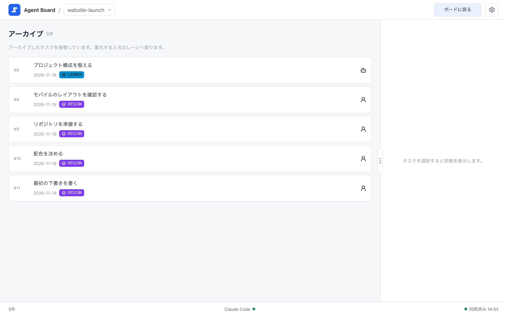
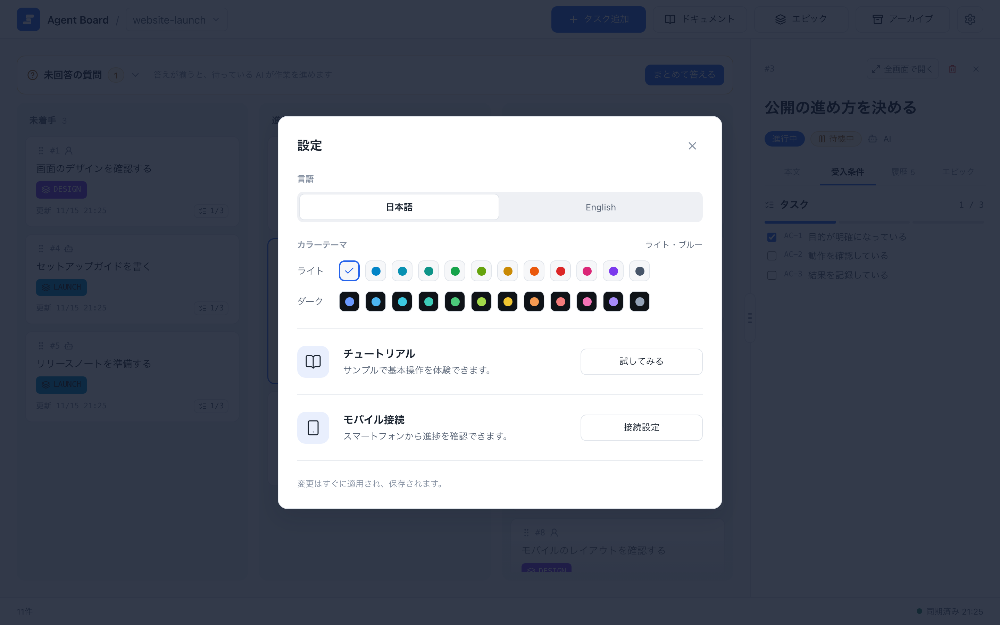
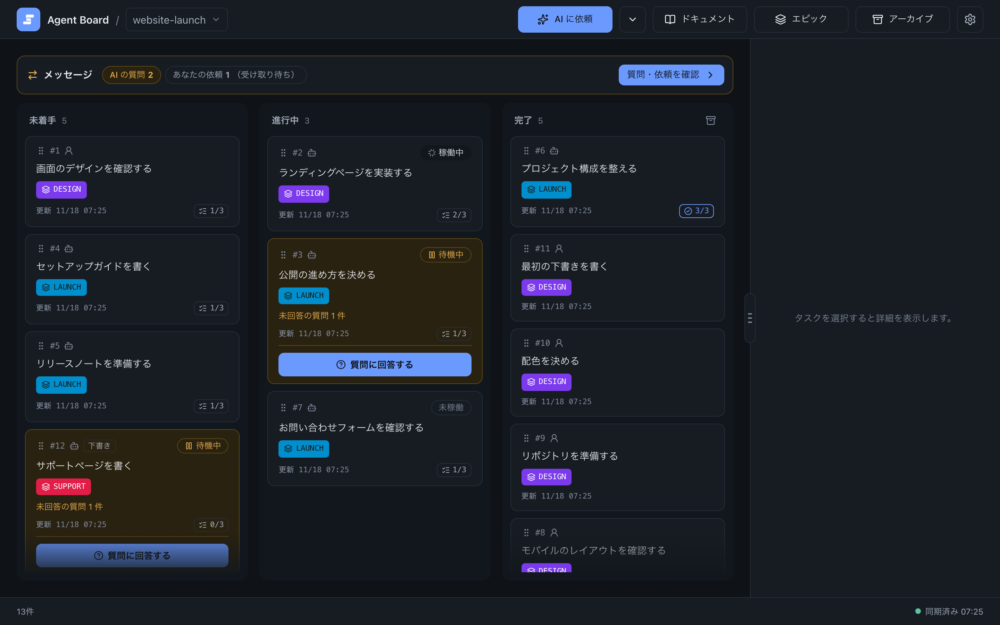

# ボード

ボードは、仕事を見守り、エージェントを止めずに介入する場所です。何が動き、何が待っているかが見えます。カードを動かす、条件にチェックを付ける、タスクを書き換える、といった操作は、エージェントを止めずに行えます。エージェントは、次にボードを読むときにその変更に従います。このページでは日々の操作を扱います。操作の前提となる概念は[仕事のモデル](../work-model)を参照してください。エージェントが止まってあなたに尋ねるときの回答は、[判断依頼](../delegate/decisions)で行います。

## 仕事を追加する

1. ヘッダーでプロジェクトを選び、**AI に依頼**を選びます。
2. やってほしいことを書き、必要なら画像を添付して**依頼する**を選びます。依頼はタスクではなく、メッセージとしてエージェントに届きます。エージェントが受け取るまでは、レーンの上の帯に**受け取り待ち**と表示されます。

タスクを自分で作るには、**AI に依頼**の横にある小さなメニューを開き、**タスクを手動で追加**を選びます。エディターで、タイトル・担当・完了条件・下書きを設定できます。詳しくは[編集と画像添付](./editing#依頼を送る)を参照してください。担当はタスク作成後に変更できません。

手動で追加したタスクは、未着手の列の末尾に追加されます。

## タスクを読む {#read-a-task}

タスクを選ぶと、右側に詳細が開きます。タブの内容は次のとおりです。

| タブ | 表示するもの |
| --- | --- |
| **本文** | タスクの本文。 |
| **完了条件** | そのタスクの完了条件と、その進捗。 |
| **履歴** | 操作や進捗の記録。日時と理由を新しい順に表示。 |
| **エピック** | タスクが属するエピックの詳細（あれば）。 |

{.screenshot}

右側のパネルに選択したタスクが表示されます。完了条件のタブには、そのタスクの条件だけが進捗バーつきで並びます。各条件はタスクの本文と同じようにMarkdownで表示されるので、リンク、コード、画像を入れられます。エピックの参考条件は、詳細の本文に書きます。

完了条件のタブでは、条件のチェックを付けたり外したりできます。変更はすぐ画面に出て、その場で保存されます。保存できなかったときは、チェックが元に戻り、そのことを表示します。保存は最新のファイルに対して行うので、開いたあとにエージェントがタスクを変えていても、あなたの選択が優先されます。ファイルのほかの部分（エージェントのほかの変更を含む）はそのまま残ります。履歴には、人が条件を付け外ししたことが残ります。

- 未着手か進行中のAI担当のタスクで最後の条件にチェックを付けると、エージェントがチェックしたときと同じく、タスクは自動で完了に移ります。
- 完了のタスクでチェックを外しても、完了のままです。作業を続けるときは、自分で移動してください。
- アーカイブ済みのタスクの条件は変えられません。条件の文言を変えるときは、タスクを復元してからプレビューを開きます。

各タブは、開いたときに内容を読みます。**履歴**タブの件数は、履歴の読み込みが終わってから表示されます。

## タスクを移動する

タッチ画面では、カード上部の左にあるグリップを押して指を動かすと、すぐにドラッグできます。カードの別の場所でも、少し押し続けるとドラッグできます。素早くなぞると、列がスクロールします。

タッチ画面では、ボタン、タブ、テーマのタイルは高さ 44 px 以上で表示され、ダイアログを開いても画面のキーボードは出ません。入力するときは欄をタップしてください。

タスクを別の列にドラッグして、移動を確認します。理由欄は任意です。空欄の場合は、移動内容に応じた理由が自動で記録されます。

ダイアログを開いている間に、エージェントや別のブラウザがそのタスクを移動した場合は、移動しません。ダイアログはタスクの今の列を表示してその旨を伝え、入力した理由は残ります。もう一度確定すると、今の列から移動します。

列の意味は次のとおりです。

| 列 | 意味 |
| --- | --- |
| 未着手(Todo) | まだ始めていない作業。 |
| 進行中(Doing) | 作業中。AIが担当するタスクにはエージェントの状態も表示されます。 |
| 完了(Done) | 完了した作業。 |

進行中のAI担当タスクには、**未稼働**・**稼働中**・**待機中**のいずれかが表示されます。エージェントが着手前に質問した場合は、未着手のタスクも待機中になります。ユーザー担当のタスクと完了のタスクは、常に未稼働です。稼働中はエージェントが作業していること、待機中はあなたの回答が必要なことを表し、回答は、カードの**質問に回答する**ボタンか、レーンの上の**メッセージ**の帯から開く一覧から行います（[判断依頼](../delegate/decisions)を参照）。列を移すと稼働中のタスクは未稼働に戻ります。未回答の質問はそのまま残るので、未着手か進行中なら待機中のままです。変更とその理由は、すべて履歴に残ります。

## タスクを変更する

タスクを編集したりエピックに割り当てたりするには、詳細ツールバーの**全画面で開く**を選びます。プレビューは同じエディターを使い、開いただけでは何も変わりません。最初の変更で下書きになり、**保存**すると確定します。くわしくは[プレビューと保存](./editing#preview-and-save)を参照してください。

## 下書き {#drafts}

下書きにすると、編集中のタスクをエージェントが変更できなくなります。エージェントは、`TASK.md`も含めて、下書きを変更できません。

- 下書きを作るには、**AI に依頼**の横のメニューから**タスクを手動で追加**を選び、エディターの**下書き**にチェックを入れます。
- 既存のタスクを変えるには、プレビューを開きます。最初の変更で下書きになり、**保存**すると下書きが解除されて、エージェントが再び扱えるようになります。エディターに下書きのチェックボックスはありません。
- 変更を取り消すには、**キャンセル**を選んでから**破棄して閉じる**を選びます。文章は保存済みの内容に戻り、履歴には「下書きの変更を破棄しました。」と残ります。
- 稼働中のタスクは読み取り専用で開きます。下書きにはできません。

下書きのタスクには**下書き**ラベルが表示されます。確定を忘れると、エージェントはそのタスクを動かせず、更新できません。プレビューを閉じたあとに下書きが残った場合は、詳細パネルの**確定する**を選んで解除します。

## 提案中の計画 {#proposed-plans}

エージェントが提案するものはすべてAIの下書きで、AIの下書きは単独のカードにはなりません。あなたの確認を待っている計画ごとに、**未着手**の先頭に**提案中の計画**カードが1枚表示されます。カードは破線の枠と淡いアクセント色で、通常のカードと区別できます。レーン見出しの数には、このカードも通常のタスクと合わせて数えられます。

- 新しいエピックのカードには、エピックのIDと名前、タスクの数が表示されます。そのエピックに関する質問が未回答のあいだは、未回答の質問の数も表示されます。
- すでに進行中のエピックにタスクが追加されたときは、**エピックに Nタスク追加**と表示されます。
- エピックに属さないAIの下書きのタスクは、**下書き(AI)**と書かれたタスクのカードと**開始する**ボタンで表示されます。そのタスクに関する質問が未回答のあいだはボタンが使えず、カードに理由が表示されます。
- あなたが自分で書いた下書きは、これまでどおり単独のカードで、**下書き**ラベルが付きます。[下書き](#drafts)を参照してください。

**見て開始する**を選ぶと、計画のレビューが開きます。広いウィンドウではダイアログ、スマートフォンでは下から開くシートです。レビューには次のものが表示されます。

- 新しいエピックの場合は、エピックのドキュメントから読んだゴール
- **始まるタスク(この順に始まります)**。各タスクの担当と完了条件の数も表示されます。タスクが1件だけのときは、番号も順序の説明もありません。
- 計画を止めている未回答の質問。それぞれの**質問に答える**ボタンで、その質問を開けます。

**あとでやる**はレビューを閉じるだけで、何も変えません。**この計画で始める**を選ぶと、エピックとそのAIの下書きのタスク、または1件のタスクが開始され、カードは通常のタスクとしてレーンに移ります。計画に関する質問が未回答のあいだは、**この計画で始める**は使えず、レビューに理由が表示されます。開始の直前に新しい質問が届いた場合は、開始が断られ、その質問がレビューに表示されます。最初の依頼文はレビューには表示されません。計画を開始できるのは人だけで、エージェントにはできません。

## アーカイブ {#archive}

完了したタスクをアーカイブすると、何も削除せずにボードを片付けられます。

- 個別のタスクは詳細からアーカイブできます。完了の列の**完了タスクをアーカイブ**を選ぶと、まとめてアーカイブできます。
- ヘッダーの**アーカイブ**を開くと、アーカイブ済みのタスクを確認し、元の列へ復元し、完全に削除できます。完全削除はアーカイブからだけ行えます。

{.screenshot}

アーカイブ画面には、アーカイブ済みのタスクがID、タイトル、担当、日付と、所属していたエピック（ある場合）とともに並びます。タスクを選ぶと詳細を確認できます。

アーカイブ済みタスクの詳細は、通常のタスクと同じ構成です。右上の**復元**と、ごみ箱アイコンの完全削除が閉じるボタンの隣に並びます。完全削除の前には確認が出ます。

## 狭いウィンドウとスマートフォン {#narrow-windows-and-phones}

ウィンドウの幅が768ピクセル未満のとき、またスマートフォンでは、ボードはレーンを横に並べる代わりにモバイル向けの表示になります。未着手・進行中・完了のタブに件数が表示され、その下に一度に一つのレーンが表示されます。タブの上には、待っているものの数が出て、一覧を開ける**メッセージ**の帯があります。タブをタップするか横にスワイプするとレーンが切り替わります。未着手の先頭には**提案中の計画**カードがあり、そのレビューは下から開くシートで表示されます（[提案中の計画](#proposed-plans)を参照）。タスクを選ぶとドロワーで内容を読み、条件にチェックを付け、判断の依頼に回答できます。タスクを長押ししてスワイプすると、隣のレーンへの移動やアーカイブができ、完了のレーンの**まとめてアーカイブ**で完了したタスクをまとめてアーカイブできます。プロジェクトの切り替えと設定のボタンはヘッダーに残ります。タスクの追加と編集は、幅のあるウィンドウで行います。

表示はウィンドウの幅に合わせてその場で切り替わります。選んだプロジェクトは変わらず、入力したものの送信前の回答も、二つの表示を行き来しても残ります。モバイル向けの表示は[リモートアクセス](./remote-access)で説明しています。

## ボードの更新

ボードは、エージェントや、このPCの別のブラウザで変更が保存されると自動で更新されます。更新のボタンはありません。ページを再読み込みすると、すべてを読み直します。

詳細パネルをボードの横に開いている間も、ボードは変化に追従します。エージェントがタスクを動かしたり条件にチェックを付けたりすると、カードとパネルにすぐ表示されるので、タスクを読みながら進み具合を確かめられます。

エディターやダイアログが開いている間は、自動更新を待ちます。編集中の内容が、勝手に動かないようにするためです。閉じてから約3秒後に、待っていた更新をまとめて反映します。

ただし、判断の依頼は例外です。エージェントが判断を依頼したときや、判断に回答が付いたとき、依頼が取り下げられたときは、エディターやダイアログを開いていてもすぐに表示します。

## 設定 {#settings}

**設定**を開くと、言語（英語か日本語）と24のテーマ（12色、それぞれライトとダーク）から選べます。

選んだ内容は、このPCに保存されます。そのため、このPCのどのブラウザでも同じ言語とテーマで表示されます。変更は、開いているほかのページ（別のブラウザのウィンドウやリモートアクセスを含む）にも、再読み込みなしですぐに反映されます。初期設定は英語とライトブルーで、ブラウザやOSの設定には従いません。利用者が入力したタスクの内容は翻訳されません。CLIのhelp・エラー・JSONの値は英語のままです。

詳細欄の幅は、この設定には含まれません。幅はブラウザごとに保存されます。

テーマの下には、ほかの機能を開く2つの行があります。どちらの行も、アイコン、見出し、1行の説明、ボタンで構成されます。

- **チュートリアル**の**試してみる**は、ダイアログを閉じて[初回の案内](#the-first-run-guide)を、いま使っている画面でもう一度表示します。
- **リモート接続**の**接続設定**は、ngrokでスマホからボードを確認するための設定を開きます。詳しくは[リモートアクセスのガイド](./remote-access)を参照してください。

{.screenshot}

ダイアログには、言語の切り替えと、ライト・ダーク各12色のテーマが並びます。ウィンドウが狭いときは、各行のボタンが説明の下に移ります。

{.screenshot}

ダークテーマを選んだあとの同じボードです。

## 初回の案内 {#the-first-run-guide}

初回の案内はブラウザの中で動き、パソコンのボードでもスマホ幅の画面でも、ngrokのアドレス経由でも同じように使えます。文面はどちらも同じです。スマホでは、最初と最後のメッセージは中央のカードとして表示します。各手順の説明は画面の下に置き、ボタンは横幅いっぱいです。**スキップ**と**ガイドを始める**のように2つ並ぶときは、行を等分します。

サンプルカード2枚は、薄暗くしたボードの上に、その手順が指すレーンの先頭の枠の中に描きます。スマホでは、画面がそのレーンへ自動で切り替わります。このカードはボードの一部ではありません。保存されず、件数にも含まれず、エージェントからも見えません。案内が表示されている間はボードのほかの部分が覆われるため、案内が終わるまでカードを開いたり動かしたりできません。

2つ目の手順では、カードが質問を出します。カードの**質問に回答する**を選ぶと、実際の質問と同じ回答ダイアログ（スマホでは同じ下からのシート）が開きます。選択肢を選んで送ると、案内が先へ進みます。この回答は案内を進めるだけで、サーバーには送られません。スマホで回答シートを開いている間は、説明が画面上部の細い帯に縮みます。

案内の途中でウィンドウの幅が変わっても、同じ手順から続きます。複数のブラウザタブで同時に案内を表示することもできます。[始める前に](../quickstart.md#before-you-start-the-first-run-guide)を参照してください。

## 次に読む

- [判断依頼](../delegate/decisions): エージェントの質問に答えます。
- [エピックと進行表](./epics): タスクをまとめ、次にやることを見ます。
