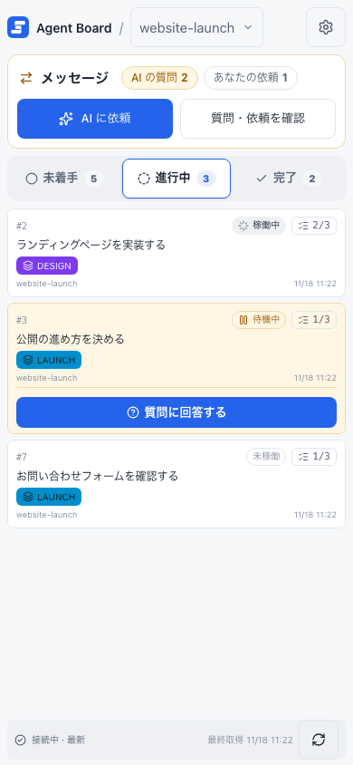
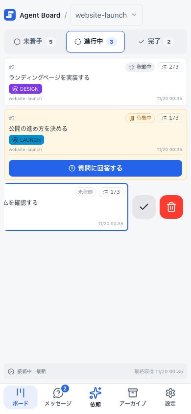
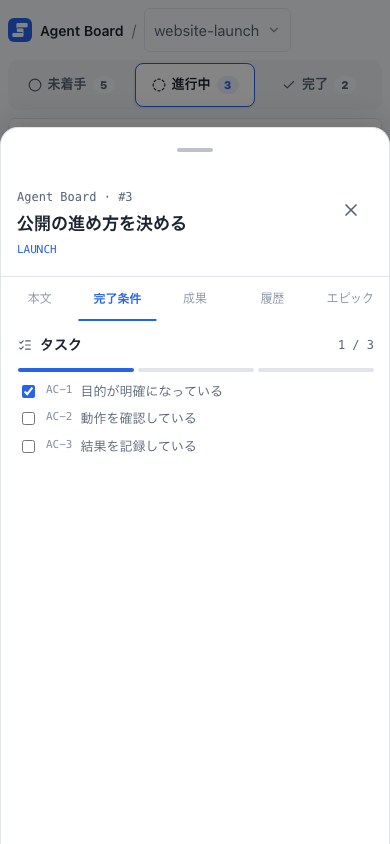

# モバイルモニター

モバイルモニターは、スマートフォン向けのボード表示です。席を離れているときに、進捗を確認したり、エージェントの質問に回答したりするために使います。このページでは、モニターの表示、ngrokでスマホから接続する方法、動作の確かめ方を説明します。

::: info パブリックプレビュー
この機能はパブリックプレビューです。仕様や動作が変更される可能性があります。現在の制約は[機能の提供段階](../feature-stages#mobile-monitor)をご確認ください。
:::

## モニターに表示されるもの

モニターは、一度に一つのプロジェクトを表示します。プロジェクトはアドレス（`?project=`）で指定し、ヘッダーのプロジェクト切り替えには、PCと同じくすべてのプロジェクトが並びます。画面には未着手・進行中・完了のうち一つのレーンだけが表示され、切り替え方は[レーンを切り替える](#レーンを切り替える)で説明します。AI担当のタスクにはエージェントの状態が表示され、未着手または進行中で回答待ちの質問がある場合は、タスクに**質問に回答する**ボタンが表示され、押すと画面の下から回答のシートが開きます。

**未回答の質問**の帯は、レーンのタブの上にあります。最初は閉じていて件数だけが見え、見出しを選ぶとプロジェクトの未回答の質問がすべて並びます。1つを選んでその質問だけに答えることも、順番に答えてまとめて送ることもできます（[判断依頼](../delegate/decisions#スマホで回答する)を参照）。

{.screenshot--narrow}

### レーンを切り替える

ヘッダーの下のタブは**未着手**・**進行中**・**完了**で、それぞれのレーンのタスク数が表示されます。タブをタップするとそのレーンが表示されます。レーンの上のどこでも、選んでいないタスクの上からでも、横にスワイプすれば隣のレーンへ移ります。未着手より左、完了より右へスワイプしても、そのままです。各レーンは個別にスクロールでき、縦のスクロールでレーンが切り替わることはありません。

### タスクを移動・アーカイブする

移動とアーカイブは、選んだタスクから始めます。誤ってスワイプしても、何も変わりません。

1. タスクを長押しして、枠が表示されるまで待ちます。これでタスクが選ばれます。
2. 選んだタスクを横にスワイプします。左へスワイプすると、次のレーンへのボタンと、ゴミ箱アイコンの赤い**アーカイブ**ボタンが現れます。右へスワイプすると、前のレーンへのボタンが現れます。長押しに続けて、そのままスワイプすることもできます。レーンのボタンにはそのレーンのアイコンが表示され、スクリーンリーダーでは「#3 を進行中へ移動」のように読み上げられます。
3. ボタンをタップします。レーンのボタンは**列を移動**を開き、変更理由を入力して**移動する**を選びます。アーカイブのボタンは**タスクをアーカイブ**を開き、**アーカイブ**を選びます。確認するまで何も変わらず、**キャンセル**を選べばタスクはそのままです。

{.screenshot--narrow}

タスクを元の向きにスワイプして戻すか、タスクの外をタップすると、何も変えずにボタンが閉じます。スワイプでタスクを削除することはありません。アーカイブしたタスクは復元でき、完全な削除は、PCと同じく、幅のあるウィンドウのアーカイブ画面からだけ行えます。

### 完了のタスクをまとめてアーカイブする

完了のレーンには、一覧の上に**まとめてアーカイブ**ボタンがあります。押すと、アーカイブされるタスクの一覧を表示した**完了タスクをアーカイブ**が開き、件数が付いたボタンで確定します。レーンが空の間は、ボタンを選べません。

### タスクを読む

タスクをタップすると、画面下部から詳細パネル（ドロワー）が開きます。**本文**・**受入条件**・**履歴**・**エピック**の4タブがあり、左右のスワイプでも切り替えられます。受入条件タブには、そのタスクの条件だけが表示されます。エピックの参考条件は詳細本文で確認します。エピックタブでは、ほかの場所に表示済みのラベルやタイトルを繰り返さず、エピックの詳細を表示します。

{.screenshot--narrow}

各タブは個別にスクロールできます。横スワイプでは、タブの内容と選択中のタブを示す下線が一緒に動きます。タブ内の操作が、外側の画面の操作を引き起こすことはありません。ドロワーを閉じるには、タブより上の領域(ハンドルとヘッダー。閉じるボタンを除く)を下へドラッグします。ドロワーはドラッグに追従して動きます。

タスクを開くと、本文・受入条件・履歴・エピックを一度に読みます。タブを切り替えても、読み直すことはありません。読み取りに失敗した場合は、そのタブの再試行ボタンを使えます。

モニターは、PCで変更が保存されると自動で更新されます。最新のデータをすぐに読むには、ヘッダーの**最新の状態に更新**ボタンを選びます。読み直している間も、ページは直前に読めたデータを表示したままです。

ページとデータのレスポンスはキャッシュされません。スクリプトとスタイルはブラウザに保存されるため、2回目以降はページとデータだけを取得します。オフライン用のスナップショットキャッシュやService Workerはありません。

新しいバージョンをインストールして`agboard serve`を再起動すると、開いているモニターは自動で再読み込みし、新しい画面に切り替わります。送っていない答えがある間やタスクのドロワーを開いている間は、答えを送るか消すまで、またはドロワーを閉じるまで待ちます。切断中は接続状態を画面に表示します。

## 始める前に

ngrokのアカウントと、そのauthtokenが必要です。**モバイル接続**のダイアログには、トークンをコピーするngrokのページを開くボタンがあります。Agent Boardは、ngrokのTraffic Policyの機能（無料のアカウントでは使えないGoogleサインイン（OAuth）を含む）を一切使わずにアドレスを開きます。そのため、無料のアカウントでもモニターを動かせます。そのほかのngrokのプランの上限や規約は引き続き適用されます。

Agent Boardは、ngrokを使って、合言葉の背後でボードにつながる公開のHTTPSアドレスを開きます。PCでのボード自身のアドレスは`127.0.0.1`のままです。ボードをインターネットに公開したり、ルーターのポート転送を使ったりしてはいけません。HTTPSはngrokで終端されるため、ngrokは通信の内容を処理できます。PCとスマホの間のエンドツーエンドの暗号化ではありません。

## 合言葉でモニターを守る仕組み

モニターは、4桁の合言葉で守られます。Agent BoardはGoogle認証もngrokのサインインも使わず、許可するアカウントの一覧も持ちません。

- 接続を開始するたびに、OSの乱数源から`0000`〜`9999`の新しい合言葉を作ります。合言葉はメモリーだけに置かれ、ファイルへの保存、ログへの出力、モニターのページへの埋め込みは行いません。
- 合言葉を見られるのはPCだけです。**モバイル接続**のダイアログの手順2「**合言葉を入力する**」と、`agboard serve --monitor ngrok`の起動行に表示されます。
- スマホはアドレスを開くと合言葉を求められ、合言葉が正しくなるまでボードの内容は何も表示されません。接続は最長12時間続き、それを過ぎるとスマホはもう一度合言葉を求めます。
- 続けて5回間違えると、モニターは正しい合言葉も含めて、それ以上の合言葉を受け付けなくなります。接続を停止してもう一度接続する（または`serve`を再起動する）と、新しい合言葉になり、間違いの回数も数え直されます。

合言葉を入力した人は、最長12時間、PCと同じようにボード全体を使えます。すべてのプロジェクトを読み、タスクとエピックを追加・編集・移動・アーカイブ・削除できます。接続の設定だけはPCに残ります。合言葉を教えることは、この操作を任せることです。

4桁の合言葉は10,000通りしかないため、アカウントでのサインインより弱い守りです。5回までという制限、ngrokがランダムに選ぶアドレス、開始ごとに変わる合言葉で当て推量を難しくしていますが、アドレスを秘密にしておくことの代わりにはなりません。アドレスと合言葉は、パスワードの組のように扱ってください。

- アドレスやQRコードを、人目のある場所で共有しないでください。
- 使わないときは接続を停止してください。
- アドレスは、ngrokがランダムに選んだものです。見つかりにくくなりますが、それを秘密として頼ることはできません。

ngrokはAgent Boardが確認できるものを何も付けないため、モニターは自分で二つを確認します。要求が公開アドレスとちょうど一致していることと、合言葉です。ngrokはHTTPS接続を終端して通信の内容を見られるうえ、ngrokアカウントの管理者はアドレスの提供方法を変更できます。合言葉は、これらに対する守りにはなりません。

すでにPC上で動いているプログラムは、ngrokを通さずに、モニターのローカルのポートへ直接要求を送れます。何かを読むには合言葉が必要ですが、5回の試行を使い切ることで、停止してもう一度接続するまで、スマホからモニターを使えなくできます。Agent BoardはPCを使う人を信頼する前提のため、これに対する追加の防御は設けていません。信頼できるPCでだけ接続を動かしてください。

## PCから接続する

1. ボードを開き、**設定**を開きます。**モバイル接続**で**接続設定**を選びます。設定のダイアログが閉じ、「**未接続**」と表示された**モバイル接続**のダイアログが開きます。
2. 手順1「**トークンを取得する**」で、**トークンの取得ページを開く**を選びます。ngrokにログインして、authtokenをコピーします。
3. 手順2「**貼り付けて接続する**」で、**ngrok認証トークン**にトークンを貼り付けます。
4. **このPCにトークンを保存する**で、トークンを保存するかどうかを決めます（[トークンの保存先](#トークンの保存先)を参照）。
5. **保存して接続**を選びます。

接続中は、ダイアログの2つの手順の代わりに「**ngrokに接続しています…**」と表示されます。準備ができると、「**接続を受け付けています**」と表示されます。手順1「**QRを読み取る**」にはQRコードと、アドレスをコピーする**URLをコピー**があります。手順2「**合言葉を入力する**」には4桁の合言葉が表示されます。QRコードが運ぶのはアドレスだけです。アドレスには、PCで選択しているプロジェクトが含まれます。別のプロジェクトを見るには、PCでそのプロジェクトを選び、新しいQRコードを読み取るか、URLをコピーし直します。スマホでは合言葉の入力が引き続き必要で、PCで端末を承認する操作はありません。

合言葉が表示されるのは、接続が動いている間だけです。接続を開始するたびに新しくなるため、停止中や失敗したときの接続には合言葉がありません。

接続が動いている間にアドレスと合言葉を渡したいときは、`agboard --project "<名前>" remote`を実行します。どちらもこのPCにだけ表示されます。[スマホ用のアドレスと合言葉を渡す](../reference/cli#スマホ用のアドレスと合言葉を渡す)を参照してください。合言葉をチャットで共有すると、接続を止めるまで、そのチャットを読める人全員がボードを開けるようになります。

ngrokに接続できなかった場合は、その旨と理由がダイアログに表示されます。トークンとインターネット接続を確認して、もう一度**保存して接続**を選んでください。PC上のボードは引き続き使えます。

## トークンの保存先

- 入力したトークンは、Agent Boardが動いている間だけ使われ、保存されません。
- 保存するには、接続の前に**このPCにトークンを保存する**を選びます。トークンは、OSが用意するこのPCの安全な保管場所に保存されます。データフォルダには書き込まれません。
- 環境変数`NGROK_AUTHTOKEN`が設定されていれば、保存済みのトークンより優先されます。そのときダイアログには環境変数を使うことが表示され、トークン欄は空のままで構いません。
- 保存済みのトークンは、このPCの安全な保管場所に保存済みと表示されます。**保存したトークンを削除**を選ぶと削除できます。
- Agent Boardを更新したり入れ直したりした後は、保存したトークンを使ってよいかをOSが確認することがあります。確認の間もボードは使えます。答えると、ダイアログに保存済みのトークンが表示されます。
- このPCで使える安全な保管場所がない場合は、「**このPCでは保存できません（都度入力）。**」と表示され、保存の選択はできません。接続のたびにトークンを入力してください。

接続を有効にしたままかどうかは、Agent Boardの内部領域に保存されます。ファイルを編集する必要はありません。合言葉はどこにも保存されません。

## スマホで開く

1. スマホで、URLを開くかQRコードを読み取ります。
2. 「**合言葉を入力**」の画面が表示されます。PCに表示されている4桁の合言葉を入力して、**接続する**を選びます。
3. モニターが開きます。接続は最長12時間続きます。それを過ぎた場合や、PCで接続を止めて開始し直した場合は、もう一度合言葉を求められます。

アドレスにプロジェクトが含まれていない場合も、ボードが開き、ヘッダーのプロジェクト切り替えでプロジェクトを選べます。以前のバージョンの`/monitor/`で終わるリンクは配信しなくなり、見つからないという応答になります。PCの接続設定を開いて、現在のQRコードを読み取り直してください。

## アドレスからボード全体を使う

QRコードのアドレス（たとえば`https://….ngrok.app/?project=…`）を開くと、PCと同じボードそのものが開き、ウィンドウの幅に合わせた画面になります（768px未満では上で説明したモニターの画面です）。同じ4桁の合言葉を求め、合言葉が合うまでボードの内容は何も表示しません。合言葉が合うと、タスクの編集・移動・削除、質問への回答、プロジェクトのドキュメントの読み取りなど、PCのボードでできることを行えます。合言葉は最長12時間有効で、間違えられる回数も同じく5回までです。

次の2つは、この方法でもPCにとどまります。**モバイル接続**の設定と、プロジェクトのドキュメントをPCのアプリで開く操作です。アドレスと合言葉を知っている人はタスクを変更できるので、どちらも他人に知られないようにしてください。

モニターは、PCに保存された言語とテーマで開きます。スマホでモニターのヘッダーの**設定**から変えると、その選択はPCにも保存されます。そのため、ボードや別のブラウザ・スマホにも同じ設定が反映されます。PCで変えた内容は、開いているモニターにもすぐ反映されます。

ngrokの無料プランでは、スマホから初めて開くときにngrokの警告ページが表示されます。「Visit Site」を選ぶと、モニターが開きます。ngrokの警告は、訪問者ごとに一度だけ表示されます。

アドレスを知っているだけではボードを読めません。間違った合言葉は、残り回数を示さずに拒否されます。続けて5回間違えると、「間違いが続いたため受け付けを止めました」と表示され、それ以上は受け付けられません。PCで接続を停止してからもう一度接続すると、新しい合言葉になります。接続が停止中と表示された場合は、PCを確認してください。

## 停止と再接続

ダイアログで**接続を停止**を選ぶと、接続を閉じます。ダイアログには「**接続停止中**」と表示され、保存したトークンはこのPCに残ります。スマホはボードを読めず、回答も送れなくなります。次にAgent Boardを起動したときも、接続は始まりません。保存したトークンで再び接続するには**再接続**を選びます。別のトークンを使うには**接続設定を変更**を選び、トークンを貼り付けて**保存して接続**を選びます。

PCがスリープした、ネットワークが変わったなどで接続が切れたときは、停止してからもう一度接続してください。接続中に別のトークンを使うには、**トークン再設定**で設定をもう一度表示し、新しいトークンを入力して**保存して接続**を選びます。接続が作り直されるため、スマホは新しい合言葉を入力する必要があります。代わりにダイアログを閉じると、接続はそのままです。

接続したままにしていた場合は、次にAgent Boardを起動したときに、環境変数かこのPCの安全な保管場所からトークンを使えるかぎり、自動で接続が始まります。トークンがなければ、ダイアログがトークンの入力を求めます。

## ngrokが通信の内容を残さないことを確認する

アカウントでFull Captureが有効だと、ngrokのTraffic Inspectorがリクエストの詳細を保持することがあります。Agent Boardがこれを無効にすることはできません。ngrokのダッシュボードで**Settings** → **Observability**を開き、Full Captureが無効であることを確認してください。モニターを使う前に確認します。

## コマンドラインで起動する

サーバーの起動と同時に接続を始めるには、環境変数にトークンを設定します。

```sh
export NGROK_AUTHTOKEN=<your authtoken>
agboard serve --monitor ngrok
```

コマンドは、ローカルのアドレスと一緒にスマホ用のアドレスと合言葉を出力します（例: `Serving at http://127.0.0.1:7420/; mobile monitor at https://… with passcode 4821`。`--json`では`monitor`フィールド）。合言葉はサーバーを起動するたびに変わります。接続を開始できないときは、`serve`は終了コード1で止まります。そのほかのオプションは[CLIガイド](../reference/cli)を参照してください。

コンピューターがスリープしたりサーバーが止まったりすると、サーバーと接続が再び動くまで、モニターは使えません。エージェントのコマンドが起動したサーバーも保存した接続を使い、スマホが接続している間は自分で止まりません。止めたいときは、PCで接続を止めます。

## スマホで確認する

レスポンシブなブラウザテストは狭い画面幅をカバーしますが、ソフトウェアキーボードは実機での確認が必要です。スマートフォンのブラウザでモニターを開き、待機中の質問を持つ未着手または進行中のタスクの回答シートを開きます。キーボードが出ても回答欄と「前へ」「次へ」のボタンを操作できることを確認し、最後の質問の「送る」で回答を送ってください。あわせて、長い本文、受入条件、エピックのタブでのスクロール、タブの横スワイプ、ハンドルとヘッダーからの下方向の閉じ操作も確認します。ブラウザのエミュレーションだけでは、Safariのキーボードの挙動は確認できません。

## 次に読む

- [判断依頼](../delegate/decisions): スマホから質問に回答します。
- [トラブルシューティング](../operations/troubleshooting): ページが開かない、更新されない。
