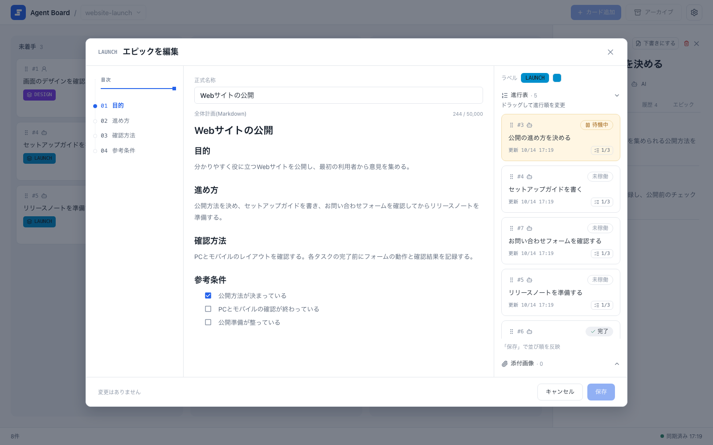

<script setup>
import { withBase } from 'vitepress'
</script>

## 動きを見る

<video class="demo-video" :src="withBase('/videos/demo.ja.mp4')" :poster="withBase('/videos/demo.ja.jpg')" autoplay muted loop playsinline></video>

1枚のカードの流れです。エージェントが着手して質問し、ユーザーがカード上で回答すると、エージェントが作業を再開します。すべての受け入れ条件を達成すると、カードは自動で完了に移ります。

## ボード

エージェントに長い作業を任せると、どの作業が進み、何を待ち、何の返事が必要なのか分かりにくくなります。Agent Boardはユーザーとエージェントが同じ履歴つきボードを見て、作業の往復を続けられるようにします。

{.screenshot}

## エピックと進行表

エピックでタスクの順序を決め、進行表で次に進められる作業を確認します。

{.screenshot}

## スマホで使う

下部ドロワーの本文・受入条件・履歴・エピックの4タブで、判断への回答や状態の確認ができます。

{.screenshot .screenshot--narrow}

## はじめる

Agent Boardは手元のマシンで動き、アカウントもホスティングも要りません。インストールしてボードを起動し、エージェントを招き入れましょう。

<div class="home-steps">

1. **ボードを起動する**

   プロジェクトを作成して`agboard serve`を実行し、ブラウザでボードを開きます。[インストールと開始](./guide/getting-started)

2. **エージェントに作業を登録させる**

   Claude CodeやCodexをHookで連携します。エージェントは進行表を読み、カードを追加します。[エージェントとの連携](./guide/agents)

3. **カードの上で回答する**

   エージェントが質問したら、PCでもスマホでも、カード上で選択肢を選んで回答します。[判断依頼](./guide/decisions)

</div>

```sh
git clone https://github.com/FooQoo/agent-board.git
cd agent-board
pnpm --dir web install
pnpm --dir web build
cargo install --path . --locked --force
```

<div class="home-cta">
  <a class="home-cta__button home-cta__button--brand" :href="withBase('/ja/guide/getting-started')">はじめる</a>
  <a class="home-cta__button" href="https://github.com/FooQoo/agent-board">GitHub</a>
</div>
