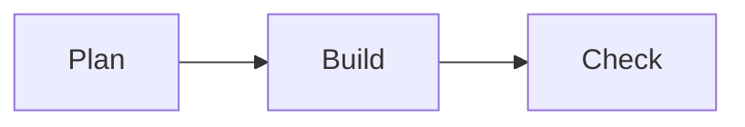

# プロジェクト設計メモ

この文書は往復の試験用に作った合成の文章です。

## 概要

Agent Board のドキュメント機能は、**太字**と*斜体*、`インラインコード`、[リンク](https://example.com/guide)を含む本文を扱います。

- 箇条書きの一つ目
- 二つ目
  - 入れ子の項目
    - さらに深い項目
- 三つ目

1. 手順その一
2. 手順その二
   1. 入れ子の手順

## 表

| 名前 | 状態 | 備考 |
| --- | --- | --- |
| alpha | done | 完了 |
| beta | doing | 作業中 |

## コード

```ts
export function add(a: number, b: number): number {
  return a + b;
}
```



## 画像


## 脚注と生のHTML

脚注付きの文[^1]です。

[^1]: 脚注の本文。

<details>
<summary>詳細</summary>

生のHTMLのブロックです。

</details>

## 長文

吾輩は猫である。名前はまだ無い。どこで生れたかとんと見当がつかぬ。何でも薄暗いじめじめした所でニャーニャー泣いていた事だけは記憶している。吾輩はここで始めて人間というものを見た。しかもあとで聞くとそれは書生という人間中で一番獰悪な種族であったそうだ。
